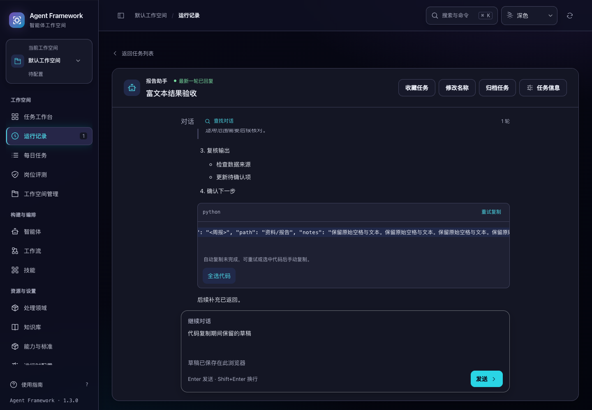
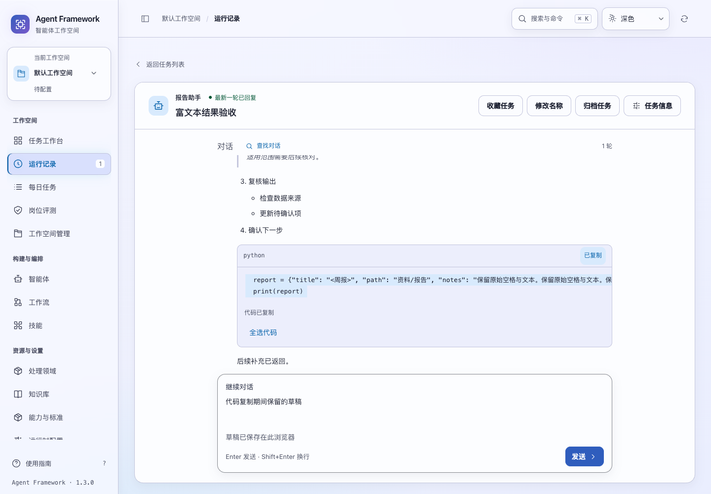
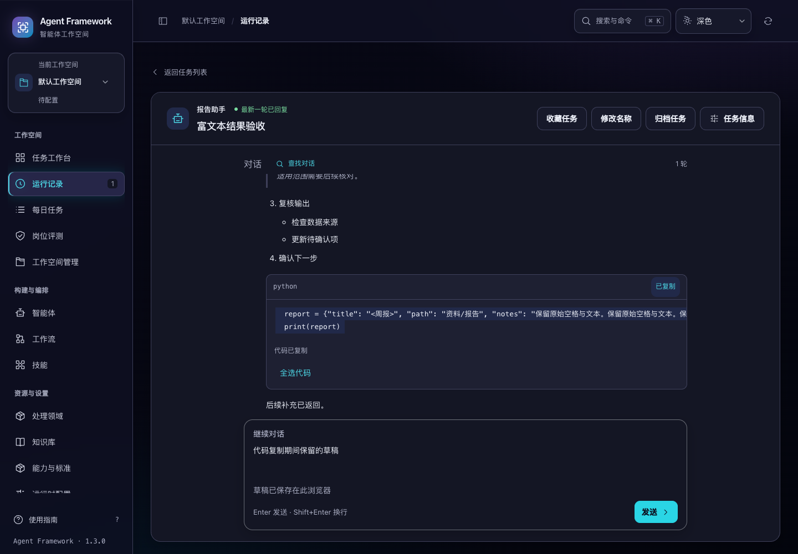

# 代码复制、手动恢复与选区保留

2026-11-04。代码块复制新增明确重试和“全选代码”入口。正在复制的状态、恢复入口和选区可跨页面重绘保留；流式回复继续更新时，同一段未变化的代码不会重复派发复制。当前源码版本保持 1.3.0，候选未发布。

## 实际行为

- 自动复制保留解析后的代码正文，包括缩进、空行和末尾换行，不包含 Markdown 围栏与按钮文字。
- 剪贴板不可用或拒绝时，在代码块内显示恢复说明和重试入口。焦点仍在原复制按钮上时，自动聚焦代码区并全选；用户已继续输入时保留其焦点和草稿。
- 超过 1.5 秒未收到复制结果时显示手动入口，原请求继续等待；重复点击和整页重绘不会叠加复制。
- 全选或局部选择代码后，可以通过键盘复制。正向、反向的局部选区和横向阅读位置可跨重绘保留；只有代码正文仍相同才恢复选区。
- 代码内容或语言改变时，清理旧复制状态。不同代码块分别管理操作，切换任务、工作空间或身份后，迟到结果不能更新当前反馈。离开页面清理等待计时器。

浏览器实测发现，直接选择 `<pre>` 中的完整代码时，原生复制可能漏掉末尾换行：测试代码原文和 DOM 选区都是 275 个字符，系统剪贴板只有 274 个字符。现在仅在选区完整位于同一代码文本节点时，用实际选择的原文写入用户触发的 `copy` 事件。实测全选复制为完整 275 个字符，反向局部选区也逐字匹配。

输入框、可编辑内容、普通文字和跨节点混合选区继续使用浏览器默认复制。事件剪贴板不可用时不阻止默认行为。自动复制仍使用浏览器剪贴板接口；已经交给浏览器的异步操作无法取消，作用域检查负责约束页面反馈。

所有操作均在本地完成，不发起业务写请求。阅读快照只为非空选区保留代码文本，普通浏览只记录滚动和焦点；复制状态随页面离开清理。

## 验证

| 检查 | 结果 |
| --- | --- |
| 新增单元测试 | 14 项通过 |
| 相关回归 | 66 项通过 |
| 全量前端 | 1078 项通过 |
| 浏览器回归 | `reply-markdown`、`task-reply-copy`、`conversation-ui`、`conversation-details` 全部通过 |
| 真实剪贴板 | 自动复制、手动全选、反向局部选择和输入框复制均逐字匹配 |
| 真实流式回复 | 等待操作跨重绘和追加输出保留，完成后的阅读位置与复制内容一致 |
| 布局 | 深浅主题四种桌面宽度、展开任务属性和 200% 文字下可操作 |

最初 11 项新增测试在旧实现上有 10 项失败；另用 3 项测试约束原生复制处理，加入处理前精确保留换行的测试失败。真实浏览器的 275→274 字符差异也在修复前独立复现，未仅依赖模拟 DOM。

最后缩小选区缓存保留范围后，再次运行 1078 项前端全量和 `reply-markdown` 浏览器套件。没有后端、安装器或静态路由变更，本轮未重复后端全量及全新安装验证；上一候选的安装、重启和备份恢复记录见 [回复复制验收](../reliability/task-reply-copy.md)。

```sh
node --test tests/test_reply_code_copy.js tests/test_reply_markdown.js tests/test_task_reply_copy.js tests/test_conversation_sync.js tests/test_conversation_review.js
npm test
.venv/bin/python scripts/run_browser_tests.py --suite reply-markdown --suite task-reply-copy --suite conversation-ui --suite conversation-details
```

候选目录为 `/private/tmp/af-reply-code-source-candidate-verified-20261104/`。167 个应用文件与保存源码逐项匹配，相比上一候选只改变 Markdown 适配层与其样式。六个历史发行产物未改变。完整摘要、日志路径、截图和校验值见 [验收证据](code-copy-recovery-verification-20261104.json)。测试使用临时数据和合成回复，没有真实模型调用。






