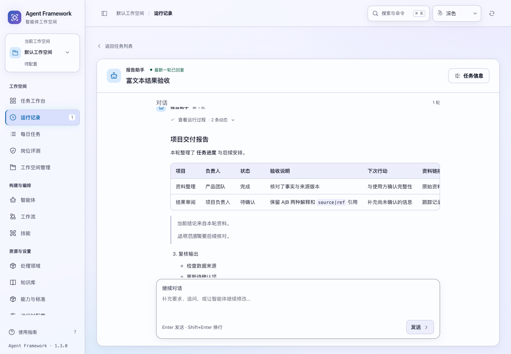
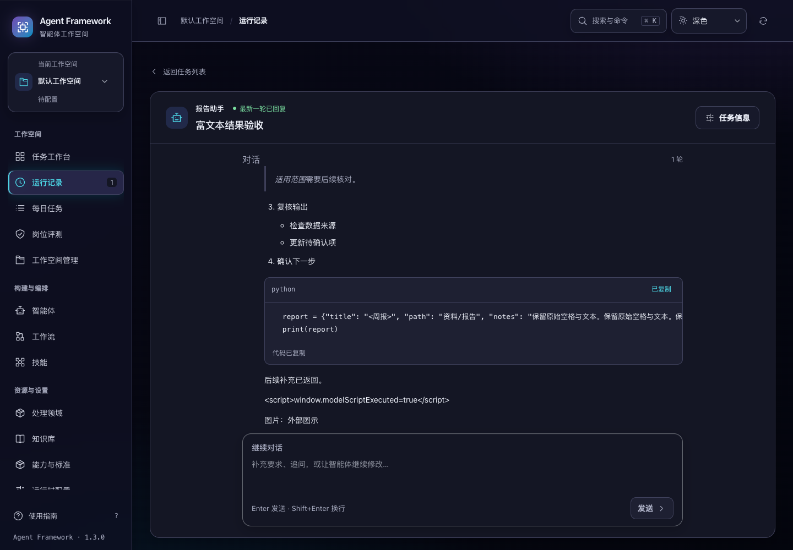

# 任务回复的表格、代码与阅读连续性

2026-11-02。当前源码保持 1.3.0；已构建独立验收候选，未替换历史发行包或发布新版本。

任务输出中的比较表、引用和嵌套清单此前容易显示成普通文本。现在任务对话的已完成回复与生成片段共用 Markdown 渲染器，支持表格、引用、嵌套列表、非 1 起始的有序列表、强调、删除线、分隔线、链接和代码块。表头保留列语义及对齐方式，宽表格和长代码在回复内部横向滚动。

## 阅读和复制

- 代码块显示语言标签并提供“复制代码”。复制的是解析后的代码正文，保留缩进、空行及末尾换行，不包含围栏、语言标签和按钮文字。
- “复制回复”继续复制原始完整 Markdown；渲染不会改写持久化结果，也不改变完整对话导出的内容。
- 复制代码失败会在该代码块内说明可选择文字复制；复制期间保留键盘焦点，重复点击不会重复派发。
- 表格滚动区和代码区可由键盘聚焦，具有可见焦点及可访问名称；表格支持方向键横向阅读。
- 流式追加时，内容没有变化的代码和表格复用原节点，保留复制提示、滚动位置与焦点。其他内容更新时按块恢复阅读位置。普通页面重绘及生成完成后的结果替换也保留这些位置。
- 阅读位置按当前任务和轮次隔离，属于本页会话状态；刷新后从已保存结果重新渲染，不承诺恢复刷新前的横向位置。

复制只在用户点击后发生。异步剪贴板结果返回时，若原代码节点已经移除或正文改变，不会把旧提示写到新内容上。

2026-11-04 补充：代码复制现支持跨整页重绘的等待状态、失败重试、全选和局部选区恢复，手动复制也保留末尾换行。具体行为和新验收见 [代码复制与恢复](code-copy-recovery.md)。下文保留最初富文本实现的验收记录。

同日新增 [流式回复的阅读连续性](stream-reading.md)：正文追加改为就地更新，未变化段落、列表和表格选区以及来源链接焦点可以保留；进度更新不再重复解析相同正文，历史轮次也不再参与每次流式阅读状态扫描。

## 渲染范围与依赖

浏览器解析器固定为 [markdown-it 15.0.3](https://github.com/markdown-it/markdown-it/releases/tag/15.0.3)，使用官方 npm 发行包中的 UMD 浏览器文件。下载时核对发行包 SHA512，仓库保留来源、依赖版本和文件 SHA256，见 [依赖来源清单](markdown-vendor.json)。仅追加文件末尾 LF，其余 JavaScript 字节与上游相同。

解析器、适配层、样式和完整许可证随 Python wheel 离线打包，不依赖运行时 CDN 或 Node 安装。`MARKDOWN-IT-LICENSE.txt` 包含主库及浏览器包内 entities、linkify-it、mdurl、punycode.js、uc.micro 的许可证。嵌套深度限制为 24；没有添加语法高亮、公式、流程图或任务清单插件，不把这些功能视为已经支持。

适配层关闭原始 HTML、自动裸网址识别和智能标点替换。只有显式的绝对 HTTP/HTTPS 链接可导航，新标签页链接使用 `noopener noreferrer`。相对路径、`javascript:`、`data:`、`file:` 等不会生成可导航链接。Markdown 图片显示为带说明的明确链接，不自动请求远程图片。HTML、SVG 和表单均按文字显示。

本地解析器资源加载失败时，回复退回完整转义文本，结果不会变成空白。此行为与原始 HTML 禁用方式参考 [markdown-it 项目文档](https://github.com/markdown-it/markdown-it)；具体约束由本项目适配层和测试验证。

## 验收

新增 15 项交互回归，覆盖表格对齐与转义竖线、嵌套结构、不同围栏与未闭合代码、HTML 转义、链接和图片策略、资源缺失回退、长未完成引用、精确代码复制、剪贴板故障与迟到结果。

**684 项前端测试、70 项后端测试和 3 个浏览器套件通过**：`reply-markdown`、`conversation-ui`、`conversation-details`。新套件使用临时数据库和可暂停的离线模型，通过真实任务接口、已保存生成片段和 SSE 验证两次追加及最后完成；没有调用外部模型。

浏览器还验证了明暗主题下 1024、1280、1440、1920px 共 8 种布局，1024px 展开任务属性栏，以及回复正文、表格、代码和复制控件全部放大到 200% 的场景。页面无横向溢出，宽内容在回复内滚动，复制入口可操作。外部资源请求和页面异常均为零。校验前已修正未闭合代码末尾换行的测试预期，以及后台重绘时使用过期元素的截图检查方式。

```sh
npm test
PYTHONPATH=tests .venv/bin/python -m unittest \
  tests.test_task_conversations tests.test_streaming_tasks tests.test_codex_stream \
  tests.test_web tests.test_release_delivery
.venv/bin/python scripts/run_browser_tests.py \
  --suite reply-markdown --suite conversation-ui --suite conversation-details \
  --output /private/tmp/af-reply-markdown-browser-final
.venv/bin/python scripts/build_release.py \
  --output-dir /private/tmp/af-reply-markdown-source-candidate-20261102
```

候选包逐文件核对了 133 个应用源码与资源。另检查 wheel 中的解析器、许可证、适配层、样式、任务对话入口、HTML 与服务路由字节均与当前源码一致。此轮没有进行新的全新环境安装验收，不能用构建成功代替安装结果。完整测试路径、构建摘要和截图见 [验收清单](rich-replies-verification-20261102.json)。




