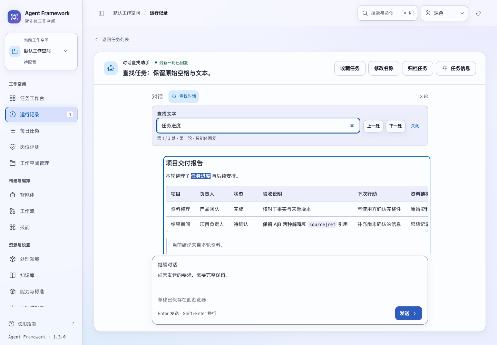
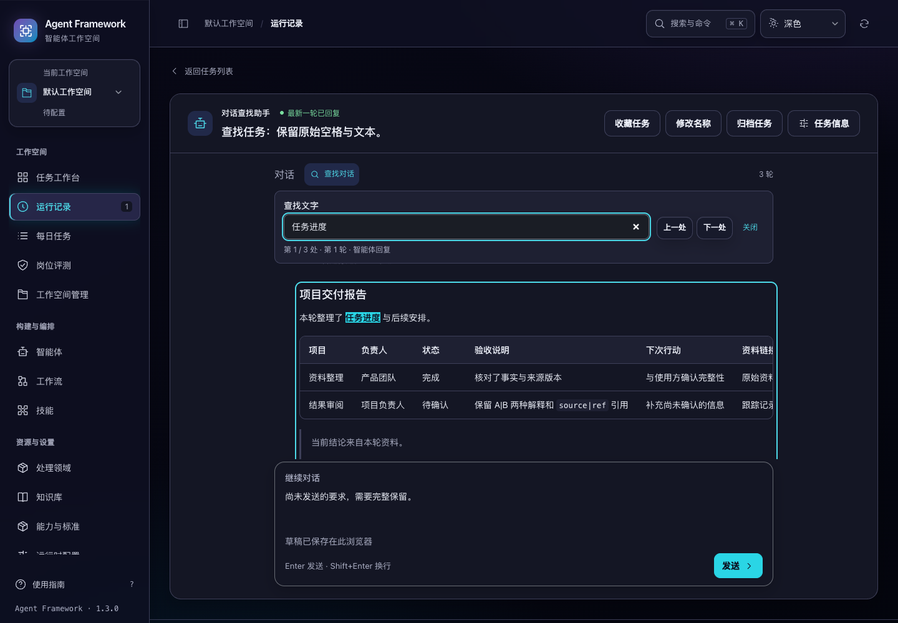

# 长对话查找索引与正文范围

2026-11-04。对话内查找现在复用未变化消息的正文索引和匹配范围，连续定位无需重新遍历整份对话；流式更新只使变动消息的索引失效。同时修复复制恢复入口“全选代码”等控件文字被误算为正文的问题。版本保持 1.3.0，候选未发布。

## 当前行为

- 同一查询的上一处、下一处与被动刷新复用已有匹配；改变关键词复用正文索引，重新计算文字匹配。
- 观察消息区域中的文本、结构和 `hidden` 属性变化。即使正文修改与查找刷新发生在同一轮 JavaScript 执行中，也会先读取待处理变化，再决定能否复用。
- 变化消息重新索引，未变化消息保留索引和 Range。新增、删除消息重新合并顺序；完整页面重绘会为新的 DOM 建立索引。
- 按钮、输入控件、代码块标题与复制状态不参与正文查找，也不会因复制反馈而触发正文重新索引。原文中实际写出的“全选代码”仍然可以找到。
- 隐藏或重新显示正文会更新匹配。上限仍是 500 处，恰好 500 处不会误报截断；后续消息还有匹配时才提示缩小范围。
- 关闭查找、离开任务或替换消息区域时，断开旧观察并释放索引中的 DOM 引用。查询偏好按原有任务作用域保留，不保存到服务端。
- 缺少 MutationObserver 时回退到原来的逐次扫描，保留正确结果；缺少高亮 API 时仍可定位并标出消息。

## 浏览器测量

`tests/measure_task_search.cjs` 在独立 Chromium 页面构造相同的 160 轮、320 段消息正文，每轮回复包含 81 段文字，总量约 100 万字符。新旧代码串行运行，各使用 3 个全新页面。查询分别得到 160 处结果，修改末轮一段文字后均为 161 处，当前选中结果保持不变。

| 操作 | 旧实现遍历正文次数 | 新实现遍历正文次数 | 旧耗时中位数 | 新耗时中位数 |
| --- | ---: | ---: | ---: | ---: |
| 首次查找 | 320 | 320 | 5.6 ms | 8.9 ms |
| 连续定位 40 次 | 12,800 | 0 | 182.7 ms | 16.4 ms |
| 被动刷新 20 次 | 6,400 | 0 | 80.4 ms | 3.9 ms |
| 修改一段正文后刷新 | 320 | 1 | 4.3 ms | 0.8 ms |
| 更换关键词 | 320 | 0 | 4.3 ms | 1.5 ms |

连续定位创建的 Range 从 6,400 个降到 0 个；一段正文增加匹配后只创建 2 个新 Range。首次查找增加了索引建立开销，后续操作复用这份工作。旧实现还读取了控件的 640 个字符，新实现将它们排除；两者的实际正文与目标查询相同。

以上是本机、合成 DOM、同一浏览器内的查找测量，包含页面布局与高亮操作，不是接口延迟、任务首次打开耗时或生产性能保证。任务仍加载完整对话，本轮没有加入消息分页。首次并行探索样本不用于上述时间比较，表格采用后续串行测量。

## 验证与交付

新增 12 项单元回归，旧实现 8 项失败；新实现全部通过。相关 66 项与全量 1090 项前端测试通过。

`task-search`、`reply-markdown`、`task-reply-copy`、`conversation-ui` 四组真实浏览器回归通过。查找套件另复验隐藏正文与恢复控件，覆盖分段回复、最终结果替换、多轮追加、500 处边界、中文输入、键盘定位、草稿、跨任务返回，以及深浅主题四种桌面宽度和 200% 查找文字。连续定位未新增正文遍历或 Range，代码复制内容保持一致，页面错误为 0。

```sh
node --test tests/test_task_search_index.js tests/test_task_search.js tests/test_task_text_search_interactions.js tests/test_reply_code_copy.js tests/test_conversation_sync.js
npm test
.venv/bin/python scripts/run_browser_tests.py --suite task-search --suite reply-markdown --suite task-reply-copy --suite conversation-ui
node tests/measure_task_search.cjs --expect-index --output /private/tmp/task-search-measure.json
```

本轮只修改 `task_search.js`，没有后端、静态资源路由或安装器变更，未重复后端全量或全新安装。候选目录 `/private/tmp/af-task-search-index-source-candidate-20261104/` 中 167 个应用文件与保存源码逐项一致，六个历史发行产物未改变。完整结果、原始样本、日志与文件摘要见 [验收记录](search-index-verification-20261104.json)。所有浏览器测试使用临时数据和合成回复，没有真实模型调用。




