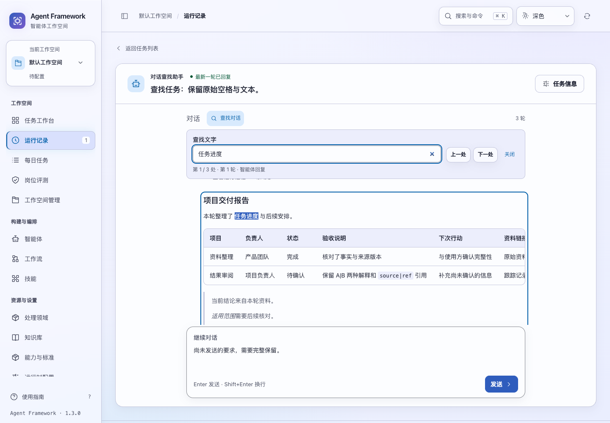
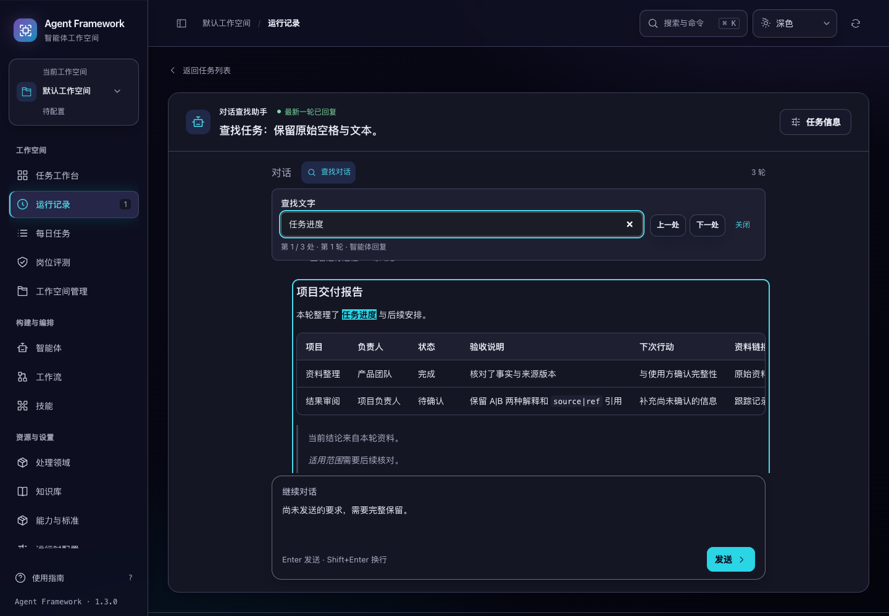

# 对话内查找与定位

2026-11-05 补充：较矮桌面的查找采用紧凑工具栏和输入区返回入口，增加历史阅读空间，并补齐各查找控件的 Esc 与匹配消失后的焦点，见 [阅读空间与键盘导航](../ui-conversation-search-20261105.md)。

2026-11-04 补充：长对话新增按消息复用的正文索引，重复定位不再遍历全部消息，复制恢复控件不参与正文查找。行为与测量见 [长对话查找索引](search-index.md)。下文保留初次实现的验收记录。

2026-11-02。源码功能已验收，版本保持 1.3.0；本轮没有构建或发布新的发行候选。

长对话此前需要逐轮滚动才能找回要求或结论。现在对话标题旁提供“查找对话”，可搜索本任务已加载的用户要求、智能体回复和生成片段，显示当前匹配数、所在轮次及消息类型。

## 使用方式与范围

- 输入最多 200 个字符，忽略大小写并按字面文字查找，不把 `[]`、`+`、`.` 等解释为正则表达式。查询两端空白会被去除。
- “上一处”“下一处”可循环定位；输入框内 Enter 查找下一处，Shift+Enter 查找上一处，Esc 关闭并将焦点还给入口。
- 查找已渲染的消息正文，可以跨强调标签匹配，也可以定位表格和代码内的文字。运行过程、来源引用区、配置及复制按钮文字不在查找范围内。
- 当前任务接口载入所有轮次，查找覆盖这些已加载消息；不搜索其他任务、其他空间或尚未收到的输出。
- 最多保留前 500 处匹配；更多匹配会明确提示缩小查找范围。没有匹配时显示范围说明，并禁用前后导航按钮。
- 中文输入法确认期间暂停查找及快捷键处理，不发送消息。

查找完全在当前页面执行，不调用模型或向服务器提交查询，不改变消息草稿。高亮通过 DOM Range 与浏览器的 [CSS Custom Highlight API](https://developer.mozilla.org/en-US/docs/Web/API/CSS_Custom_Highlight_API) 绘制，不插入或改写消息节点。缺少该 API 时仍能定位并框出所在消息，同时显示兼容性说明。

## 阅读连续性

选择匹配会滚动到相应消息；代码和表格内的远端匹配也会横向滚入可视范围。流式追加、结果完成和新轮次到达时，匹配列表会自动更新，已有匹配按轮次、消息类型及文本位置继续定位，后台更新不会主动跳转。

查找期间暂停自动跟随最新输出。“回到最新消息”会退出查找并恢复跟随。关闭查找保留当前阅读位置，不改动继续对话的输入。代码复制保持原始缩进、换行和正文，高亮及查找控件不会混入剪贴板。

查询按租户、工作空间、任务用户和对话隔离，仅存于当前页面内存。切换任务清理延迟查找及旧 DOM 引用；返回时保留该任务的查询。浏览器刷新后查询清空，已有消息草稿仍按原草稿机制恢复。没有增加搜索历史或跨页面同步。

## 验收结果

**692 项前端测试、70 项后端测试通过；5 个浏览器套件通过**：`task-search`、`reply-markdown`、`conversation-ui`、`conversation-details`、`task-messages`。

新增 8 项前端测试覆盖字面匹配、Unicode 原始位置、截断边界、跨文本节点范围、任务与空间隔离、延迟工作清理、输入法及兼容性提示。静态服务测试也核对新增脚本与样式均可访问，保留原有 CSP。

浏览器使用临时数据库与离线模型，经真实任务接口及 SSE 验证生成片段、两次输出更新、完成结果、多轮消息、横向定位、逐字代码复制、未发送草稿、中文输入、按键导航、缺少高亮 API 的回退，以及切换任务与刷新。新轮次增加匹配时，当前选中结果及滚动位置保持；“回到最新消息”恢复跟随。搜索操作没有产生写请求。

视觉检查覆盖明暗主题的 1024、1280、1440、1920px 宽度，1024px 展开任务属性栏，以及查找文字放大到 200%。控件可操作，消息输入保留，无页面横向溢出。浏览器页面异常为零。

首轮浏览器检查曾错误要求本来就在视口内的代码匹配产生横向滚动，已改为检查行末远端匹配；最终套件通过。截图等待两次绘制帧后采集，避免刚调整窗口大小时的合成残影。完整运行路径及文件摘要见 [验收清单](task-search-verification-20261102.json)。

```sh
npm test
PYTHONPATH=tests .venv/bin/python -m unittest \
  tests.test_task_conversations tests.test_streaming_tasks tests.test_codex_stream \
  tests.test_web tests.test_release_delivery
.venv/bin/python scripts/run_browser_tests.py \
  --suite task-search --suite reply-markdown --suite conversation-ui \
  --suite conversation-details --suite task-messages
```




