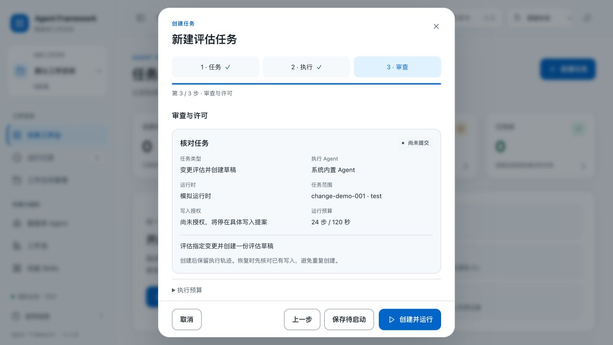
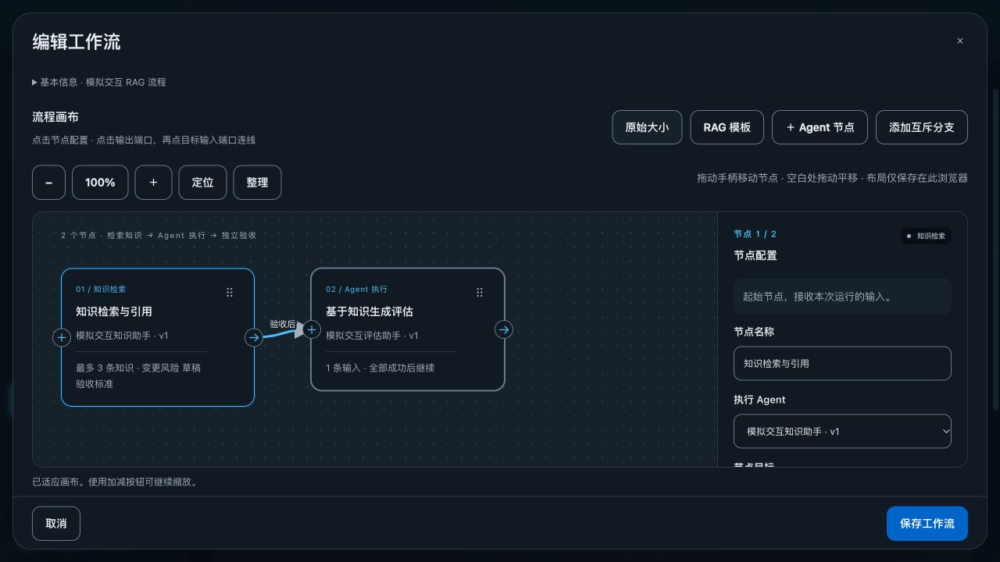

# 工作台交互与使用动线

2026-10-23。本轮改进将随 **1.2.0** 发行；已有 **1.1.0 原安装包保持不变**。本目录记录源码交互改进的验收，安装包构建、安装和数据清理的最终结果以 `docs/release/` 中对应版本的记录为准。

## 任务从设置到验收

任务创建分为“任务与范围 → 执行方式 → 审查与许可”三步。必填字段验证通过后才能前进，最后集中展示任务、固定 Agent 版本、运行时、范围、权限和预算。前两步回车不会创建任务，中文输入法确认不会误提交；提交期间冻结表单并阻止重复创建。

写入许可默认不勾选。未授权的任务可以保存并运行到具体动作提案，再审查参数并授权。任务目标、Agent、运行时等发生变化后，旧的模型发送许可和写入许可会清除，要求重新审查。

需要补充运行时或 Agent 配置时，可离开任务表单，在配置页通过“返回任务”继续；任务说明、范围和预算保留，返回时重新读取最新配置并重新审查许可。取消有未保存修改的表单时，先选择继续编辑或明确放弃。这里保留的是当前页面中的输入，不是持久化任务；刷新或关闭页面不会保存这些未提交内容。

工作台统计卡可进入对应运行筛选。任务详情根据状态提供下一步：待授权时查看动作提案，验收不一致时查看证据，完成后阅读报告。新路由从顶部开始，返回列表恢复此前滚动位置；后台轮询不会重复播放页面进入动效，也不会把过期响应渲染到另一个路由。

## Agent、Skill 和资料的连续操作

Agent 编辑分为五个步骤，区分必需配置与可选 Skill、高级能力；显示已完成情况，并在保存前集中审查。字段错误会定位回对应步骤。Agent 卡片的“创建任务”会预选该 Agent。

从 Agent 编辑进入 Skills 管理时，可保留尚未保存的岗位内容，选择明确的已发布版本后返回。绑定固定版本，不自动升级；返回会校验空间、Agent 和编辑版本，避免把其他上下文中的结果带回。保存成功后保持新卡片可见并定位；后续列表读取失败会明确提示刷新失败，不会把已成功保存误报为保存失败。

知识、记忆、经验和 Skill 保存后，页面定位到对应模块与记录，并提供相应的审核或发布入口。知识保存仍为草稿，提交审核和发布保持明确操作。Skill 内容没有变化时不创建新版本。新工作空间创建后仍停留在原空间，使用“进入此空间”显式切换；切换先读取目标会话和运行列表，失败时保留当前空间。

## 可操作的工作流画布

节点拖动柄支持直接拖动，位置按 8 像素对齐；方向键、Shift 加方向键及检查器中的四个移动按钮提供替代操作。支持空白区域拖动平移、缩放按钮、按修饰键滚轮缩放、定位节点和整理布局；普通滚轮保留滚动行为。适配视图按实际节点范围计算，不因空白画布而把本来能容纳的节点缩小。

选中节点时同步检查器，并突出相关上游、下游和可连线目标；无效连线与字段错误有明确定位。拖动可取消并恢复原位置，节点位置变动参与未保存检查。布局缓存按租户、工作空间、工作流分隔，保存在当前浏览器的本地存储中；不提供跨浏览器同步，也不改变业务执行契约。

手机使用“画布 / 节点设置”切换，避免将两部分挤在同一屏。选择节点进入设置，定位和缩放返回画布；保存操作在检查过的手机、平板、桌面和横屏尺寸中保持可见。低高度窗口允许表单内部滚动。

工作流保存、启动和授权使用服务器已返回的结果作为成功依据。后续列表刷新失败不会重新发起已成功的写操作；响应未知的写请求也不会自动重放。

## 动效与可访问操作

页面、任务步骤和结果提示使用短暂过渡，动效随导航、选择和反馈发生。系统设置减少动态效果时关闭非必要动画；轮询刷新不重复播放路由进入动画。提示可关闭，并在悬停或获得焦点时暂停消失计时。

主要操作保留可见焦点、语义标签及键盘入口。画布提供无需拖动的移动方式；小屏将画布和检查器分开。该轮是功能及布局验收，不构成完整的 WCAG 或平台设计规范认证。

## 实际验证

所有交互运行使用独立模拟数据，运行时为 Mock，模型调用数为零。正式工作台没有用于这些交互验收的任务或资料。

| 验证层 | 结果 | 证据 |
| --- | --- | --- |
| Python 回归 | 184 / 184 | [日志](tests-tests.log) |
| Node 前端交互检查 | 125 / 125：会话 15、Agent 20、任务动线 20、资料与空间 36、工作流 34 | [会话](session-tests.log)、[Agent](agent-tests.log)、[任务](journeys-tests.log)、[资料](resources-tests.log)、[工作流](workflow-tests.log) |
| 实际浏览器操作 | 16 项操作记录，包含任务、Agent/Skill 往返、资料保存、空间切换、拖动、键盘移动、平移和滚动返回 | [操作证据](ui-journeys.json) |
| 页面尺寸 | 九个模块 × 五个尺寸，共 45 条记录，无页面水平溢出或横向裁切的已检查控件 | [布局记录](responsive.json) |
| 深色外观 | 九个模块，无页面水平溢出 | [外观记录](dark-routes.json) |
| 工作流弹窗 | 六个尺寸，保存按钮均在可视区域 | [弹窗记录](workflow-dialogs.json) |
| 任务弹窗 | 六个尺寸 × 第一步 / 第三步，共 12 条记录，主要操作均在可视区域 | [弹窗记录](task-dialogs.json) |

Node 检查使用隔离的模拟 DOM/API，不能替代真实浏览器操作。页面尺寸记录覆盖 320×740、375×812、768×1024、1280×720、812×375；弹窗额外覆盖 640×812。这些记录验证指定布局与操作，不代表穷尽所有内容、浏览器或设备。

授权和结果验证的两条浏览器链路如下：

1. 默认不授权创建 `run-e7c67e8b4afd4709`：停在审查写入阶段，创建调用 0 次、草稿 0 份。明确授权后，模拟写入成功但响应丢失，恢复后成功；界面显示验收 3 / 3，通过外部模拟库核对草稿 1 份、创建调用 1 次。
2. 从已保存的模拟 Agent 创建 `run-3ecbc54dc1be473e`：主动勾选本次许可后正常完成，界面显示验收 3 / 3，草稿 1 份、创建调用 1 次。

[后端核对记录](runtime-verification.json) 从 SQLite 验收表独立确认两条任务均为 `SUCCEEDED`、模型调用 0、草稿 1 份、写入调用 1 次。关键事实与证据、草稿回读、报告章节三项验收均为 `passed: true`，与界面显示一致。本轮浏览器没有再次模拟进程退出；进程重启等恢复行为由 Python 回归覆盖，发行安装包的故障矩阵另行记录。

交互改动冻结时与 1.1.0 wheel 比较，40 个 Python 文件字节相同，`web.py` 仅增加 `/journeys.js` 静态路由，原主题规则前缀保持不变。该比较证明本轮交互改进没有修改授权网关、验收器和恢复执行器；它是修改发行元数据前的快照，不能替代 1.2.0 安装包与最终源码的核对。见 [边界记录](backend-boundary.json)。

## 界面记录

业务工具仍为模拟实现，只支持 test 范围；单用户回环访问及模型上下文发送许可边界保持原有约束。本目录的截图和 JSON 是开发验收证据，不应随正式安装包携带。
