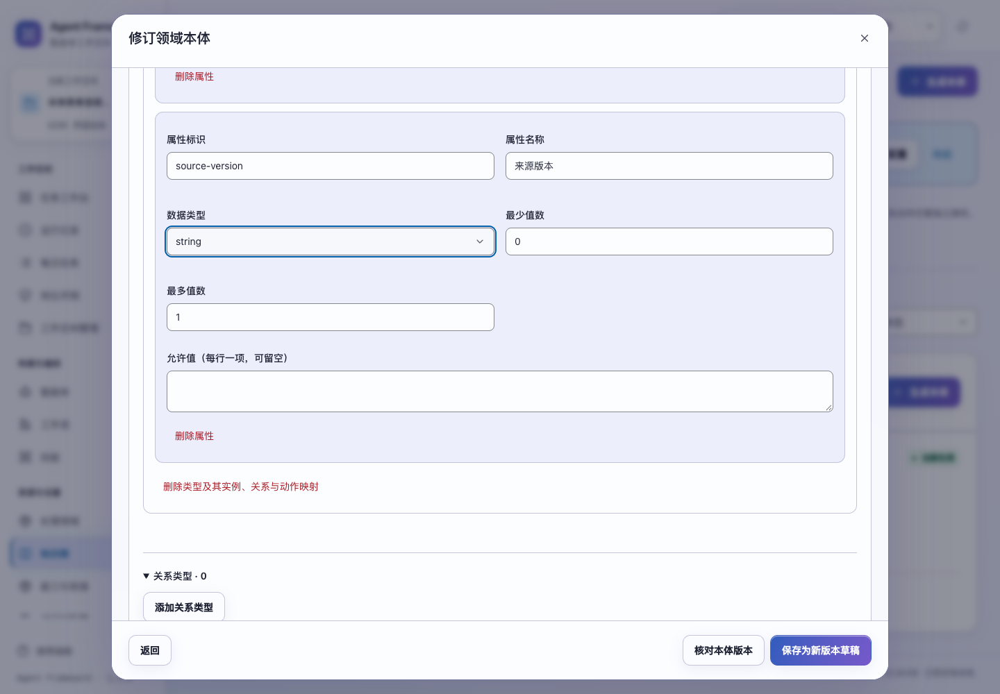
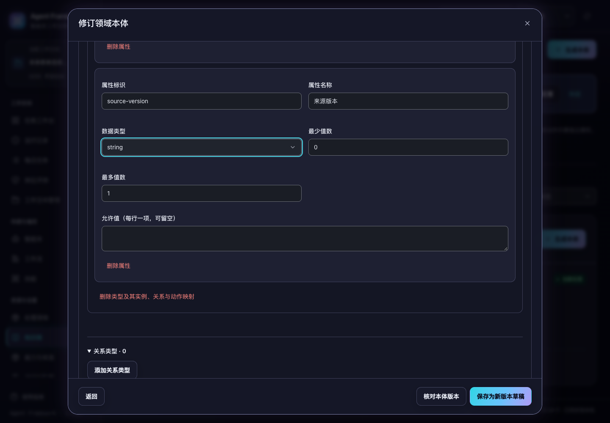

# 生成受理、审阅回执与编辑连续性

2026-10-31。当前源码改进，尚未重新构建或发布发行包。

此前复盘与本体生成只在预检时核对智能体、Skill 和来源。另一个进程随后修改或归档智能体、撤回技能或资料，旧请求仍可能被受理并调用生成器。持有旧空间视图的审阅保存、修复和沉淀也没有在最后写入时重新检查空间是否已删除。首批 15 项回归在原实现中有 12 项失败，另外 3 项确认已接受生成和停用技能的兼容行为。

## 新生成的受理边界

新请求在写入 `GENERATING` 记录的同一事务内再次检查：

| 内容 | 核对规则 |
| --- | --- |
| 工作空间 | 仍存在且未删除 |
| 所选智能体 | 仍属于当前租户和空间，未归档，修订号与预检一致 |
| 已启用的固定 Skill | 包未归档、指定版本仍发布，内容与摘要仍匹配冻结配置 |
| 复盘事实 | 原运行状态和证据摘要仍与预检一致，不能用已经变化的运行事实生成旧复盘 |
| 本体来源 | 原先选择的明确版本仍有效、可访问，来源摘要与预检一致 |

发生配置或来源冲突时返回 `409`，不调用生成器，也不留下生成记录或占用本次提交编号。核对新配置后，API 可以用未被接受的原编号重新提交。空间已删除则按既有不可用规则拒绝。停用的 Skill 不阻止生成，不会自动升级已经选择的版本。

事务先受理成功时，随后发生的配置修改不会替换本次生成的选择。模型调用开始前，原请求已经保存；仍在执行的已受理生成可以完成，并保存基于原上下文的结果。相同编号和相同请求继续返回原提案，不再次调用模型。已接受后来源撤回，仍可保留生成记录；沉淀继续检查来源是否当前有效。

空间删除不会自动取消已经受理的生成。其完成结果保留在原空间中，恢复空间后可沿用原编号核对。空间不可用时，旧视图不能通过重复生成或沉淀请求绕过空间边界。本轮没有新增服务退出后的模型请求自动重放；未知结果仍需沿原记录核对。

## 审阅写入与准确回执

- 保存审阅、创建修复草稿和沉淀，在预检与实际写入事务中均检查空间有效性。空间在校验期间被删除时，拒绝写入；沉淀不会留下部分资产。
- 保存继续检查提案修订号、草稿状态和输出结构。修复、沉淀继续执行各自的来源与约束检查；修复不再次调用模型，沉淀不等于发布。
- 生成完成、保存审阅、修复和沉淀的返回值都在提交事务中读取。另一页面在提交后立即编辑提案，原回复仍描述本次接受的内容及修订号，普通查询再返回当前版本。
- 已完成的沉淀不再依赖提交后的另一次详情读取，避免将成功写入误报为后续读取失败。原有按选中条目去重、整次回滚和持久回执继续有效。

接口字段、路径和数据库结构保持兼容。这里的事务检查覆盖复盘/本体提案的生成、审阅保存、修复与沉淀；资产自身的后续审核、修订和发布继续使用既有资产流程。已接受提案保留原智能体与来源，不因当前配置变化而自动重新生成。

## 本体编辑的键盘连续性

修改属性类型会重建部分编辑区。自定义选择器的按钮标识随重建变化，此前无法准确恢复焦点。现在先定位选择器对应的原生字段，再按稳定字段标识或语义属性恢复；不使用临时禁用和校验标记作为字段身份。

正常文字、双倍文字下均可通过可见选择器和键盘连续将类型改为 `date` 再改回 `string`，原有实例输入和折叠状态继续保留。正文滚动与文本选区也保持。弹窗外框为裁剪容器时，清除原生控件操作造成的意外外框偏移；正文仍恢复原滚动位置，避免焦点正确但控件已移出屏幕。真正可滚动的弹窗继续保留其原偏移。

本轮新增验收以桌面 Web/PC 为准：1024/1440px、浅色/深色、正常/至少双倍文字，共 8 组。文字放大使用同源测试样式，并核对控件实际字号、焦点与正文/页脚边界，应用现有页面保护设置保持有效。原有窄屏兼容回归继续执行。

## 复验

```bash
.venv/bin/python -m unittest tests.test_learning_acceptance -q
.venv/bin/python -m unittest discover -s tests -q
npm test
.venv/bin/python scripts/run_browser_tests.py --suite ontology --suite legacy-modules --suite audit-fixes
```

新增 **22 项后端回归**，覆盖独立连接交错修改智能体、归档、撤回 Skill、撤回来源、复盘状态变化、空间删除、事务内互斥、接受后的原请求复用，以及提交后其他页面立即审阅时的准确回复。实际 HTTP 验收确认冲突为 `409`、没有提案记录且生成器调用为零。新增 **4 项界面回归**核对自定义选择器身份、字段消失时的焦点边界、选区/正文滚动及裁剪外框偏移。

完整后端 **697 项**、完整界面 **197 项**通过。`ontology`、`legacy-modules`、`audit-fixes` 三套浏览器验收通过，涵盖实际生成、修复、审阅、沉淀、来源证据与发布动线。本体表单套件通过 11 组检查，含上述 8 组桌面焦点场景，浏览器没有未处理脚本错误。详细数据、源码摘要和本轮记录见 [验收数据](acceptance-verification-20261031.json)。

所有测试使用隔离临时数据、离线配置或合成模型响应，没有调用真实模型或修改已有业务数据。




