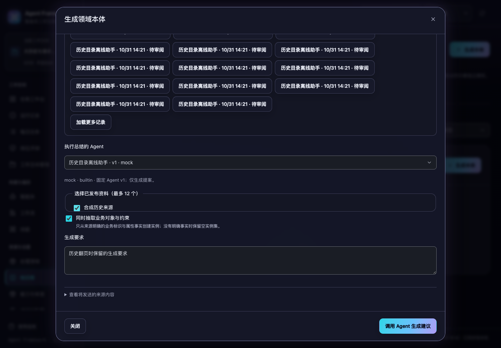

# 提案历史分页与生成请求核对

2026-10-31，当前源码。复盘与本体生成的历史记录可以继续加载到 200 条之后；结果未知的生成，直接按原请求编号核对，不再依赖近期历史列表。

## 找回原生成请求

以前，“核对生成状态”先搜索最近 200 条历史，再读取详情。当原请求被更新记录挤出这个窗口时，已经受理的请求也会被误报为未发现。

现在，一次只读请求按照租户、工作空间、主体和原请求编号定位。生成中、失败、待审阅和已沉淀均返回当前记录；已沉淀时包含原确认回执。核对不会再次调用生成、创建提案或写入资产。

暂未找到时保留原编号和未知状态，并提示“暂未找到不代表在途生成已停止”。需要采用保存内容且当前有未保存修改时，继续保留替换确认；选择继续编辑不会丢失原输入。

## 查看更多历史

窗口首次读取 50 条摘要。展开生成或复盘记录，点击“加载更多记录”继续读取下一页，显示已载入数量；没有下一页时显示已全部载入。

继续加载只更新历史区域，保留生成要求、Agent 选择、来源选择及已有输入节点。读取失败保留当前记录和分页位置，可明确重试；关闭重开后，旧页回复不能追加到新窗口。继续加载结束后，键盘焦点留在更多按钮；最后一页回到记录摘要，保持操作可见。



[浅色截图](history-light.png)。桌面验收覆盖 1024/1440 宽度、深浅色和历史区域 200% 文字，共 8 组；另沿用本体编辑的 8 组桌面焦点回归。

分页按原有插入顺序从新到旧，使用稳定边界继续。读取期间新增记录不会挤乱后续页，已有记录更新也不会移动边界；重新打开窗口可看到最新记录。游标绑定当前租户、空间、主体、用途和原运行筛选，不能用于其他范围。

## 摘要读取

历史目录在同一条查询中投影标识、版本、状态、请求编号、Agent 名称、运行关联和时间等展示字段。完整输出、冻结来源、被拒绝的生成内容和确认回执保留在详情中，目录不再逐条调用详情，也不会为显示失败记录而校验完整本体。

SQLite 仍需从原记录 JSON 中提取字段；本次减少的是逐条连接、完整记录传入应用层以及应用层正文解析，没有建立另一份需要同步的提案缓存，也不承诺数据库完全不读取正文所在的数据页。

在独立临时数据中保存 400 条历史，每条含 32 KiB 合成正文，同样读取 200 条摘要，三次测量：

| 指标 | 修改前 | 修改后 |
|---|---:|---:|
| SELECT 次数 | 201 | 1 |
| 应用层 JSON 解码字节 | 6,595,800 | 0 |
| 返回摘要数 | 200 | 200 |
| 摘要响应字节 | 43,601 | 43,601 |
| 中位耗时 | 约 114 ms | 约 3.3 ms |

这是启用查询与解码追踪的本机测量，不包含网络和浏览器绘制，不代表其他机器上的固定速度。原始数据见 [修改前](history-before-20261031.json)与[修改后](history-after-20261031.json)。复测命令：

```sh
.venv/bin/python scripts/benchmark_learning_history.py --records 400 --body-kib 32 --repeats 3
```

## 接口与兼容

- `GET /api/learning-requests/{request_id}`：读取本人当前空间中该请求的完整现状；不存在时返回 404，且不暴露其他范围的记录。
- `GET /api/learning-proposals?purpose=ontology&limit=50&cursor=...`：返回 `proposals`、`has_more` 和 `next_cursor`。页大小为 1–200，默认 200；不提供游标时读取首页。
- `run_id` 和 `purpose` 筛选继续适用。无效页大小、游标或与当前条件不匹配的游标返回 400，筛选先于页大小限制。
- 原服务层 `Learning.list()` 仍返回最多 200 条摘要列表；现有详情、生成、修复、保存、沉淀及权限契约沿用。

新增的两个目录索引自动建立，原有提案正文与请求编号不迁移。工作空间被删除期间，HTTP 接口仍遵守原空间不可用的限制。

## 验证

完整后端 **738 项**、界面 **221 项**通过。本轮新增 19 项后端用例与 8 项界面用例，覆盖单次摘要查询、437 条历史遍历、分页期间新增与更新、范围隔离、无效游标、旧请求定位、当前状态与原沉淀回执。

浏览器新增验收先真正提交一次离线生成，故意丢弃成功回复，并插入 235 条更新的合成记录。原请求已不在近期 200 条中，页面仍通过一次原编号读取找回，生成提交始终只有一次；随后分批遍历全部 236 条，无丢失或重复，较旧记录能经明确确认打开。

`learning-catalog`、`learning-reads`、`ontology`、`audit-fixes`、`legacy-modules` 五套通过。失败结果修复验收也按当前替换确认流程检查了保留输入、明确采用、修复、证据与发布。机器可读结果见 [验证记录](history-verification-20261031.json)。

所有验证使用临时服务和合成数据，未调用真实模型、修改现有业务数据、重新构建安装包或发布。未知写入和浏览器刷新后未保存输入的原有边界保持不变。
