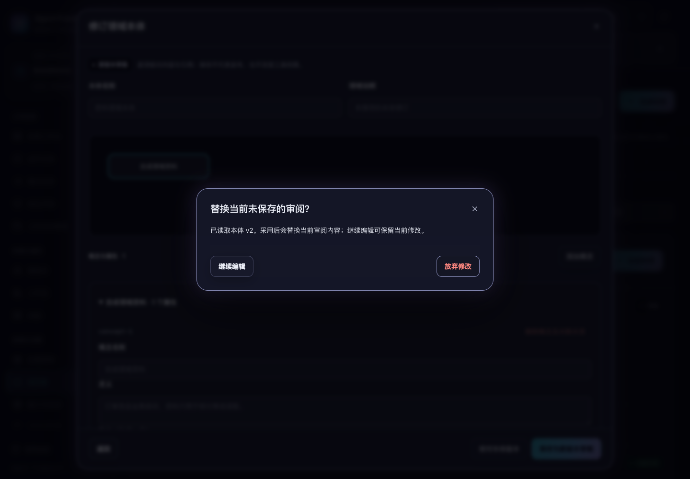

# 审阅读取与版本替换保护

2026-10-31，当前源码。复盘提案与本体编辑在慢请求、关闭重开和其他页面修订时，保留当前输入，并在采用保存版本前明确确认。

## 读取与取消等待

点击“重新读取已存提案”“核对本体版本”或“核对生成状态”后，显示读取进度，暂停编辑和保存，防止迟到回复覆盖期间新增的修改。原有只读字段继续保持只读。

关闭入口保持可用。若有未保存内容，会询问是否放弃；选择“继续编辑”保留原输入，并使此次等待读取失效。旧请求之后成功或失败，都不会覆盖当前输入、显示旧错误或解锁另一个正在加载的窗口。

初次打开窗口的加载也可以关闭。关闭后再次打开使用新的界面会话，之前的 Agent、来源或历史回复不能替换新窗口。核对生成状态时，如果目录读取已取消，不再追加详情读取。

关闭等待读取只取消本窗口对回复的采用，不承诺终止已发出的服务请求。生成、修复、保存或沉淀等写入仍需等待结果，继续沿用原有未知回执核对规则。

## 采用保存版本

- 读取失败：保留原输入、选择和版本，恢复操作；读取错误不会被误判成新的未知写入。
- 读取成功但当前内容已修改：先显示替换确认，选择“继续编辑”保留本地输入；明确放弃后才采用保存内容。已修改的生成要求也受保护。
- 本体存在新版本：确认框显示将采用的版本号，例如 `v2`。拒绝替换会保留原本体版本与本地修订；接受后采用新版本内容。
- 本体版本没有更新：更新该版本的状态信息，保留本地修订，不询问放弃、不重复保存。
- 拒绝替换后，键盘焦点回到原读取按钮；接受替换会清除旧内容的校验报告。



[浅色确认框截图](replacement-light.png)。

读取、取消等待和替换确认均不写入资料、不发布、不重复调用模型，也不会产生新的本体版本。原有生成和保存接口保持不变。窗口打开期间，空间切换会提示先处理并关闭当前审阅，避免输入被带到其他空间。

## 校验结果归属

本体约束校验的回复同时核对空间、界面会话和被校验的内容对象。关闭重开后，即使文本完全相同，旧校验成功或失败也不会写入新窗口；重新读取了同样内容的另一个对象，也不沿用旧校验回复。当前内容在校验期间发生变化时，仍提示重新校验。

## 验证

```sh
npm test
.venv/bin/python scripts/run_browser_tests.py --suite learning-reads --suite ontology --suite audit-fixes --suite legacy-modules
```

界面测试 **213 项通过**，比本轮开始新增 16 项独立用例；本体交互脚本另补充旧会话成功、旧会话失败及同内容重新读取的 3 项校验归属检查。新增回归复现了旧校验结果覆盖新窗口的问题。

上述四套浏览器验收通过。新增 `learning-reads` 使用两个真实页面验证 5 类流程，并检查 1024/1440 宽度与深浅色下的 4 组替换确认框。最终重验覆盖关闭确认完成后的键盘焦点恢复及版本号提示。现有本体验收继续覆盖 8 组桌面键盘与 200% 文字场景。

本轮修改界面与验收脚本；后端实现未变，未重复运行全量后端测试。上一轮的 [719 项后端验收](../workspaces/asset-write-verification-20261031.json)独立保留，不计入本轮新增结果。机器可读结果见 [验证记录](read-verification-20261031.json)。

验证使用临时服务、合成资料和离线 Agent，没有调用真实模型、修改现有业务数据、重新打包或发布。未保存的编辑仍不跨浏览器刷新保留。
