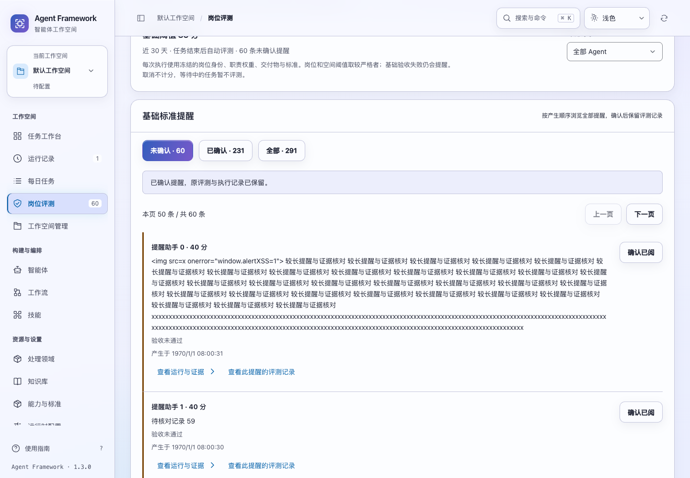
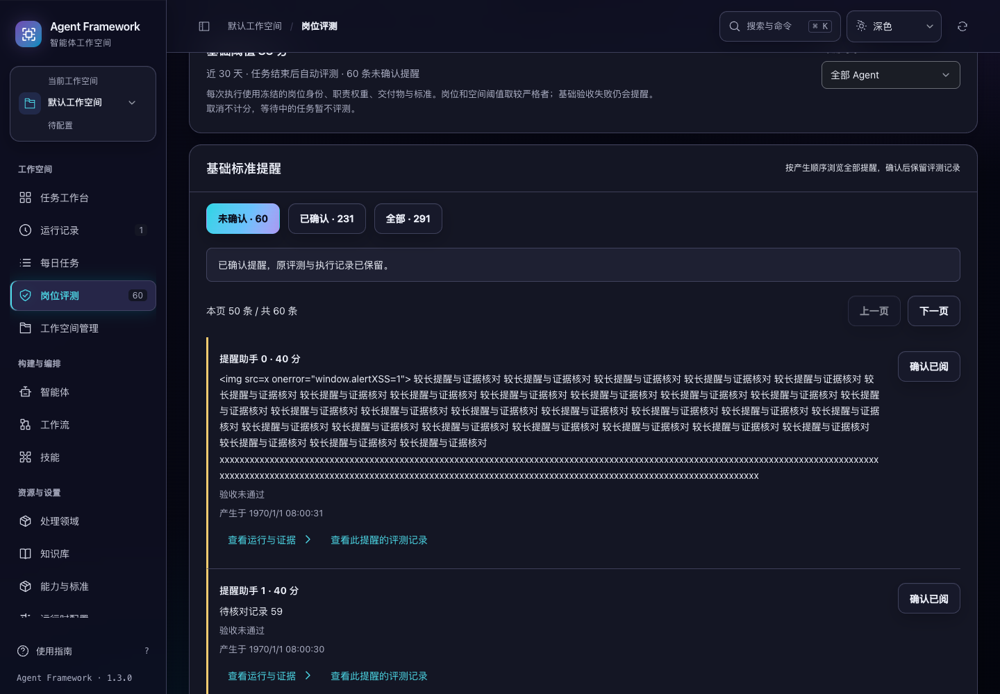

# 岗位评测提醒收件箱

2026-10-31，当前源码。岗位评测页面新增独立的提醒收件箱，默认显示未确认提醒，支持已确认和全部状态，以及按岗位筛选、上一页和下一页。

旧页面只读取最近 200 条提醒，较早的未确认记录可能被较新的已确认记录挤出列表，导致未确认数量仍大于零，却找不到对应操作。现在筛选在分页前完成，全部历史提醒都可按产生顺序浏览。

## 使用方式

1. 进入“岗位评测”，在“基础标准提醒”中查看未确认记录。
2. 每页最多 50 条；使用下一页继续查找更早的提醒。可选择已确认或全部，核对历史处理情况。
3. “评测对象”同时筛选提醒收件箱。即使岗位已不在当前智能体目录，历史提醒中的岗位仍可选择。
4. 每条提醒可打开产生提醒时的评测，或跳转到原始执行记录。确认已阅只记录处理状态，不删除提醒、报告或任务。
5. 确认成功后，即使列表读取失败，页面仍保留已确认提示。重试读取不会再次提交确认；重复确认也保留首次确认时间。

读取期间显示等待状态，失败时显示原因和重试入口。主动翻页优先于后台同步，不会因同步正在进行而忽略点击。切换状态或岗位时从第一页开始，较早的翻页回复不会覆盖新筛选。提醒按工作空间与主体隔离。





截图为隔离验收数据，包含长提醒和转义文字。

## 接口与一致性

新增 `GET /api/agent-alerts`，默认返回未确认提醒。支持 `status=open|acknowledged|all`、`agent_id`、`limit` 和 `cursor`，每页大小为 1–50。

响应包含当前页 `alerts`、按当前岗位范围统计的 `counts`、历史岗位选项 `agents`、`next_cursor` 和 `has_more`。三个计数分别表示未确认、已确认和全部提醒。历史岗位选项来自当前私有范围的全部提醒，不受当前状态筛选限制。

分页按插入顺序从新到旧读取。位置绑定工作空间对应项目、租户、主体、状态、岗位与每页大小，条件变化后需重新开始。权限条件由服务端独立施加；分页位置不授予访问权限。计数、选项和记录在同一个读取快照内取得，完整提醒正文只解码当前页。

确认接口保持原路径与布尔回执，新增 `acknowledged_at`。首次确认时间在写事务内保存，再次确认返回相同时间。页面在接受确认回执后使更早开始的读取失效，避免已处理提醒被旧回复恢复成待处理。

旧 `GET /api/agent-evaluations` 接口保持兼容。本轮原先仅扩展提醒历史；后续的[完整评测历史优化](evaluation-history.md)已为评分明细增加分页和全部历史范围。提醒仍不受评分天数限制。收件箱会读取当前确认状态，并非冻结多次请求之间的状态；在其他页面确认后，当前页可能变少或为空，此时可返回上一页或最新提醒。

## 验证

专项数据包含 61 条较早的未确认提醒和 230 条较新的已确认提醒。旧概览能复现“有 61 条待处理，但最近列表全部已确认”；新接口和界面可完整浏览待处理记录。

后端验证覆盖全部历史遍历、筛选先于分页、主体隔离、正文读取量、分页参数、并发读取快照及重复确认。界面验证覆盖迟到回复、筛选切换、重复点击、确认成功后读取失败、原评测与任务跳转，以及 1024 / 1440 桌面宽度、深浅主题和 200% 文字。

新增 10 项后端专项测试和 16 项交互测试。完整后端 **793 项**、界面交互 **315 项**通过；提醒收件箱、每日任务恢复、审阅修复与历史模块四套浏览器验收通过。最终结果、已修正的回归与源码摘要见 [验证记录](alert-inbox-verification-20261031.json)。

```sh
.venv/bin/python -m unittest discover -s tests -q
npm test
.venv/bin/python scripts/run_browser_tests.py --suite alert-inbox --suite daily-recovery --suite audit-fixes --suite legacy-modules
```

验证使用临时数据库与离线助手，没有调用真实模型。改动尚未重新打包或发布。
