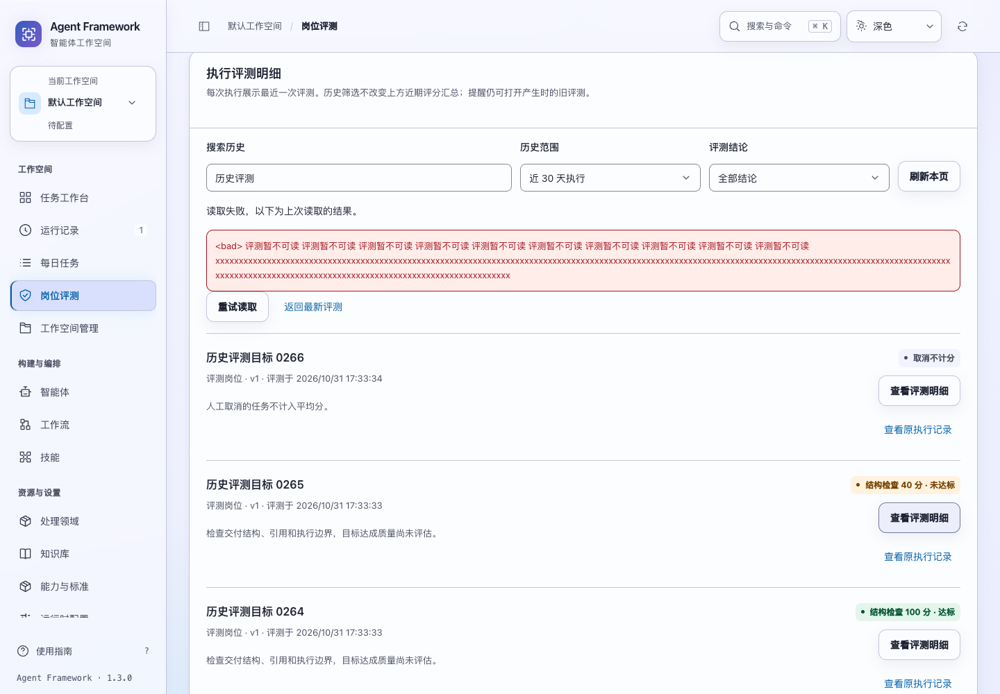
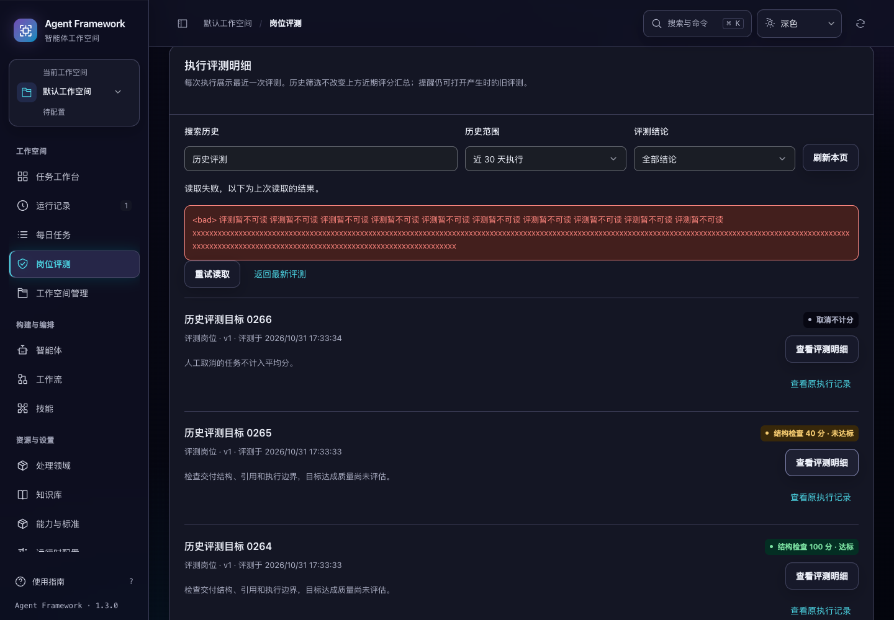

# 完整评测历史与近期评分汇总

2026-10-31，当前源码。岗位评测明细改为服务端筛选与分页，支持完整历史范围、岗位、结论和关键词。旧实现先截取 200 条再在页面按岗位过滤，且最终列表没有明确的生成顺序；现在历史岗位和较早的执行都能找到。

## 使用方式

- “评测对象”包括当前岗位和历史报告中的岗位，即使岗位已不在当前目录，也能查阅其历史。
- 明细默认显示近期窗口内的执行，可切换“全部历史”。时间窗口按执行创建时间判断，不是按补评时间判断。
- 可按达标、未达标、取消不计分、离线演示不计分筛选，也可搜索目标、岗位名称、运行标识或评测标识。筛选在分页之前执行，每页最多 50 条。
- 每次执行展示最近一次评测，按报告写入顺序排列。补评产生的新版本不会删除原报告；旧提醒继续打开产生提醒时的评测。
- 列表展示简明评分口径，点击“查看评测明细”才读取完整冻结依据。明细可关闭和重试；关闭后回到实际打开它的入口，保留原页码和筛选。
- 查询失败明确显示原因。同页刷新失败保留并标注上次结果；换页失败不会把上一页内容冒充当前页。可重试本页或返回最新评测。

“近期评分汇总”保持原来的评分窗口与计分规则，不受下方关键词、结论和“全部历史”选项影响；岗位筛选会选择对应岗位的汇总。页面显示统计截止时间，读取失败时也标明汇总仍为上次结果。结构检查分不代表目标达成质量，离线演示与人工取消继续不计入平均分。

## 稳定翻页与范围隔离

首次读取确定报告插入位置上界和统计截止时间。后续翻页、同页刷新继续使用这一窗口；新增报告和补评不会把原记录挤动或替换成另一版本。发现新报告后显示数量，点击“查看最新评测”建立新窗口。新关键词、结论或时间范围也从第一页开始。

岗位变化保留其他筛选但重置页码；切换空间、租户或主体清空私有搜索状态。迟到的旧读取不能覆盖新查询，离开页面后的响应也不会把任务标识误当成岗位筛选。

本页面保存评测设置或完成补评后会使旧读取失效，并刷新到新的报告窗口。其他窗口修改设置会使原游标返回 400，页面提供回到最新评测的入口。

## 接口与数据

`GET /api/agent-evaluations?view=page` 接受 `search`、`agent_id`、`verdict`、`period=window|all`、`limit=1..50` 和 `cursor`。重复或未知参数、非法状态、游标格式错误或游标与当前条件不匹配均返回 400。

游标绑定租户、项目、主体、评测设置、筛选与页面大小。数据库先限定私有范围，再选出窗口内每次执行的最新报告；统计、岗位选项、评分汇总和本页记录使用同一个读取事务。摘要查询不在 Python 中解码完整报告，不传输职责正文、证据列表或评测契约。

旧版直接执行/对话的离线模拟报告继续按原规则转换为“不计分”，均分使用既有舍入方式。原 `GET /api/agent-evaluations` 保持兼容；报告详情、提醒与确认接口保持原路径。

## 验证与体积

新增 **11 项后端、16 项历史交互和 1 项明细入口焦点测试**。完整后端 **830 项**、界面 **392 项**通过。完整评测历史、提醒收件箱、详情读取、跨模块实际操作与跨页面控件五套浏览器验收通过。

专项数据包含近期窗口内 267 次执行、窗口外旧岗位的 1 次执行及两个空间。验证六页无重漏、旧岗位筛选、窗口外记录、明细冻结依据、筛选空态、慢响应、重试和空间隔离。专项浏览没有发起写入或外部模型调用。另有跨模块验收实际完成提醒确认和评测设置保存。

1024 / 1440 宽度、深浅色、正常与 200% 文字共 8 组桌面布局通过。长错误经过转义，重试可通过键盘到达。

同一组 267 条合成记录，每份报告附加 8 KB 正文，对比三次本地读取中位数：

| 方式 | 返回报告数 | Python 完整报告解码数 | JSON 体积 | 本地查询中位耗时 |
| --- | ---: | ---: | ---: | ---: |
| 原概览 | 200 | 267 | 1,770,010 字节 | 8.149 ms |
| 新摘要首页 | 50 | 0 | 23,052 字节 | 11.968 ms |

新查询增加了分页统计，单次数据库读取略慢；主要收益是减少完整正文解码、响应体积和页面内容。两种读取返回的页大小与内容不同，这不是生产负载性能承诺。





截图里的长错误是隔离测试数据。完整测试路径、辅助检查修正和源码摘要见 [验证记录](evaluation-history-verification-20261031.json)。

```sh
npm test
.venv/bin/python -m unittest discover -s tests -q
.venv/bin/python scripts/run_browser_tests.py --suite evaluation-catalog --suite alert-inbox --suite reading-interactions --suite legacy-modules --suite control-routes
```

改动在当前源码中，尚未重新打包或发布。
