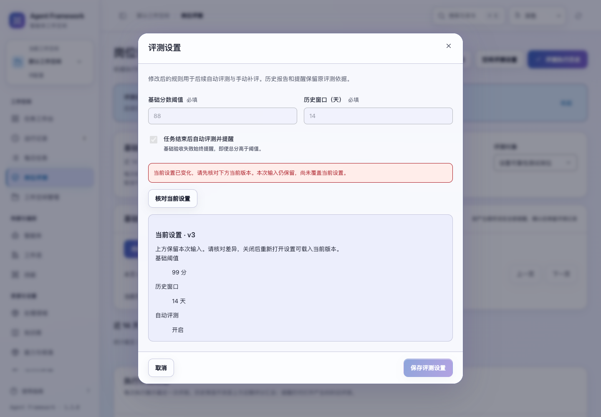
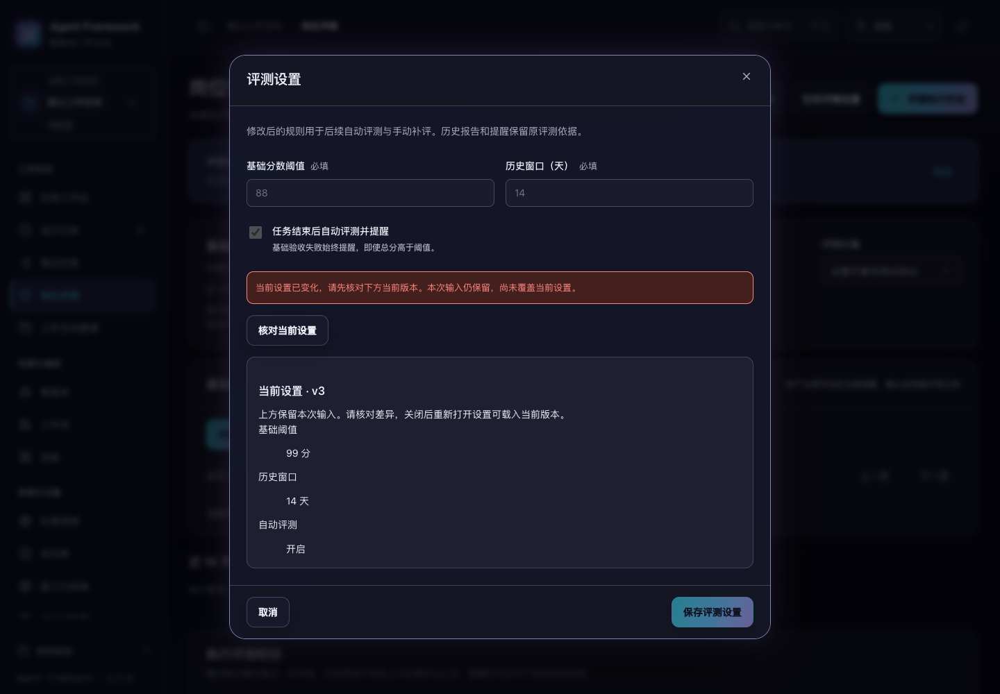

# 每日计划与评测设置的保存恢复

2026-10-31，当前源码。每日计划设置、空间评测设置和岗位评测契约共用明确的保存与核对流程。

## 保存与恢复

- 保存期间固定本次内容和所属空间，锁定输入、关闭与提交操作，重复点击不会发起第二次写入。
- 收到成功响应后，先接受返回的版本并显示“已保存”，再读取页面。读取失败时保留确认结果，提供“重试读取”；此操作不会再次保存设置。
- 连接中断或服务端异常导致结果不明时，保留本次输入并暂停编辑和提交，提供“核对当前设置”。核对只读取配置，不会生成计划、评测执行历史或创建岗位版本。
- 当前配置与本次提交一致且版本已前进时，提示“当前设置与本次修改一致”。这表示读取时的当前值匹配，不把相同内容误称为本次请求的持久回执。
- 当前仍是原版本时，解除输入锁定，允许用户手动再次保存。重试仍携带原版本；如果原请求随后完成，已有的版本检查会拒绝重复更新。
- 当前版本内容不同或保存返回版本冲突时，保留输入，展示当前配置供核对，并阻止直接覆盖。关闭后重新打开可编辑最新版本。
- 核对失败可继续重试读取。关闭尚未确认的窗口前会说明：此处输入会丢弃，已经写入的设置仍会保留。

确认结果保留在当前页面；离开页面后不会显示在另一个空间、身份或页面中。输入和未确认请求仅保留在当前窗口内，刷新浏览器不会恢复草稿，也没有新增持久请求标识。用户可以重新打开设置查看服务端当前值。

## 过期响应与版本

保存与核对响应同时检查租户、空间、主体、路由和弹窗归属。旧响应不能关闭后来打开的设置窗口，也不能把错误写进新窗口。岗位设置的异步打开还检查请求顺序；离开页面或选择其他弹窗后，迟到的读取不会重新打开旧设置。

确认保存后使旧页面读取失效。空间评测规则更新会清空旧窗口的评分汇总，直到新汇总读取完成，避免把原窗口的分数标为新窗口结果。每日计划直接接受已确认设置；后续读取重新计算下次执行时间。

岗位契约接口直接从本次提交成功的 Agent 版本生成响应。此前保存后再次读取当前 Agent，可能混入紧接着发生的其他编辑；现在响应稳定对应本次写入。

新增 `GET /api/evaluation-policy`，仅返回当前范围内的版本、阈值、历史窗口和自动评测开关。原 POST 保存接口保持兼容。每日计划与岗位契约复用各自现有的 GET 接口进行核对。

## 验证

新增 25 项设置交互测试及 2 项后端回归测试。专项浏览器验证覆盖三种设置的响应丢失、写入前断线、并发冲突、重复提交、保存后读取失败及过期岗位读取。所有浏览器数据与服务均为临时夹具，没有调用外部模型。

完整后端 **832 项**、界面 **417 项**通过。设置恢复、明细读取、跨模块操作、每日任务恢复、全站控件五套浏览器验收通过。

冲突核对界面验证了 1024 / 1440 宽度、明暗主题、正常与 200% 字号共 8 组桌面布局；核对按钮可通过键盘到达，窗口没有横向溢出。





完整测试结果、运行路径和源码摘要见 [验证记录](settings-recovery-verification-20261031.json)。

```sh
npm test
.venv/bin/python -m unittest discover -s tests -q
.venv/bin/python scripts/run_browser_tests.py --suite operation-settings --suite reading-interactions --suite legacy-modules --suite daily-recovery --suite control-routes
```

本轮改动仅在当前源码中，尚未重新打包或发布。
