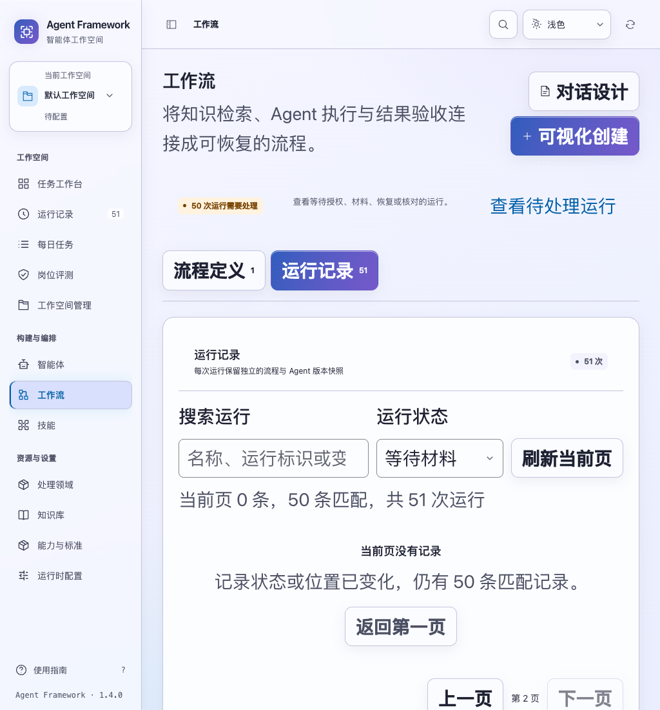
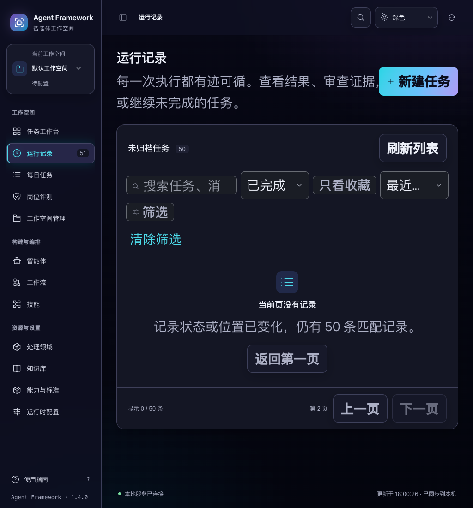

# 1.4.0 发布验收

2026-11-04。将此前以 1.3.0 独立候选记录的改进收敛为 1.4.0，更新正式发布与安装说明，并补齐跨版本升级、完整备份回退和安装后工作流恢复证据。动态分页空页属于本次修复的功能缺口；工作流恢复属于已有功能的验收补齐。

## 发布范围

- 新版归档：`dist/agent-framework-1.4.0.tar.gz`。
- 独立 wheel：`dist/bounded_agent_mvp-1.4.0-py3-none-any.whl`。
- 校验清单：`dist/SHA256SUMS`，同时保留 1.1.0、1.2.0、1.3.0 的六份历史产物。
- 归档 SHA-256：`6ebb7fa34512b6f2fc2a620e50d6762a9d97172c95f88c3e15da90dc46c22d82`。

正式归档和 wheel 使用已经完成验收的候选原字节。168 个应用文件以及随包安装、启动和两份说明逐项匹配当前保存源码。构建不包含开发数据库、缓存、日志、测试夹具或本机模型凭据。本轮只交付本地发行物，没有修改用户运行中的数据或部署服务。

## P0：安装后工作流恢复

`scripts/verify_release.py --browser-check` 先完成配置、任务、回执及保存／删除草稿的两次重启与首次备份还原，再运行八套安装浏览器流程。

随后直接使用该轮浏览器创建的两条工作流记录：一条已取消，一条已完成。先捕获公开 API 返回的定义、运行、冻结快照、事件、节点身份、子任务结果、模拟业务事实和启动请求回执，再依次完成：

1. 正常停止实际安装启动脚本所创建的进程，用同一数据目录重启，确认会话变化。
2. 比较持久事实，重放原已接受的具体授权凭据，再读取实际状态作完整比较。
3. 再次停止服务，用安装后的 CLI 备份、检查内容并恢复到全新目录，确认原数据库哈希未变。
4. 启动恢复目录，再次比较持久事实，并在授权重放前后分别检查。

两条运行保持 `CANCELLED`／`SUCCEEDED`，原子任务不变，取消运行有 0 份草稿，完成运行仍有 1 份草稿、1 次模拟写调用。恢复与重放没有增加运行、事件或业务写入。恢复功能本身没有为此修改；新增的是可重复验收与故障检测。交付单测增加“数据丢失时必须先失败”和“重放响应后仍检查实际状态”的反例。

安装验收结果：85 个模块来自隔离安装环境，72 个 UI 资源逐字节匹配 wheel；八套共 56 项浏览器流程、84 组布局检查通过，页面错误为 0。两条工作流经历的是上述额外一次真实进程重启与第二轮备份还原，区别于此前仅做浏览器刷新的证据。

## P0：原版升级与回退

`scripts/verify_upgrade.py` 分别离线安装原版 1.3.0 和最终 1.4.0，使用两个发行包各自的真实安装／启动脚本。通过原版公开 API 创建完成任务、模拟业务草稿、未提交任务草稿和等待授权工作流。

停止原版后复制整个数据目录，核对所有文件哈希。1.4.0 指向原数据目录启动，逐项检查原事实；允许新版响应增加字段，但原值不能丢失或改变。随后新建并完成一项普通任务，再检查原状态。等待授权流程不会因升级获得授权，原模拟草稿仍只有一份。

回退停止新版，将升级前完整备份复制到另一目录，用原版及其原环境启动并检查原事实；升级后的数据目录和原备份均未被修改。最后再次启动新版数据，确认旧记录与升级后新增任务仍可读取。

这里验收的是**旧版本配合升级前完整备份回退**。不支持把升级后的数据库直接交给旧版降级，也不自动合并升级后新增的数据。操作说明见 [INSTALL.md](INSTALL.md)。

## P1：动态空页

任务、工作流和评测历史原先以当前页是否为空判断整个筛选是否为空。现在：

- 当前页为空但仍有匹配时，显示“当前页没有记录”、剩余匹配数和“返回第一页”。
- 只有成功读取且确实零匹配时，才显示“没有匹配的运行”或“没有符合条件的评测”。
- 工作流与评测存在分页范围之外的新记录时，提示返回第一页重新核对筛选。
- 空页计数不再出现 `0–50 / 50` 之类虚假区间；正在读取或读取失败不被解释为零匹配。
- 返回第一页只重置分页，保留搜索、状态、评测结论、日期和范围；使用 GET 读取，并把键盘焦点移到列表标题。

浏览器用隔离的 51 条历史进入第二页，分别改变最后一条工作流状态、评测结论，并通过公开 API 归档最后一条任务。三类历史均出现真实空页，键盘返回后取回剩余 50 条匹配。再搜索不存在的内容，验证真正零匹配文案。24 组浅色／深色、1024／1440 宽度、正常／放大文字检查通过，页面错误为 0。四套既有历史浏览器回归（任务、工作流目录、工作流历史一致性、评测目录）通过。





## 证据与复现

完整结果和日志保存在 [验收归档](verification-1.4.0.zip)，摘要、源文件及发行物哈希见 [验收清单](verification-1.4.0.json)。前端全量 1,227 项、修正夹具后的后端全量 1,406 项全部通过。测试使用临时合成数据与 mock 运行时，没有真实模型或业务服务调用。

首次后端全量执行 1,406 项，其中一项“排队消息重启恢复”失败。定位到测试只在原 `Application` 对象上模拟队列满，先前完成回调已创建的工作空间副本仍可派发消息，导致测试关机时取消了本应保持待恢复的轮次。将容量模拟覆盖到该测试期间的全部工作空间视图后，相关 43 项通过，该用例连续 20 次通过；应用代码和已验收发行包未改变。首次失败日志与修正后的完整回归日志均保留，不把首次失败结果记为通过。

验收环境为 macOS arm64、Python 3.14.3、PyYAML 6.0.3、Node 及 Chrome。没有以这轮验收声称强制断电恢复、跨平台迁移、其他 Python 版本或高并发部署通过。

```sh
.venv/bin/python -m unittest discover -s tests -p 'test_*.py' -q
npm test
.venv/bin/python scripts/verify_release.py dist/agent-framework-1.4.0.tar.gz \
  --wheelhouse /tmp/agent-wheelhouse --report /tmp/agent-installed-1.4.0.json --browser-check
.venv/bin/python scripts/verify_upgrade.py dist/agent-framework-1.3.0.tar.gz dist/agent-framework-1.4.0.tar.gz \
  --wheelhouse /tmp/agent-wheelhouse --report /tmp/agent-upgrade-1.4.0.json
.venv/bin/python scripts/run_browser_tests.py --suite dynamic-pages \
  --suite workflow-history-consistency --suite workflow-catalog --suite evaluation-catalog --suite run-history \
  --output /tmp/agent-pages-1.4.0
```

准备本机 Python 对应的 PyYAML wheel 后再执行离线安装。报告和浏览器输出使用新路径。临时服务与数据在验收结束后清理。
