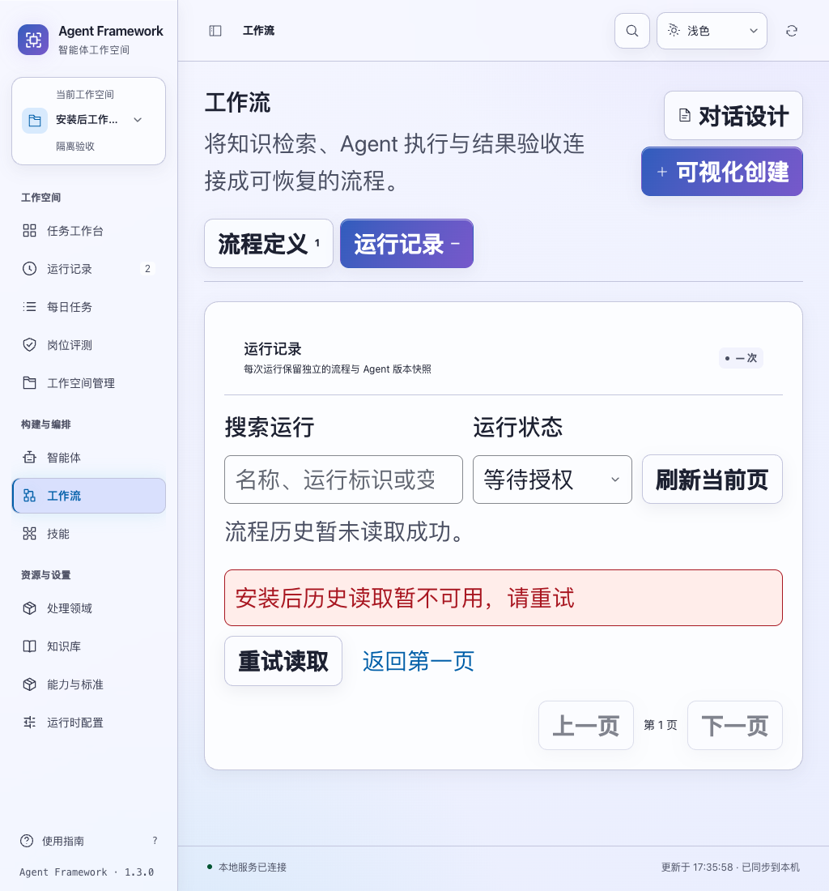
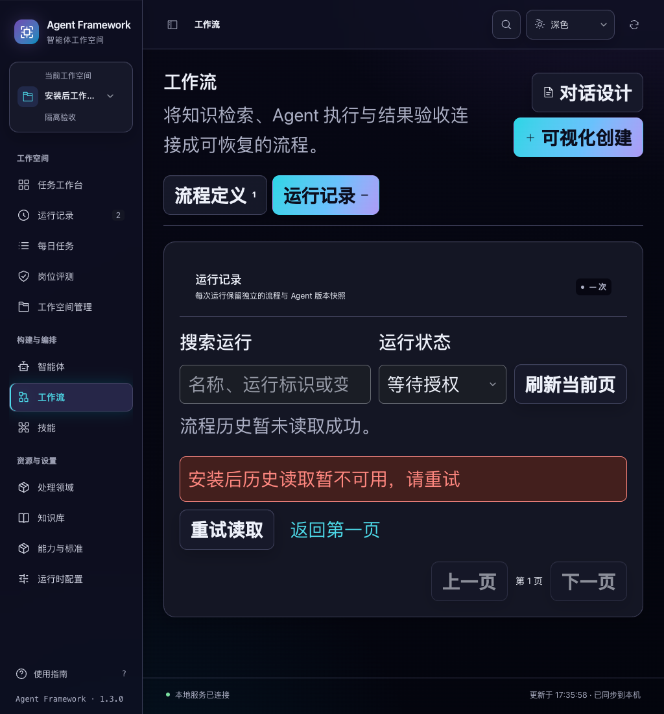

# 工作流恢复与核对的安装后验收

2026-11-04。将工作流恢复、取消及历史一致性改进纳入新的独立安装候选，并把相应流程接入安装校验器。版本仍为 1.3.0，尚未发布。

## 安装后覆盖

`scripts/verify_release.py --browser-check` 现在包含八套浏览器验收：提交回执恢复、首次任务准备、任务名称、归档、收藏、多轮导出、工作流恢复和消息草稿。浏览器连接的是通过实际启动脚本运行、已经完成备份还原检查的安装服务。

工作流用例通过公开接口创建独立工作空间、mock 智能体、一份流程定义及两条运行，实际执行到等待具体提案授权。没有导入开发目录的应用模块、直接修改数据库，或使用开发夹具的队列释放接口。单独使用安装环境中的 Python 以隔离模式检查模块来源。

新流程验证：

- 恢复请求尚未返回时重绘页面，重复点击仍不会提交第二次请求；取消入口保持可用。
- 丢弃已经受理的恢复响应后，明确核对只读原运行，沿用原节点，不新增任务或草稿。
- 丢弃取消响应后，核对实际取消终态；返回历史时模拟读取失败，不再显示过期的等待授权行或旧数量。键盘重试恢复真实筛选结果。
- 明确授权第二条运行的具体提案，丢弃响应，再核对实际成功结果。独立验收通过，模拟草稿写入次数为 1。
- 授权核对后的历史读取失败不会显示旧匹配；读取成功后才显示零匹配。
- 显式重放已接受的授权凭据，事件记录不变，草稿仍只有一份，写入调用次数仍为 1。
- 刷新浏览器后，两条运行保持“已取消”和“已完成”，原节点、冻结配置及两项子任务身份不变。

此浏览器流程共发出四次操作 POST：恢复、取消、授权，以及一次用于验证幂等行为的原授权重放。核对和历史重试没有增加操作请求。最终取消的运行有 0 份草稿，完成的运行有 1 份模拟草稿；没有真实模型或业务服务调用。

## 结果

| 检查 | 结果 |
| --- | --- |
| 交付脚本回归 | 25 项通过 |
| 全新离线安装 | 85 个模块来自安装环境，72 项 UI 资源逐字节匹配 wheel |
| 正常重启 | 两次，原有配置、历史、回执和草稿保存／删除版本保持正确 |
| 备份恢复 | 安装 CLI 检查并还原，原数据库未改变，已有目标被拒绝且内容不变 |
| 安装后浏览器 | 八套共 56 项流程、84 组布局检查，页面错误为 0 |
| 新增工作流验收 | 7 项流程、8 组桌面布局检查 |
| 产物内容 | 168 个应用文件匹配当前源码；四份随包安装／启动文件和说明匹配 |
| 历史发行包 | 六份历史产物的校验和保持不变 |

新建工作流及导出夹具是在恢复后的服务上创建的，本轮没有声称这些新记录自身经历了进程重启或备份恢复。工作流用例覆盖的是浏览器刷新；交付校验器的两次进程重启与备份恢复使用另一组明确保存的历史、配置和回执。

本轮仅增加安装校验器及浏览器用例，没有修改应用实现。候选与上一份多轮导出候选相比，包含六处应用文件变化：新增工作流控制脚本，以及其资源注册、页面挂载、样式、授权保护和历史同步实现。对应源码已在前两轮通过 1,223 项界面检查及相关后端、浏览器回归，本轮没有重复同一应用源码的完整测试。





候选目录：`/private/tmp/af-installed-workflow-candidate-20261104/`。归档 SHA-256：`336c9e714da03f67aa7cb6bda3dda139622d7b3df47700d8dbbb03d6f61a801a`。详细结果见 [交付证据](workflow-recovery-delivery-verification-20261104.json)。

验证环境为 macOS arm64、Python 3.14.3、PyYAML 6.0.3 和 Chrome。安装、运行与浏览器测试均使用临时隔离数据，未部署或发布。

## 复现

准备适配本机 Python 与平台的 PyYAML wheel，以及 Playwright 与 Chrome。使用尚不存在的候选目录和报告路径：

```sh
.venv/bin/python scripts/build_release.py --output-dir /tmp/agent-workflow-candidate
.venv/bin/python scripts/verify_release.py \
  /tmp/agent-workflow-candidate/agent-framework-1.3.0.tar.gz \
  --wheelhouse /tmp/agent-wheelhouse \
  --report /tmp/agent-workflow-installed.json --browser-check
.venv/bin/python -m unittest tests.test_release_delivery
```

临时安装环境与数据库在结束时清理，报告、浏览器结果和截图保留。
