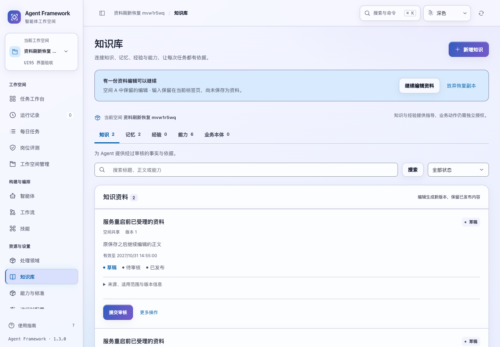
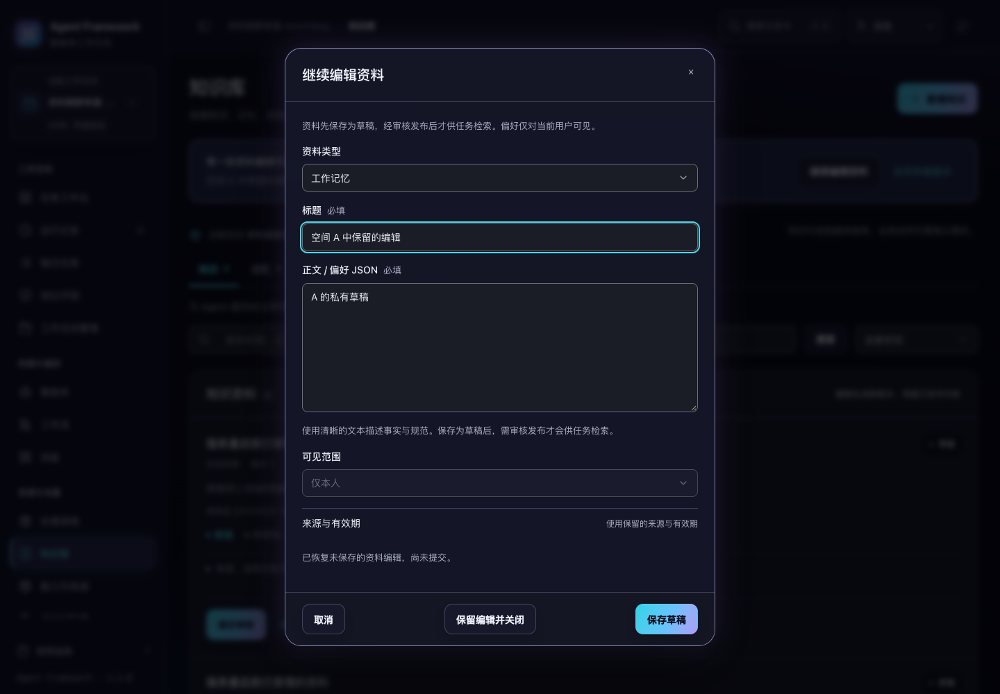

# 资料编辑的刷新与中断恢复

2026-10-31，当前源码。知识、私有偏好、工作记忆和能力方法的未完成编辑，会保留一份当前标签页的恢复副本；刷新后可从知识库继续，待核对的原保存编号和后续输入也会一起保留。

## 使用

输入后短暂等待，编辑窗口显示副本已保留的状态。点击“保留编辑并关闭”可以先关闭窗口，知识库会显示恢复入口；普通取消仍会询问是否放弃当前更改。



刷新页面后，点击“继续编辑资料”恢复原表单。正文或偏好 JSON 尚未写完时也会原样保留，不要求先通过保存校验。

若上次保存结果未知，入口改为“继续核对原保存”。恢复原编号、冻结的原提交内容及本页后续编辑后，需要明确核对或重试；加载恢复副本不会发送保存请求。



原保存已确认时，仍可按 [资料保存回执与原提交恢复](asset-save-recovery.md) 选择继续修订、另存或查看所示版本。确认已保存后清理副本，随后目录读取失败也不会把成功变成失败。

## 副本与实际资料

- 副本使用浏览器当前标签页的 `sessionStorage`，按租户、主体和工作空间隔离。同一标签页可以在不同空间分别保留一份编辑；不会覆盖另一空间的输入。
- 未完成编辑存在时，新建或打开其他资料会引导先恢复或放弃，避免无意覆盖副本。
- 原次提交内容与后续表单输入分开保存。重试只能沿用冻结的原编号和原体，不会把刷新前的新编辑混进原请求。
- 修订会恢复打开时的原版本、来源、适用限制与修订基础；不依赖当前目录是否仍包含该旧版本，也不会把修订变成新建。
- 副本形状、范围、字段长度、版本基础和冻结提交一致性均需校验。损坏、超限或范围不匹配的副本不会被恢复或自动发送；只显示通用处理提示，不展示其中的正文。
- 副本不替代服务端资料和回执。放弃副本需要确认，只移除当前标签页副本，不取消在途保存、不删除已受理资料。
- 当前编辑回到最初状态且没有待核对提交时，清理已经撤销的旧副本；已完成编辑的延迟保存也不会让副本重新出现。

副本在输入后约 200 毫秒写入，并在提交前、页面离开前同步保留。点击保存前先保留原编号与原体，覆盖立即刷新和回复丢失的情况；成功保存、明确采用已存版本或确认放弃时清理。

## 存储不可用时

存储被浏览器阻止、空间不足或副本无法准备时，明确显示“输入仍在本页，刷新后可能丢失”。当前页面仍尽力保留最新内存副本，并允许正常保存到服务。“保留编辑并关闭”无法可靠保留副本时会保持窗口打开。

清理存储失败也不会把已保存资料改报为失败；若恢复入口再次出现，可核对服务中的原保存结果。不会因暂未找到回执而自动认定原保存已取消。

恢复范围为同一浏览器标签页、同一站点地址和相同身份与空间。没有跨设备同步，也不承诺关闭整个标签页、清理浏览器存储或使用隐私模式后仍可恢复；关闭标签页后的保留行为由浏览器决定。来源与发布权限继续由服务端校验。

## 验证

```sh
npm test
.venv/bin/python -m unittest discover -s tests -p 'test_asset*.py' -q
.venv/bin/python scripts/run_browser_tests.py --suite asset-drafts --suite asset-saves --suite asset-writes --suite ontology --suite audit-fixes --suite legacy-modules
```

本轮界面 **255 项通过**，其中新增恢复用例 18 项；资料后端专项 **41 项通过**。资料保存业务实现未变，上一轮完整 757 项回归独立保留，不计为本轮重新执行。

六套浏览器验收通过。新增 7 类流程覆盖未完成 JSON、已受理与未送达的原请求、后续编辑、分空间保留、明确放弃、撤销全部输入及存储失败。恢复入口与“保留编辑并关闭”在 1024/1440 宽度、深浅色和 200% 文字下共 8 组检查通过。

浏览器验收实际停止旧 HTTP 服务、关闭应用对象，再在同一数据目录和端口建立新服务。刷新后原请求编号、原提交和后续输入均恢复；只读核对找到原 v1，用户明确继续保存后才创建 v2，未自动重放。

机器可读结果见 [验证记录](asset-edit-verification-20261031.json)。所有验收只使用临时服务、合成资料和离线运行，未调用真实模型、修改现有业务数据、重新打包或发布。
