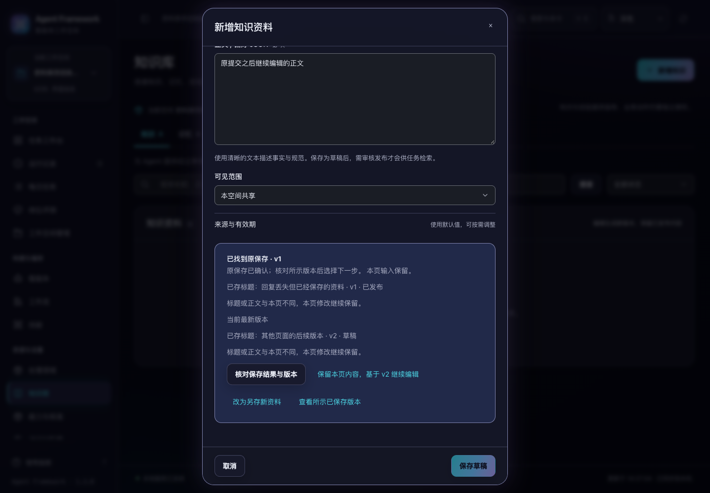

# 资料保存回执与原提交恢复

2026-10-31，当前源码。手工添加知识、偏好、工作记忆、能力方法及修订时，每次页面保存绑定一个固定编号。回复丢失后，核对或重试仍指向原次保存，避免重复创建资料或版本。

后续完善：[资料编辑的刷新与中断恢复](asset-edit-recovery.md)，补充当前标签页恢复副本、保留编辑并关闭，以及刷新后的原请求核对。以下测试数字保留首次回执实现的验收记录。

## 保存结果未知时

页面保留输入并提供“核对保存结果与版本”和“重试原保存”。重试发送原编号与冻结的原内容；提交后继续编辑的内容不会混入原请求，即使新的偏好 JSON 尚未写完，也能确认原先那份有效提交。

尚未找到回执不代表在途保存已停止。页面保留原编号，允许稍后核对或明确重试；不会自动重放。确定未受理的首次格式、权限或范围错误，可以修正输入后重新保存；已经出现未知结果时，后来的错误不会让页面擅自丢弃原编号。



[浅色截图](asset-recovery-light.png)。

## 找到已保存版本后

核对区域展示原保存的版本、该版本当前状态，以及可读取的最新版本。原提交后的编辑继续留在表单中，后续操作需要明确选择：

- **保留本页内容，基于所示版本继续编辑**：采用所示版本作为修订基础，保留表单内容；再次保存才创建后续草稿。其间如有其他新版本，提交仍会冲突，不覆盖别人已保存的版本。
- **改为另存新资料**：保留输入，下一次保存使用新的资料标识与保存编号；不自动创建副本。
- **查看所示已保存版本**：关闭本页并定位资料。存在后续本地修改时，先确认是否放弃，选择继续编辑会保留原输入。

已经核对到保存版本时，底部保存按钮暂停，选择下一步后才恢复。其他页面随后审核、发布或撤回原版本，回执查询会显示其当前状态，不会因此重复保存、重新发布或误报为新草稿。

普通保存成功且输入没有变化时，仍直接显示草稿结果。目录随后刷新失败不会把成功改报为失败；即刻打开下一份资料也会恢复正常的保存按钮。

资料编辑从打开时冻结的原版本建立修订基础。后台目录刷新不会把修订意外变成新建；原资料不在列表时拒绝打开空白修订。已有适用限制继续保留。

## 提交与回执

`POST /api/knowledge/assets` 可附加 `request_id`。编号按租户、项目、环境与主体隔离，并绑定原提交内容；同号不同内容返回 409。相同编号与内容返回原资料版本，不追加索引或审计。

版本、全文索引、创建审计和保存回执共用一个写事务。回执写入失败时全部回滚；多个数据库连接同时重试也只提交一次。回执存入本地数据库，重新建立服务对象后仍可读取。已删除空间继续阻止保存和回执查询，恢复后沿用原回执。

`GET /api/asset-saves/{request_id}` 是只读核对接口，返回原保存版本及 `save_receipt`：编号、引用、版本、内容哈希、受理状态和时间。外层 `status` 是该资料版本当前状态，`save_receipt.status` 是原保存受理时的 `DRAFT`；两者可以不同。原版本的内容哈希必须仍匹配回执。

尚未找到时返回 404 和 `code: "asset_save_not_found"`，不暴露其他主体的回执，即使原资料是空间共享。没有编号的历史调用保持原有行为与返回格式；本次去重保证适用于带编号的保存。

经验归档、本体生成与沉淀继续走各自现有流程；没有改变低层历史归档通道。资料审核、发布和撤回仍需原有明确操作。

## 边界

原页面在保存或核对期间限制重复操作和空间切换；关闭未知保存会说明“关闭不会撤销已受理或在途的保存”。刷新前有输入或待核对提交时，浏览器会提示。

当前已支持从相同标签页的恢复副本找回输入、后续修改和原提交编号，见 [刷新恢复的范围与限制](asset-edit-recovery.md)。服务端回执与已保存资料继续保留；恢复后仍需明确核对或保存，不做自动内容合并，不替用户选择最新版本，也不把暂未找到当作已取消。

## 验证

```sh
.venv/bin/python -m unittest discover -s tests -p test_asset_save_recovery.py -q
.venv/bin/python -m unittest discover -s tests -q
npm test
.venv/bin/python scripts/run_browser_tests.py --suite asset-saves --suite asset-writes --suite ontology --suite audit-fixes --suite legacy-modules
```

完整后端 **757 项**、界面 **237 项**通过；新增 19 项后端用例与 16 项界面用例。覆盖四类资料、并发重试、回执持久化、原子回滚、范围隔离、后续发布、后续版本、本地新编辑与原提交分离，以及连续保存的按钮状态。

上述五套浏览器验收通过。新增验收真实丢弃已提交回复和未送达请求，核对重试体与原编号完全一致；验证本页编辑明确保存为 v3、其他页面已发布的原版本保持已发布、过期修订核对 v4 后才保存 v5，及四类资料正常保存。保存恢复区域在 1024/1440 宽度、深浅色和 200% 文字下共 8 组检查通过。

详见 [机器可读验证记录](asset-save-verification-20261031.json)。全部验证只使用临时服务与合成资料，未调用真实模型、修改现有业务数据、重新打包或发布。
