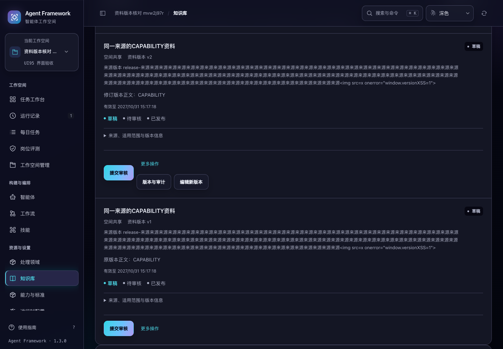
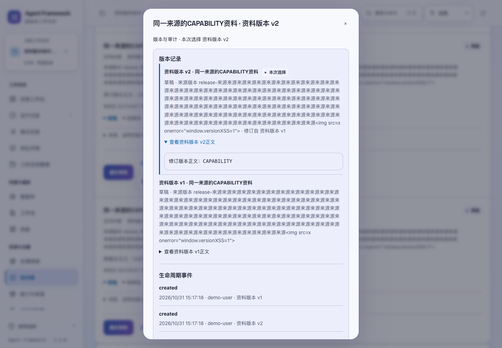

# 资料版本核对与操作结果

2026-10-31，当前源码。资料卡片现在分别显示应用内的「资料版本 v2」和外部「来源版本 1」。修订正文会产生新的资料版本；来源标签只有用户修改时才变化，不能用来判断保存到了哪一版。

## 查看所选版本

知识、私有偏好、工作记忆与能力方法的卡片，以及保存、审核、发布后的提示，都标明实际资料版本。没有有效版本信息时显示「资料版本未记录」，不会拿来源标签代替。



从卡片的「更多操作 → 版本与审计」打开历史，标题和「本次选择」标记对应点击的确切版本。历史按新到旧排列，可分别展开各版正文；私有偏好保留格式化 JSON，便于核对实际值。长来源标签自动换行，用户提供的标记只作为文字显示。



查看历史不提交保存或状态修改。先打开 v1，再打开 v2 时，迟到的 v1 回复不会替换 v2；离开知识库、切换身份或空间、关闭查看窗口后，旧回复也不会突然重开窗口。经验评测记录使用相同的读取保护。

## 审核、评测与发布

服务确认成功后，立即显示此次操作对应的资料版本及结果，再刷新目录。若刷新失败，保留成功结果并提示「该版本操作已完成，列表刷新失败」，用户可以重新读取目录，无需再次提交已完成的操作。

结果提示使用此次成功回复。其他页面随后发布同一版时，当前目录可以显示最新的「已发布」，但不会把本次「已提交审核」的回执改写为另一次操作。切换空间或身份后的迟到结果不在新范围内提示成功。

经验评测返回评测记录，而审核、发布返回资料记录；两种回复分别处理。评测完成后保留资料名称、版本和「已评测」状态，可查看原评测记录，仍需明确点击「审核并发布」才发布。

## 实现与边界

- 审核、撤回、评测和发布请求固定发起时的空间及序列化正文；页面会话过期时，只在服务明确拒绝后刷新会话并重试一次。
- 同一范围、同一资料版本的在途操作会阻止重复点击。
- 历史与评测读取校验请求顺序、身份、空间、路由及窗口状态；关闭意图立即生效，不依赖稍后到达的原生关闭事件。
- 本轮改动是界面行为，服务端权限、状态转换、资料保存回执与标签页编辑恢复继续沿用已有实现。

以上成功提示仅适用于已经收到明确成功回复的操作。本轮没有为审核、发布、撤回或评测新增持久请求编号，也不承诺这些操作在回复丢失后可自动核对或安全重放。草稿保存的原提交核对仍按 [保存回执与恢复](asset-save-recovery.md) 执行，未完成输入按 [刷新与中断恢复](asset-edit-recovery.md) 保留。

## 验证

```sh
npm test
.venv/bin/python -m unittest discover -s tests -p 'test_asset*.py' -q
.venv/bin/python scripts/run_browser_tests.py --suite asset-versions --suite asset-saves --suite asset-drafts --suite ontology --suite audit-fixes --suite legacy-modules
```

界面测试 **273 项通过**，比上一轮新增 18 项；资料后端专项 **41 项通过**。原先的版本显示、读取竞争和结果确认缺陷先由 15 项失败用例复现，随后补充关闭/路由时序 2 项，以及使用真实请求封装的 1 项综合回归。后者覆盖三类写入和会话续期，实际捕获并修复了遗漏请求正文及误用经验评测回复的问题。

六套浏览器验收均已有通过结果；初轮发现的审核请求问题修复后，复验资料版本、本体和完整模块流程，再增加经验评测及发布流程并复验资料版本。最终新增套件包含 8 类流程，以及 1024/1440 宽度、深浅色和 200% 文字共 8 组布局检查，页面运行错误为零。正文可通过键盘聚焦查看，卡片和正文无横向溢出。

本轮未修改后端业务实现，因此没有重复运行此前的完整 757 项测试；此前结果独立保留，未计入本轮测试数。机器可读证据、各次复验路径和源码摘要见 [验证记录](asset-version-verification-20261031.json)。所有浏览器数据均来自临时服务和合成资料，经验评测使用离线模拟运行，未调用真实模型、重新打包或发布。
