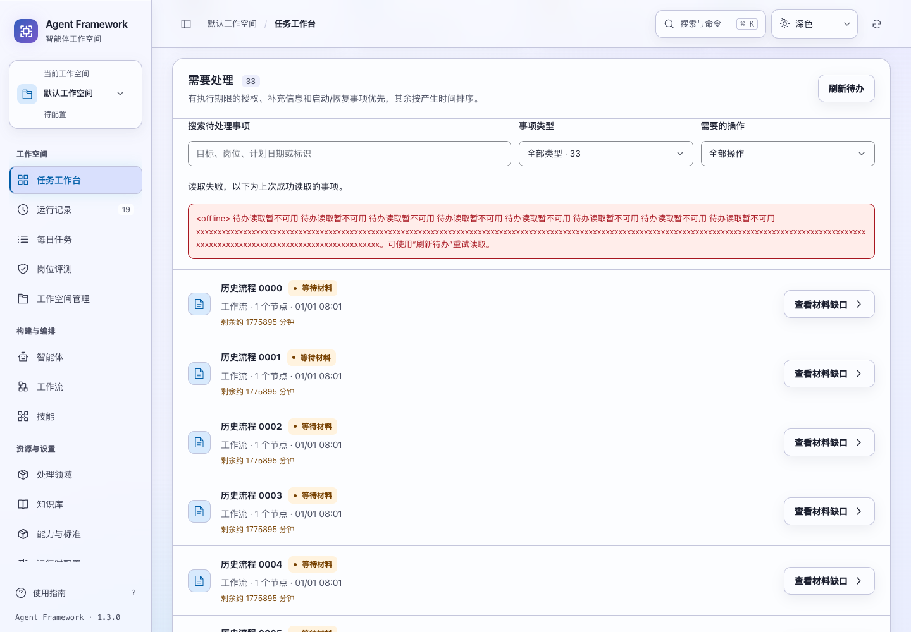
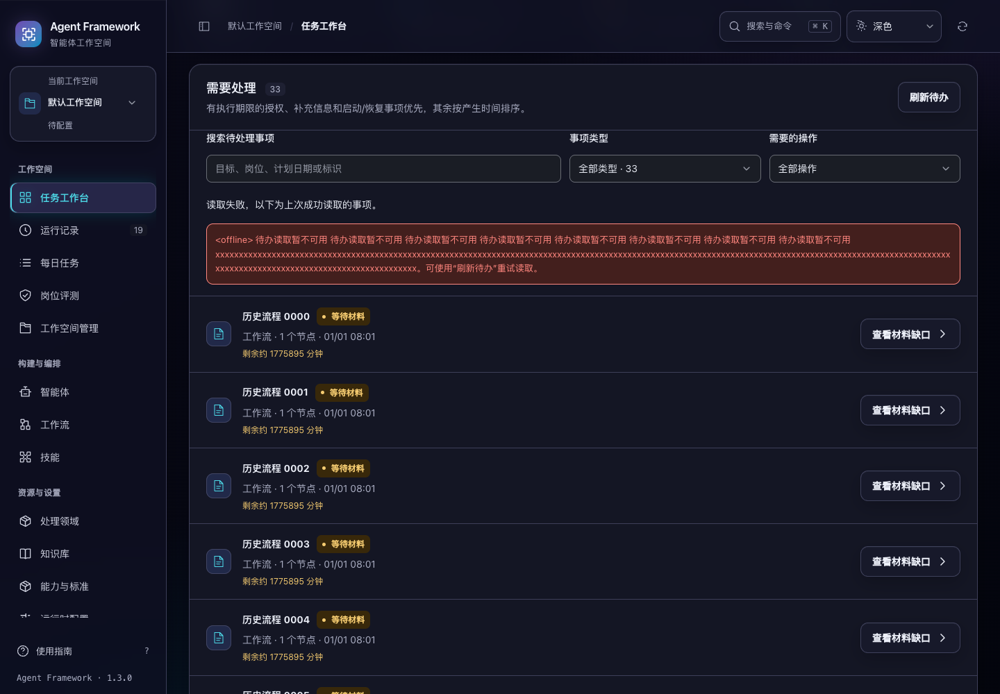

# 工作台完整待办与每日计划定位

2026-10-31，当前源码。工作台“需要处理”区域现在可以浏览全部任务、工作流和每日计划。原界面只显示前 8 项，末尾链接指向普通运行历史；后面的工作流和计划因此难以从工作台找到。

## 完整浏览与处理

- 每次展示最多 8 项，提供上一页、下一页与返回开头，显示当前范围、匹配数量和待处理总数。
- 可按任务、工作流、每日计划筛选，并组合所需操作与关键词。搜索覆盖目标、岗位、标识、业务对象、计划日期以及计划内任务目标。
- 三类事项统一排序：有执行期限的授权、补充信息、启动和恢复事项优先；其他事项按产生时间排列，相同位置使用事项标识确定顺序。
- 任务与工作流进入对应详情；每日计划进入对应计划的位置，并通过键盘焦点和滚动明确定位。
- 详情返回保留当前类型、操作、关键词和浏览位置。后台读取期间仍可筛选、翻页与打开已显示的事项。
- 后续页更新时，尽量保持第一项仍存在的可见事项在当前位置；已解决事项移除后会调整范围，避免停留在空白尾页。结果不是冻结快照，新状态与新事项会继续反映在列表中。

筛选和翻页在当前已读取的完整集合中进行，不会执行任务或生成新的运行。后台仍读取原有完整待办接口，本轮没有将后端改为分页接口，也未缩小待办范围。

## 读取恢复与范围隔离

待办读取与任务草稿读取分别处理。首次读取失败时明确说明尚不能确认是否有待办；刷新失败时保留并标注上次成功结果和原详情入口。用户可使用“刷新待办”重试，后台不会对同一错误持续发起重试。

响应核对租户、空间、主体、路由和请求顺序。切换范围后清空原搜索、类型、操作和结果；迟到响应不能把旧待办写入新页面。筛选状态只保留在当前浏览器内，不会跨完整页面重载恢复。

工作流使用有效显示状态，包括派发受阻状态，不再只显示底层运行状态。

## 每日计划直达链接

新增 `#/daily/:plan-id` 路由。概览已经包含所选计划时直接定位；计划不在最近 60 条概览内时，使用 `GET /api/daily-plans/:id` 单独读取，并附在当前列表中。刷新直达链接仍可查看原计划。

读取按租户、工作空间和主体隔离，附加关联任务的当前状态，不改写计划记录。所选计划不可用时，保留近期计划并显示错误、重试和返回近期计划的入口。失败后重试成功会将焦点移到恢复的计划，随后后台刷新不会重复拉动滚动位置。

## 验证

新增 22 项界面回归，包括完整遍历、组合筛选、位置保持、过期响应、范围隔离、错误恢复及每日计划读取与定位；完整界面测试 **460 项**通过。新增 2 项计划详情回归，相关历史、工作流、每日计划和 HTTP 测试共 **69 项**通过。

专项浏览器使用 19 项任务、13 项工作流和 1 项历史派发失败计划，共 33 项待办，验证完整遍历、类型和操作组合筛选、慢请求、工作流详情往返、每日计划定位、超过 60 条后的计划读取、失效链接恢复和空间隔离。专项 9 项流程检查通过，浏览与恢复零写入、零页面异常。

待办、每日派发恢复、任务动线、设置保存和全站控件五套浏览器验收通过。专项验证 1024 / 1440 宽度、明暗主题、正常与 200% 字号，共 8 组桌面布局，键盘焦点可见且无页面横向溢出。所有数据、长错误和执行期限均为临时测试夹具；没有调用外部模型。





完整路径与源码摘要见 [验证记录](attention-inbox-verification-20261031.json)。

```sh
npm test
PYTHONPATH=tests .venv/bin/python -m unittest test_workspace_operations test_workflow_catalog test_run_catalog test_web
.venv/bin/python scripts/run_browser_tests.py --suite attention --suite daily-recovery --suite journeys --suite operation-settings --suite control-routes
```

本轮只更新当前源码，没有重新打包或发布。
