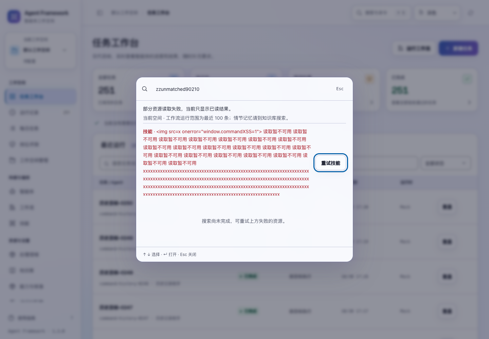
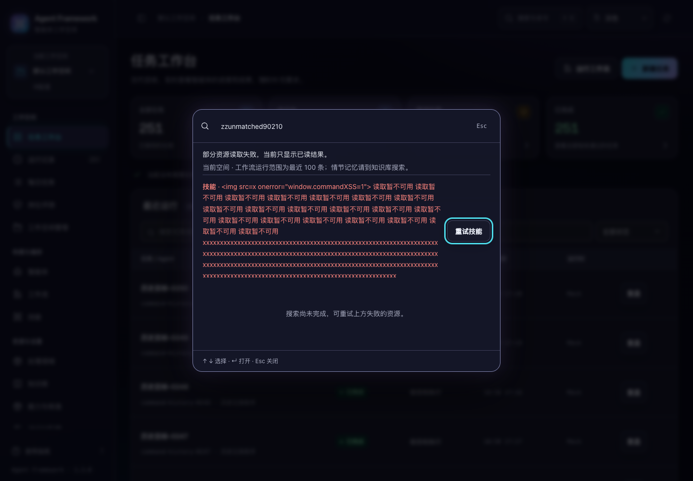

# 全局搜索的读取反馈与结果定位

2026-10-31，当前源码。顶部“搜索与命令”及 `⌘K / Ctrl+K` 现在独立展示各类资源的读取状态，支持失败重试、结果翻页和准确定位。

## 搜索与恢复

- 打开后立即显示读取状态。任务运行、智能体、工作流、技能、知识与资料分别读取；已经成功的结果可先使用，一类失败不会遮住其他资源。
- 失败原因留在面板内，并提供该类资源的重试按钮。重试保留输入，连续点击不会重复派发。仍有失败的资源时，不会把不完整搜索说成“没有匹配”。
- 新关键词立即移除旧查询的运行和资料结果，再读取新匹配。较早查询的迟到成功或失败，不会覆盖新查询，也不会在页面外弹出过期错误。
- 同一空间内关闭后重新打开，保留关键词，并在结果重新读到后恢复仍可用的选中对象及结果页。刷新应用后重新开始；搜索上下文不写入持久存储。
- 资源按类型分组，查询结果每组页面最多 12 项，可用“上一组 / 下一组”浏览全部已读匹配。新结果到达时按对象标识保留选择，避免回车打开另一条记录。
- 中文输入过程中不误提交；重试成功后，若焦点仍在重试按钮上，回到搜索输入。关闭面板可回到原入口，导航或其他弹窗已经接管时不会抢焦点。

## 打开结果

任务与智能体进入对应详情；技能进入只读包内容；资料定位到对应卡片。工作流定义会定位并展开该流程的节点与路由，保持查看状态，不直接开启编辑器或运行工作流。被删除的流程定义会提示重新搜索或查看目录。

知识与资料继续采用服务端已有的正文与语义匹配规则。即使关键词不在标题中，合法命中也会保留；不会再次用标题筛选丢弃它。资料版本显示实际修订版本。“新建任务”使用通用任务入口，不再将新任务描述为固定的评估流程。

## 当前范围

只搜索当前空间可访问的记录。请求固定使用打开时的空间；切换空间、租户、主体或离开页面后，旧回复失效，也不能再激活旧结果。

运行搜索覆盖完整可访问历史，面板读取前 50 项；超过时提供“查看全部匹配运行”，带上关键词进入可翻页的运行列表，并清除原列表的其他筛选条件。智能体、流程定义、技能和资料在当前目录中匹配。

后续的[流程完整历史优化](workflow-history.md)已解除工作流运行最近 100 条的限制：面板查询完整历史的前 50 个匹配，超出时可进入保留关键词的完整流程列表。情节记忆继续在知识库的记忆页搜索和翻页。本轮也没有新增搜索索引、修改权限、运行模型或提交资源写入。

## 实现与复验

搜索状态从主界面脚本分离到 `commands.js`。每次打开拥有独立会话，每类来源保存自己的请求编号、读取状态和失败原因。运行与资料查询改变时使旧请求编号失效；关闭或范围变化则使整个会话失效。静态脚本通过本地服务的显式资源映射加载。

新增 **24 项搜索交互测试**，修复前首批 19 项中 18 项失败。最终全部 **359 项界面测试**、**809 项后端测试**通过；搜索专项、跨页面控件、详情读取和跨模块流程四套浏览器验收通过。

搜索浏览器场景使用 31 个目标智能体、251 条合成历史运行、两处空间及实际资料、技能和流程定义，覆盖逐类失败恢复、慢回复、原选择恢复、正文命中、准确定位、历史入口、空间隔离和中文输入。新场景没有提交任何写入，也没有调用外部模型。1024 / 1440 宽度、深浅主题、正常与 200% 文字共 8 组布局检查通过。





截图使用故意构造的长错误文本，检验安全转义、换行和重试按钮焦点。完整结果、测试修正及源码摘要见 [验证记录](command-search-verification-20261031.json)。

```sh
npm test
.venv/bin/python -m unittest discover -s tests -q
.venv/bin/python scripts/run_browser_tests.py --suite commands --suite control-routes --suite reading-interactions --suite journeys
```

改动尚未重新打包或发布。
