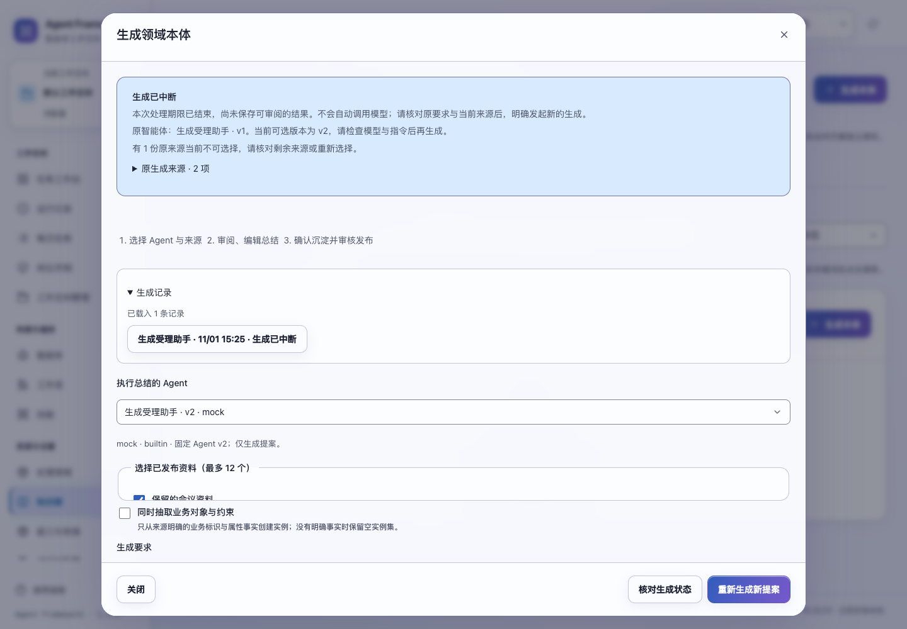
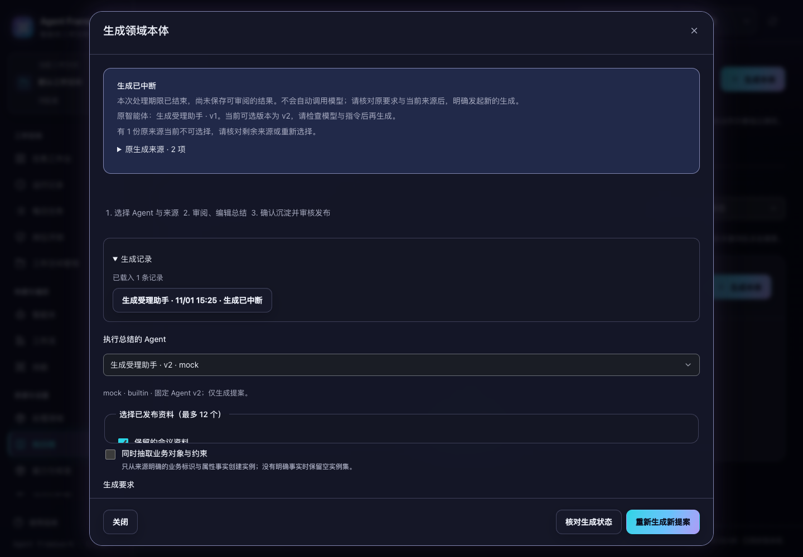

# 复盘与本体生成中断后的恢复

2026-11-01，当前源码已验证，版本保持 1.3.0，未重新打包发布。

服务退出后，已受理但没有保存结果的复盘或本体生成不再一直显示为处理中。处理期限结束后，历史、详情和原请求核对统一显示“生成已中断”。打开记录会恢复原要求和建模方式，提示智能体版本变化及当前不可用的来源，用户可以核对后明确生成一份新提案。

## 处理期限与结果保护

新版本受理的生成保存私有处理者标识和 **240 秒**处理期限，与原请求记录一起提交。现有模型与 Skill 共享预算不超过 180 秒，剩余时间用于完成处理和保存。

- 期限内，未完成记录显示 `GENERATING`；期限结束后只读投影为 `INTERRUPTED`。查询不改写记录，不调用模型。
- 服务重启本身不立即证明生成已经中断。期限尚未结束时仍显示处理中；下一次查询在期限结束后显示中断。
- 成功和失败结果写入前均核对原处理者、期限、`GENERATING` 状态及初始修订号。失效处理者的迟到回复返回冲突，不能覆盖原记录。
- 同一原请求编号始终返回该请求的当前状态。中断后明确重新生成使用新编号，保留旧中断记录；没有自动重放或自动接管。
- 已完成的 `DRAFT`、`FAILED`、`DEPOSITED` 等记录不会因为处理期限过去而失效。已受理生成仍沿用原有配置、来源快照及后续审阅校验规则。

无需新增数据表。旧版未完成记录没有处理者信息时，以创建时间加 240 秒推导展示期限。结果写入保护适用于运行这份新代码的处理者；它不能阻止仍在独立运行的旧版程序写入。

## 页面恢复

刷新后，可从持久化生成历史重新打开原记录，或通过已有原请求核对入口读取。未完成记录恢复原生成要求、原来源选择和业务对象抽取开关，真实模型许可恢复为未勾选。

原智能体仍可用时，页面选择同一智能体的当前版本，并明确提示原版本与当前版本的差异。原智能体不可用时保持未选择。已撤回等不可用来源不会悄悄替换成其他资料；页面展示数量提示，并保留可展开的原来源引用供核对。新的生成使用页面上确认的当前版本和有效来源，仍执行服务端受理校验。

正在生成、中断和失败都有可读状态说明。读取失败保留输入，采用已保存内容前仍沿用既有替换确认，迟到读取仍受窗口与空间归属保护。本次没有增加未送达请求的浏览器持久化，也没有改变首次生成等待期间的关闭规则。

## 备份边界

存在期限内的复盘或本体生成时，核心备份拒绝继续并提示等待。已过期的未完成记录可以备份；恢复时清除副本中的处理者和期限，使其显示中断，原数据库和已完成结果保持不变。私有身份与工作空间可见性不变。

## 验证

新增 8 项后端测试覆盖中断、只读投影、跨实例读取、迟到成功与失败、旧数据兼容、明确新生成、备份恢复和身份隔离。新增 5 项前端测试覆盖输入恢复、提示转义、版本与来源变化、许可重置和历史标签。

```sh
PYTHONPATH=tests .venv/bin/python -m unittest \
  tests.test_learning_generation tests.test_learning tests.test_learning_catalog \
  tests.test_learning_acceptance tests.test_backups tests.test_proposal_responsiveness \
  tests.test_ontology_regressions tests.test_ontology_evidence tests.test_web
npm test
.venv/bin/python scripts/run_browser_tests.py \
  --suite learning-generation --suite learning-reads \
  --suite learning-catalog --suite proposal-capacity \
  --output /private/tmp/af-learning-generation-browser-20261101
```

**139 项后端、617 项前端测试及 4 个浏览器套件全部通过。** 浏览器夹具创建已过期的受理记录，修改智能体版本、撤回一份来源，再实际关闭并重新打开服务应用。读取和刷新阶段模型调用为零；用户明确重新生成后调用一次，产生新提案且保留原中断记录。

1024、1280、1440、1920px 四种宽度与明暗主题共 8 种布局通过无横向溢出和新生成按钮可点击检查。已人工查看两张 1440px 截图。测试使用临时数据和离线生成，没有调用外部模型或发布安装包。

源码摘要和验收详情见 [learning-generation-verification-20261101.json](learning-generation-verification-20261101.json)。




