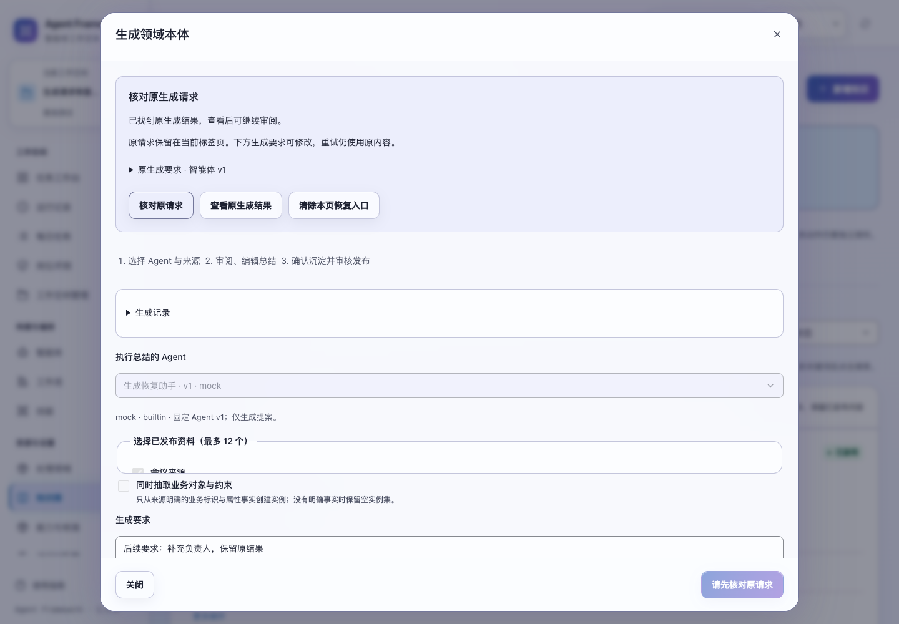
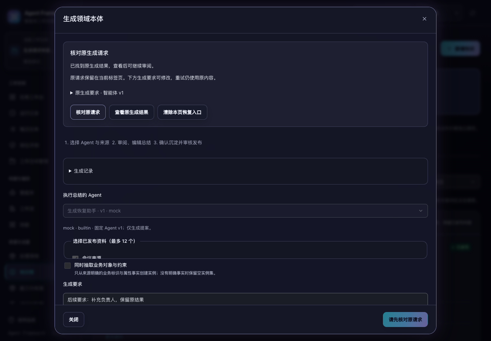

# 复盘与本体生成请求的刷新恢复

2026-11-01，当前源码已验证，版本保持 1.3.0，未重新打包发布。

复盘和本体生成现在可以在等待时关闭窗口。原请求在发送前保留到当前标签页，刷新后可从知识库或运行列表继续核对。后来填写的要求单独保留，不会改变已经发送的内容，也不会因为刷新或再次点击而自动生成另一份提案。

## 从等待到恢复

1. 点击生成时保存原编号、智能体及版本、要求、许可、运行或资料引用、本体抽取开关。等待期间锁定原配置，要求框可记录后续想法，关闭窗口不取消服务器生成。
2. 重新打开或刷新后展示“核对原生成请求”。原记录仍在处理时，只读核对后继续等待；成功时明确点击“查看原生成结果”进入审阅。
3. 服务明确返回 `learning_request_not_found` 时，提供“使用原内容重试”。重试保持原编号和完整请求，后续要求不混入。服务端仍检查配置、来源和权限；已受理的同编号返回原记录。
4. 中断或失败时，可查看原记录后修复或重新准备。沿用已有中断期限保护，不自动重试过期生成。
5. 原结果采用后，后续要求保留为未发送文本；从“返回生成设置”继续填写。新生成使用页面上核对过的当前配置，模型许可重新确认。

正常收到首次生成结果时仍直接进入审阅。恢复入口中的主动核对不会替用户采用结果。采用和再次核对中断记录均保留后来填写的要求；读取或响应校验失败也不会清除原请求。

## 身份、窗口和存储边界

恢复记录按租户、本人、工作空间、生成类型及复盘运行区分，保存在 `sessionStorage`；不会将一个运行的请求带到另一个运行或工作空间。请求只保存生成参数和用户要求，不保存来源正文或登录凭据。当前标签页关闭后的恢复取决于浏览器会话存储行为；已受理记录仍可从服务端生成历史查找。

发送与查询使用捕获的工作空间。回复还需匹配原请求编号、类型和完整请求的 SHA-256 摘要；窗口会话、页面路由或身份变化后，迟到回复不能覆盖新窗口。生成等待时离开页面会关闭窗口并保留恢复入口。现有审阅写入仍沿用原来的等待和未保存修改确认。

配置目录、来源或历史暂时读不到时，已有未确认请求仍可核对。通用 404、权限错误、网络失败和不匹配的回复都不会开放原请求重试。

浏览器存储不可写时，保留同页内存副本并明确提示刷新恢复可能不可用。损坏记录不变成请求，另一份恢复记录也不会被旧窗口覆盖或清除。用户可明确清除本页入口；确认文案说明这不停止原生成，已受理结果仍在历史中，再次生成可能产生另一份提案。

## 验证

新增 **18 项交互测试**覆盖发送前持久化、重复提交阻止、刷新与关闭、迟到回复、同编号重试、后续要求、摘要不匹配、身份与空间隔离、存储失败与冲突、损坏记录、生成中状态、许可重置、明确清除及来源读取失败。既有请求核对 HTTP 测试增加专用未找到错误码断言。

```sh
npm test
PYTHONPATH=tests .venv/bin/python -m unittest \
  tests.test_learning_generation tests.test_learning tests.test_learning_catalog \
  tests.test_learning_acceptance tests.test_backups tests.test_proposal_responsiveness \
  tests.test_ontology_regressions tests.test_ontology_evidence tests.test_web
.venv/bin/python scripts/run_browser_tests.py \
  --suite learning-requests --suite learning-generation --suite learning-reads \
  --suite learning-catalog --suite proposal-capacity --suite audit-fixes \
  --output /private/tmp/af-learning-requests-browser-final-20261101
```

**635 项前端、139 项后端测试及 6 个浏览器套件全部通过。** 新浏览器套件暂停实际离线生成，关闭并刷新页面，在模型仍暂停时查询 `GENERATING`，确认没有增加调用。释放后恢复同一结果；另一次请求在发送前被拦截，明确原内容重试后只产生一份新提案。最后验证复盘保存后的迟到回复不能覆盖新窗口，切换路由后仍可继续核对。

最终共 3 次离线生成调用、3 份提案、0 个遗留调用。1024、1280、1440、1920px 与明暗主题共 8 种布局通过恢复按钮可见、可点击及无横向溢出检查；两张 1440px 截图已查看。所有验收只使用临时数据，没有调用外部模型。

验收详情和源码摘要见 [learning-request-verification-20261101.json](learning-request-verification-20261101.json)。处理期限与备份规则见 [生成中断后的恢复](learning-generation-recovery.md)。




