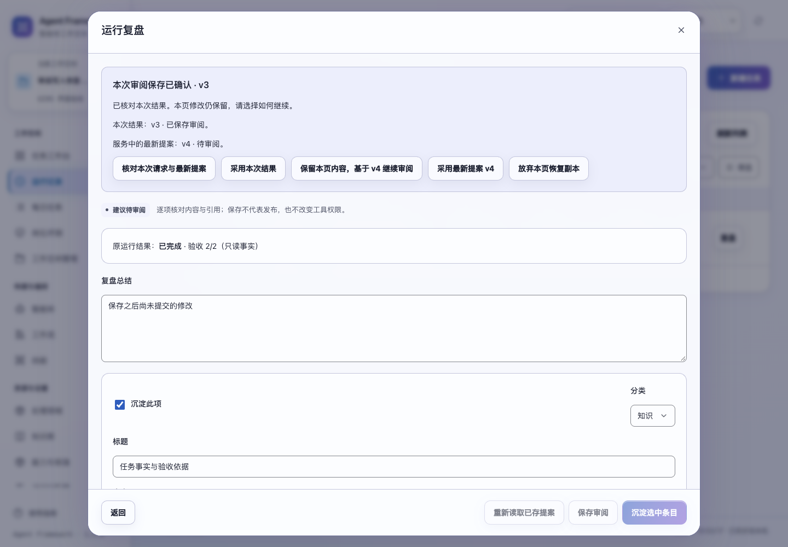
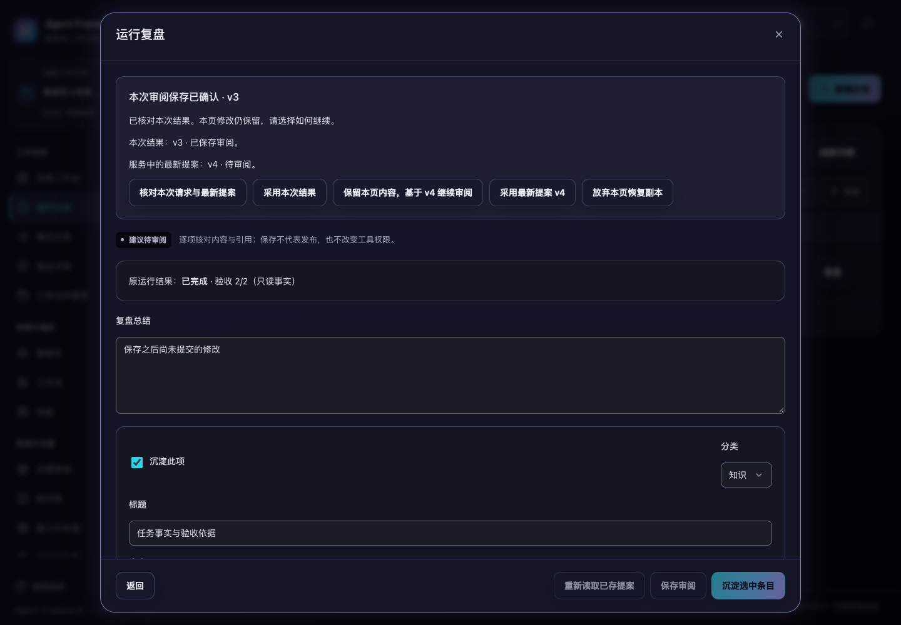

# 审阅保存与沉淀的回执恢复

2026-11-06 界面补充：[复盘与本体窗口的读取和返回体验](../ui-learning-navigation-20261106.md)。初始读取失败可原位重试，历史等待和关闭返回尊重当前焦点，重绘保留长文本选区与阅读位置。读取仍冻结可能被替换的字段及写入操作；本文件的回执与恢复协议继续适用，原有写入浏览器回归已重新通过。

2026-11-02，当前源码已验证，版本保持 1.3.0，未重新打包发布。

复盘建议和本体生成提案现在可以准确核对自己的审阅保存及沉淀。回复丢失后，页面分别展示本次请求接受的结果和服务中的最新提案；另一页面的保存或沉淀不会成为本次成功的证明。本页后续内容及勾选独立保留，关闭或刷新后可从原运行的复盘窗口、本体生成窗口继续。

## 提交与核对

审阅保存和沉淀接口接受可选 `request_id`。请求摘要绑定操作、提案编号、原版本及完整内容或所选条目；沉淀选项按编号排序。相同请求重试返回原始接受快照，后来的保存、沉淀和来源撤回不会改写该回执。改变内容、版本、提案或操作后复用编号会发生冲突。

新增 `learning_write_requests`，按租户、工作空间、本人和请求编号隔离。审阅更新与回执在同一事务提交；沉淀资产、检索索引、审计、提案状态与回执也一起提交。回执保存失败会整体回滚，不产生孤立资产。快照摘要用于检查回执完整性。

`GET /api/learning-writes/{request_id}?proposal_id={原提案编号}` 在同一个只读快照中返回：

- `state`：`COMPLETE` 或 `MISSING`；
- `saved`：本次请求接受时的确切提案与 `write_receipt`，不存在时为空；
- `latest`：同一提案现在的状态与内容。

读取与重试均先检查空间和提案访问范围。空间删除后禁止核对及重试，恢复原空间后才可继续。无编号的旧调用仍保留既有保存和沉淀行为；新的带编号沉淀只能由原回执证明成功，不会为另一请求完成的沉淀补造成功回执。

回执包含接受时的状态。比如自己的保存为 v3、其他页面后来沉淀为 v5，则 `saved` 仍是 v3 的审阅草稿，`latest` 是 v5 的沉淀结果。资产后续的审核、发布或撤回应从资产入口查看。

## 页面行为

发送前记录原请求编号、版本、内容或勾选。先保存审阅再沉淀使用两个不同编号；只有保存明确完成后才继续沉淀。保存回复不明时停止这条提交链，核对成功不会自动补发沉淀。

- 核对只展示结果，不替换本页输入。编号、操作、提案、版本及请求内容必须匹配；沉淀还核对所选条目及资产数量。
- 只有明确读到 `MISSING` 才提供原请求重试。重试使用原始版本、内容和勾选，后续输入不会混入。
- 可以采用本次结果或最新提案；替换未保存内容、进入沉淀结果前需确认。
- 最新提案仍可编辑时，可以明确保留本页内容并基于该版本继续审阅。再次保存产生新编号，不自动合并其他页面内容。
- 最新提案已经沉淀时，本页修改仍保留，不能把已沉淀提案当作可修改草稿继续提交。采用结果前明确确认。
- 勾选随保存和重新打开保留；采用不同内容时，只保留该版本实际存在的条目编号。

恢复副本使用当前标签页的 `sessionStorage`，按租户、本人、空间、用途、运行和提案隔离。恢复本身不会发起写入，也不调用模型。副本上限为 2,000,000 个字符；超过上限、浏览器存储失败、损坏数据及副本冲突会明确提示。内存保留可用内容，普通关闭在无法保存副本时被阻止。关闭整个标签页后不保证恢复未提交内容。

慢核对可以关闭，重新打开仍保留编辑；普通读取取消后释放忙碌状态。窗口、路由、空间或身份变化后，迟到结果不会进入新窗口。放弃恢复副本需确认，并说明这不会取消在途写入或删除服务中的提案和资产。

## 验证

新增 11 项后端测试、18 项交互测试和 `learning-writes` 浏览器套件。覆盖并发重复请求、其他页面的保存与沉淀、事务回滚、来源撤回、重启、备份恢复、只读快照、空间及身份隔离、精确重试、编辑与勾选恢复、存储故障和迟到回复。

后端 118 项、前端 669 项测试通过。五个浏览器套件通过：`learning-writes`、`learning-reads`、`learning-requests`、`ontology-saves`、`audit-fixes`。浏览器验收使用临时空间和离线 Agent，没有调用外部模型。

新浏览器用例中，本页审阅 v3 的回复丢失，另一页面保存 v4；刷新后同时展示这两个版本并保留后续编辑及单项勾选。明确继续审阅后保存新版本；一次未送达沉淀按原请求重试，只生成原先勾选的 1 个资产。整个页面发起 4 次写请求，包含 1 次未送达请求。服务已沉淀后，仍能恢复本页未提交修改，再明确采用唯一回执。

明暗主题与 1024、1280、1440、1920px 共 8 种布局均无横向溢出，恢复按钮可见且可点击。截图、执行日志路径、精确命令和源码摘要见 [验收清单](learning-write-verification-20261102.json)。旧审阅读取套件已更新为检查弹窗内提示，并验证关闭、重开后保留草稿；测试的延迟请求只拦截一次，避免提前移除拦截导致重复处理同一请求。

