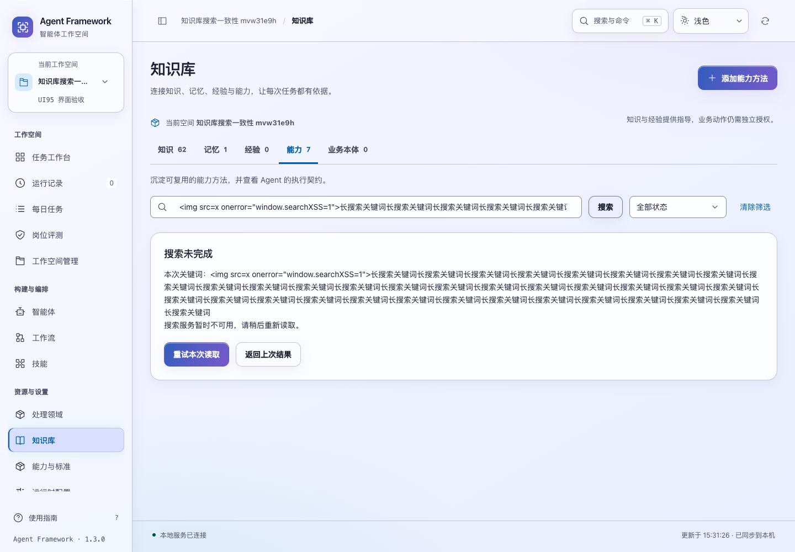
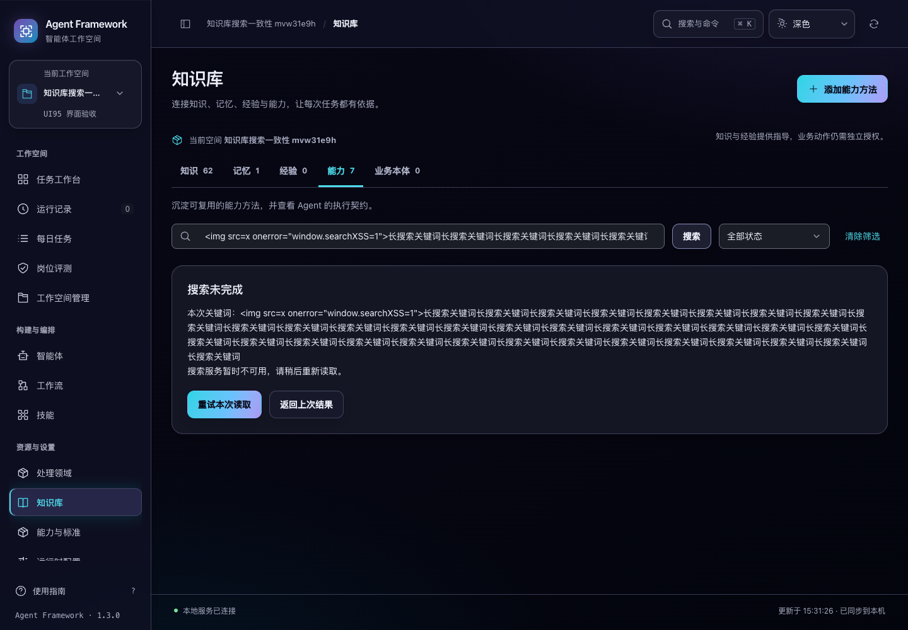

# 知识库搜索状态与失败恢复

2026-10-31，当前源码。知识库搜索现在区分输入中的关键词、正在读取的查询和上次成功结果，避免新搜索失败后继续把旧资料显示为新结果。

## 使用

提交搜索后，结果区显示正在读取的关键词，暂时隐藏旧卡片。结果返回后，下方明确标注这批资料对应的关键词；输入新文字但尚未搜索时，现有结果仍标明原关键词。

读取失败会保留关键词，提供「重试本次读取」和「返回上次结果」。重试使用失败请求的原关键词；期间输入的新文字继续保留，不会混入重试。返回上次结果直接恢复当前页面已成功读取的资料及其关键词，不需要等待新请求。



等待期间可以提交另一组关键词。较早请求的成功或失败都不能覆盖更新的结果，也不会再弹出过期错误。离开知识库后，旧搜索不会重绘新页面或显示旧错误。

清除关键词后，状态筛选仍按当前选择保留；点击「清除筛选」同时清除关键词和状态。搜索没有匹配项时，工作记忆与能力方法分别显示「没有匹配的…」，不会误报为尚未创建任何资料。

## 焦点与文字显示

提交搜索时，焦点留在搜索输入框，便于修改关键词。读取期间如果已经移到状态筛选或其他控件，回复到达不会强行拉回搜索框。

共用选择框在页面重绘时，先按原生字段恢复焦点，再交回可见的选择框按钮，避免控件重建后焦点落到页面正文。长关键词和错误文字正常换行；包含 HTML 标记的关键词只显示为文字。



## 请求与数据范围

- 查询固定发起时的工作空间；结果和错误只有在请求顺序、关键词、租户、主体与空间仍匹配时才应用。
- 同一关键词仍在读取时，重复提交不重复派发请求。定时刷新复用相同的在途读取；保存、审核等写入之后的读取仍会发起新请求，避免复用写入前的旧快照。
- 「返回上次结果」会使已放弃的在途查询失效。缓存只属于当前页面及原身份、空间，不能恢复另一身份的数据。
- 搜索、重试、清除和返回均只读取资料，不提交保存、审核或发布。

上次结果是页面内的旧快照，不能保证一直反映其他页面的最新修改；正常刷新仍会重新读取。本轮没有改变服务端搜索匹配规则、权限、数量上限或分页方式，也没有新增跨刷新保存搜索结果的能力。

## 验证

```sh
npm test
.venv/bin/python scripts/run_browser_tests.py --suite library-search --suite asset-versions --suite asset-saves --suite asset-drafts --suite legacy-modules --suite controls --suite control-routes
```

界面测试 **290 项通过**，比上一轮新增 17 项。最初的专项回归复现了 12 项失败，另补充清除筛选的并发边界、身份隔离、定时刷新复用与写后读取保护。真实浏览器进一步捕获并修复了共用选择框重建导致的焦点丢失。

七套相关浏览器验收均已有通过结果。新增套件在 64 条合成资料（其中 62 条知识资料）上验证 8 类流程，覆盖失败重试、保留后续输入、旧回复、返回快照、页面切换、无匹配提示以及不产生写入。1024/1440 宽度、深浅色和 200% 文字共 8 组检查通过；单段 2000 字符关键词的结果说明没有横向溢出。

本轮仅修改界面和测试，未重复运行后端测试；上一轮资料专项 41 项和此前完整 757 项的结果独立保留，不计为本轮执行。各次验收路径、最终截图、源码摘要和边界见 [验证记录](library-search-verification-20261031.json)。所有数据来自临时服务，没有调用真实模型、修改既有业务数据、重新打包或发布。
