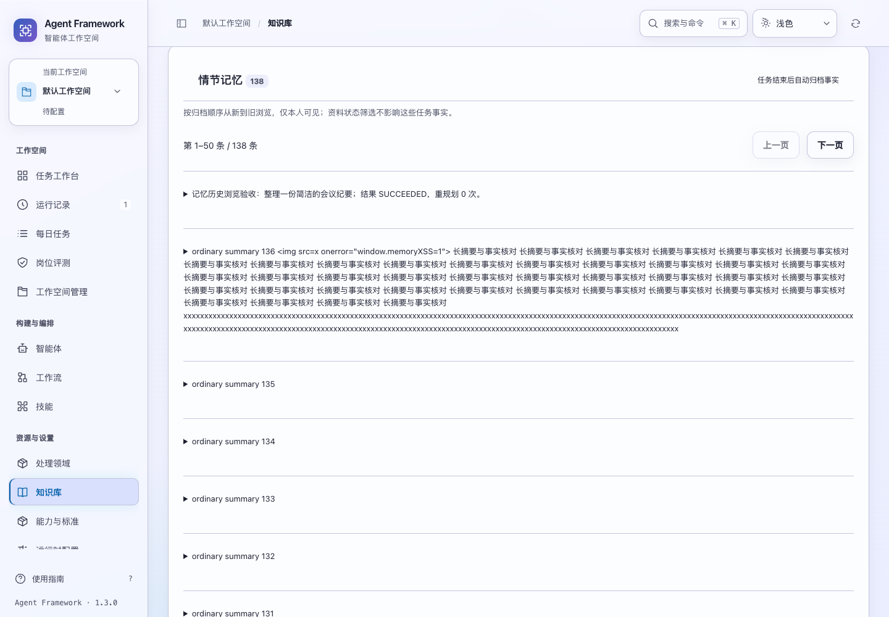
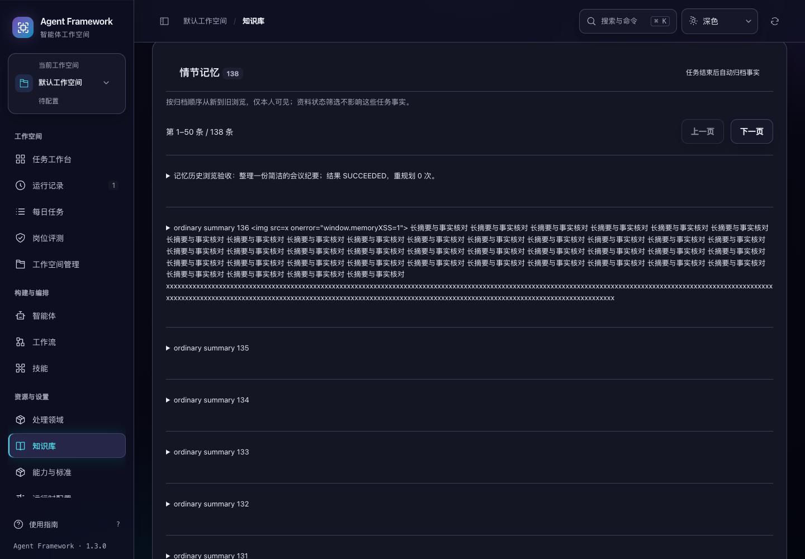

# 情节记忆历史浏览

2026-10-31，当前源码。知识库 → 记忆现在可以浏览超过 50 条的情节记忆，按归档顺序从新到旧翻页，保留当前页和搜索条件。

## 使用体验

- 每页最多 50 条，显示当前范围与匹配总数，支持上一页、下一页。关键词继续按摘要匹配，可找到较早的记录。
- 浏览期间有新任务归档，会显示新记录数量。自动同步保留当前浏览位置；点击“从最新记录开始”后再纳入新记录。新记录提示统计当前私有范围的所有新归档，不限于当前关键词。
- 翻页失败时显示失败原因，可重试原目标页、返回上次成功页，或从最新记录恢复。尚未提交的新搜索输入会保留。
- 改变搜索条件会从第一页开始；旧翻页回复不会覆盖新搜索。切换空间后重新建立浏览位置，记忆仍仅本人可见。
- 每条记录保留原始任务与证据入口。工作记忆、偏好等资料的状态筛选不影响情节记忆，界面明确说明这一点。





截图使用隔离的合成记录，包含长摘要和转义文本检查。

## 接口兼容

| 调用 | 行为 |
| --- | --- |
| `GET /api/memory` | 保留原形状和默认最近 12 条 |
| `GET /api/memory?view=page&limit=50` | 返回第一分页及计数 |
| `GET /api/memory?view=page&limit=50&cursor=…` | 在原浏览范围内继续读取 |
| `GET /api/knowledge-hub` | 保留原形状与最多 50 条的旧计数语义 |
| `GET /api/knowledge-hub?memory_page=1&query=…` | 界面使用的分页模式；记忆放在原 `memory.episodes`，分页信息在 `memory.episode_page` |

知识库分页模式支持 `memory_cursor` 和 `memory_limit`。单独的记忆分页接口使用 `cursor` 和 `limit`。每页大小为 1–50，查询最多 2000 字；重复参数、无效位置、大小或模式返回 400。分页位置不能混用于不同主体、项目、环境、租户、关键词或每页大小。

分页信息包含：

- `total`：本次浏览范围内的全部私有记忆数量。
- `filtered_total`：其中匹配摘要关键词的数量。
- `offset`：当前页之前的匹配条数。
- `newer_count`：浏览开始后新增的私有记忆数量。
- `cursor`、`next_cursor`、`has_more`：当前页、下一页位置及是否仍有下一页。

知识库分页模式的 `counts.episodes` 为 `total + newer_count`，不再受 50 条上限影响。其他资料、能力、经验和本体的内容与规则继续沿用原接口。

## 一致性与读取成本

首次读取保存当时最大的归档插入序号。后续页面只在这一上界内按序号向前读取，新记录另行计数；返回上一页和自动刷新复用同一上界。分页位置只用于定位，权限始终由服务端的租户、项目、环境和主体条件决定。

每次请求的计数、摘要匹配及正文读取共用一个数据库读取快照。仅对选中的最多 50 条记录解码完整正文；有关键词时仍需扫描当前范围内的摘要，以计算准确的总数和当前位置。这不是全文索引，也不承诺检索耗时不随历史量增长。

浏览上界固定记录集合的新增边界，并不冻结多次请求之间的正文修改。分页历史只保留在当前页面内，重新载入应用会从最新记录开始；它不是长期保存的书签。其他类型的资料仍沿用现有列表。

## 验证

新增 12 项后端专项测试和 9 项界面交互测试，覆盖完整翻页、搜索计数、并发归档、正文解码范围、私有范围、读取快照、参数校验及旧接口兼容。首次后端基线复现缺少分页接口，最终专项测试全部通过。

真实浏览器使用 137 条合成记忆，完整读取 50 / 50 / 37 条；通过普通任务入口运行离线助手，再验证第 138 条记录的提示、主动查看和原任务跳转。另验证翻页失败恢复、迟到回复、空间隔离，以及 1024 / 1440 宽度、深浅主题和 200% 文字的 8 组布局。

完整后端 **783 项**、界面交互 **299 项**通过。记忆分页、知识库搜索、资料版本和历史模块四套浏览器验收全部通过，完整记录与源码摘要见 [验证记录](memory-history-verification-20261031.json)。

```sh
.venv/bin/python -m unittest discover -s tests -q
npm test
.venv/bin/python scripts/run_browser_tests.py --suite memory-catalog --suite library-search --suite asset-versions --suite legacy-modules
```

本轮验证使用临时数据库和离线任务。改动尚未重新打包或发布。
