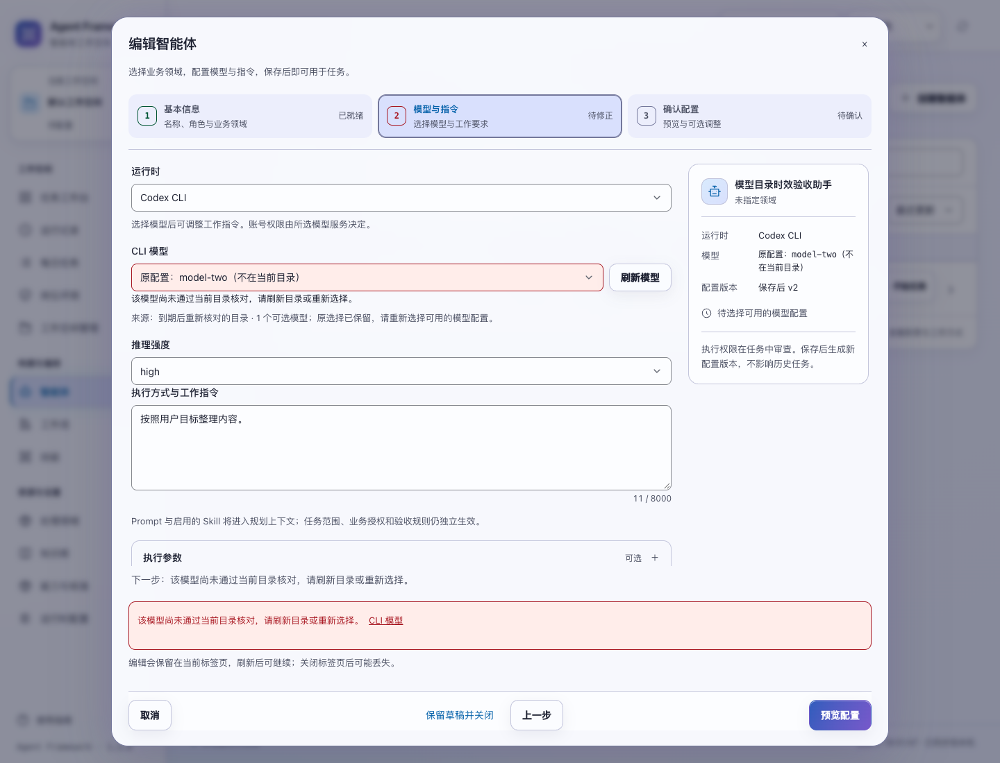
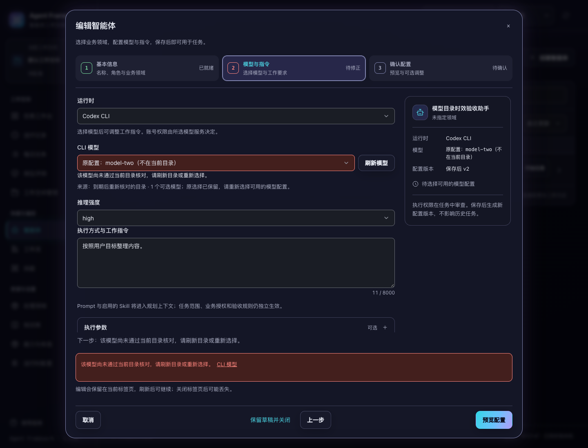

# 模型目录缓存时效

2026-11-03。当前源码改进，版本保持 1.3.0，未发布。

此前服务端目录缓存有五分钟有效期，浏览器内存中的目录却持续复用，直到手动刷新或整页重新载入。长时间打开产品后，再次编辑智能体仍可能看到已移除的模型或过期的推理强度选项。

现在浏览器使用目录中的 `fetched_at` 计算剩余有效期。到期后，下一次打开智能体、切换运行时或读取模型目录会重新请求服务端；已有表单输入继续沿用原有的保留与修正流程。

## 有效期规则

- 正常目录最多复用至服务端读取时间后的五分钟。例如服务端缓存已使用 299 秒，浏览器只复用剩余约 1 秒。
- 没有有效时间戳的旧响应，包括内置模拟目录，仅在本页短暂复用一分钟。
- 已过期的返回值不会重新获得缓存有效期。未来时间戳最多获得本地五分钟的复用时间；本机时钟回退到接收时间之前时，会重新读取。
- 同一运行时的并发到期读取共用一个请求。不同运行时分别计时，同一租户与身份下的工作空间仍共享目录。
- 请求失败不替换原目录，也不延长有效期。当前表单保留原选择并显示错误；已过期目录在下次读取时会再次尝试。
- 手动“刷新模型”继续绕过浏览器有效缓存，并使用原有服务端刷新入口。

到期判断发生在读取目录时。它不是后台轮询，也不保证账号在实际调用时仍有对应模型的权限。已打开的编辑器继续尊重当前输入；保存与新任务继续使用现有服务端校验及配置快照。

实现只调整 `agents.js` 中共享目录读取函数。前端记录包含对应目录对象、接收时间与到期时间；身份切换时一并重置，旧请求不能把数据或有效期写入新身份。后端接口和数据格式保持兼容。

## 验证

新增 **10 项**缓存行为测试，覆盖五分钟边界、临近到期的服务端缓存、旧响应、异常时钟、并发合并、失败与手动刷新、运行时和身份隔离。上轮候选源码下 10 项全部失败；修改后相关测试 **31 项通过**，完整前端 **1045 项通过**。

**5 组浏览器回归通过**：`model-freshness`、`agent-models`、`agent-opening`、`runtime-settings`、`agent-drafts`。新增流程在隔离服务上验证：

1. 短时间重复打开复用目录，模型与推理强度保持不变。
2. 超过有效期再次打开时自动重读，已移除模型继续显示原值，并要求明确修正；服务器配置不变。
3. 到期读取失败后，原配置仍可核对；再次打开会重试，连接恢复后重新显示有效选项。
4. 智能体与运行时页面共享有效目录；临近到期的服务端缓存不会再延长五分钟。

浏览器使用受控的 `Date.now` 偏移模拟缓存时间流逝，计时器正常运行，没有真实等待多个五分钟。共 6 次自动目录请求，均未携带手动刷新参数；仅通过 API 创建 1 个验收智能体，没有其他保存、任务创建或真实模型调用。已检查自动核对后原模型失效的浅深色截图；相关 `agent-models` 套件还复验了 8 种桌面布局与焦点情况。

```bash
node --test tests/test_model_catalog_freshness.js tests/test_agent_model_interactions.js tests/test_agent_opening.js
npm test
.venv/bin/python scripts/run_browser_tests.py --suite model-freshness --suite agent-models --suite agent-opening --suite runtime-settings --suite agent-drafts --output /private/tmp/af-model-freshness-browser
```

本轮只修改前端程序，未重复完整后端测试或全新安装验收。候选包包含 166 个程序文件，按当前源码、wheel、包内清单及内外校验和核对；结果记录于同目录验证清单。版本未提升，尚未发布。




