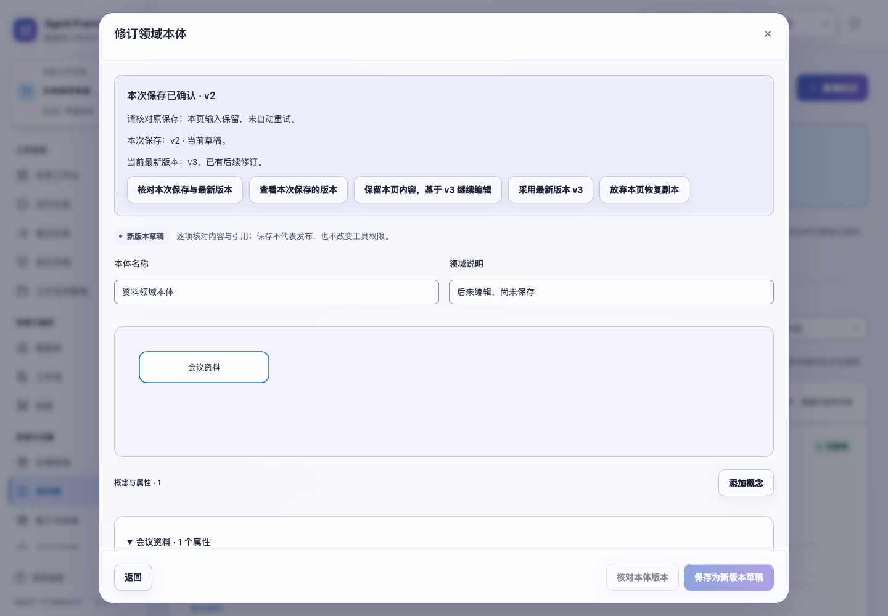
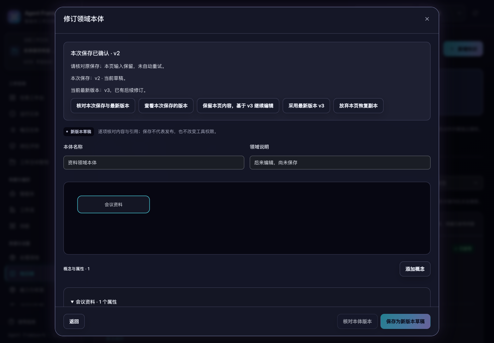

# 本体修订的保存回执与编辑恢复

2026-11-02，当前源码已验证，版本保持 1.3.0，未重新打包发布。

本体修订现在可以准确核对自己的保存。保存回复丢失后，系统分别展示“本次保存的版本”和“当前最新版本”，保留本页后续编辑。另一页面保存了新版，不再被当成本次提交成功的证明。关闭或刷新后，可从知识库继续编辑和核对。

## 保存与核对

新页面在提交前冻结保存编号、原本体版本和完整内容。服务将本体新版本、检索索引、审计事件及保存回执放在同一事务提交；任何一步失败都会回滚。相同编号与相同原始内容重试返回同一版本，不新增索引或审计。改变内容、原版本或操作后复用编号会返回冲突。

回执复用 `asset_save_requests`，无需新增数据表。请求摘要包含 `ontology.revise` 操作、原版本引用及完整内容。资料保存回执新增 `request_hash` 字段，其他原有字段保持。没有 `request_id` 的旧修订调用仍受版本冲突检查，但只有带编号的提交提供精确重试能力。

`GET /api/ontology-saves/{request_id}?base_ref={原版本引用}` 在一个只读数据库快照内核对：

- 原保存是否存在及其确切版本、接受时的草稿状态和目前生命周期状态；
- 同一本体当前最新版本；
- 当前租户、空间、本人和资产访问范围。

查询不会保存或发布。已有回执在后来修订、撤回或来源变化后仍指向原结果；新修订继续检查最新版本、来源与空间状态。空间删除后不再接受写入或返回该空间的保存核对结果。

## 保留编辑并选择下一步

保存失败后，页面保留原请求及后续编辑，不自动重试。核对结果中的“本次保存”必须匹配编号、请求摘要、版本、内容与资产哈希；不匹配或读取失败时继续保持未确认。

- 尚未找到原保存时，可明确重试原编号、原版本和原内容。后续编辑不会混入重试。
- 找到原保存时，可查看本次版本；若本页又有修改，关闭并查看前需确认。
- 已有新版本时，可保留本页内容，明确基于所示版本继续编辑；再次保存使用新编号。这里不会自动合并另一页面的内容。
- 也可明确采用最新版本，确认后替换本页内容。
- 正常保存完成后，切换到本体列表并定位本次版本；列表读取失败与保存成功分别说明。

编辑和原保存参数保存在当前标签页的恢复副本中，按租户、本人、工作空间及本体区分。重新打开会读取原版本，再恢复本页内容；恢复本身不提交保存。来源、历史或版本无法读取时，恢复副本仍保留供稍后重开。

慢核对可关闭；窗口、路由或身份变化后，迟到查询和保存回复不能覆盖新窗口。浏览器不能写入恢复副本时会明确提示，并阻止普通关闭丢失输入；同页内存副本仍可用。损坏副本不会变成保存请求，旧窗口不能覆盖或清除另一份副本。放弃恢复副本需确认，并说明这不会取消在途保存或删除服务端版本。

## 验证

新增 **11 项后端测试和 16 项交互测试**，覆盖同编号去重、跨应用并发、事务回滚、重启、后续版本、生命周期变化、只读快照、空间及身份隔离、输入恢复、摘要校验、存储异常、迟到回复和采用版本的确认。

```sh
PYTHONPATH=tests .venv/bin/python -m unittest \
  tests.test_ontology_save_recovery tests.test_asset_save_recovery \
  tests.test_asset_write_safety tests.test_ontology_regressions \
  tests.test_ontology_evidence tests.test_learning tests.test_learning_acceptance \
  tests.test_backups tests.test_web
npm test
.venv/bin/python scripts/run_browser_tests.py \
  --suite ontology-saves --suite learning-requests --suite learning-reads \
  --suite audit-fixes --suite asset-saves \
  --output /private/tmp/af-ontology-saves-browser-final-20261102
```

**152 项后端、651 项前端测试及 5 个浏览器套件全部通过。** 新浏览器套件验证保存 v2 回复丢失、另一页面保存 v3、刷新恢复及保留后续内容保存为 v4；未送达提交明确重试只产生 v5；另一页面抢先保存 v6 时原保存仍显示未找到，明确保留本页内容后才保存为 v7。慢核对的迟到回复和跨空间恢复也通过。

验收还复现并修正了保存后未切换到本体列表、输入框失焦重绘按钮导致点击丢失的问题。恢复按钮在 1024、1280、1440、1920px 与明暗主题共 8 种布局下可见、可点击且无横向溢出；已查看 1440px 的两张截图。所有验收使用临时数据和离线生成，没有调用外部模型。

详细记录见 [ontology-save-verification-20261102.json](ontology-save-verification-20261102.json)。




