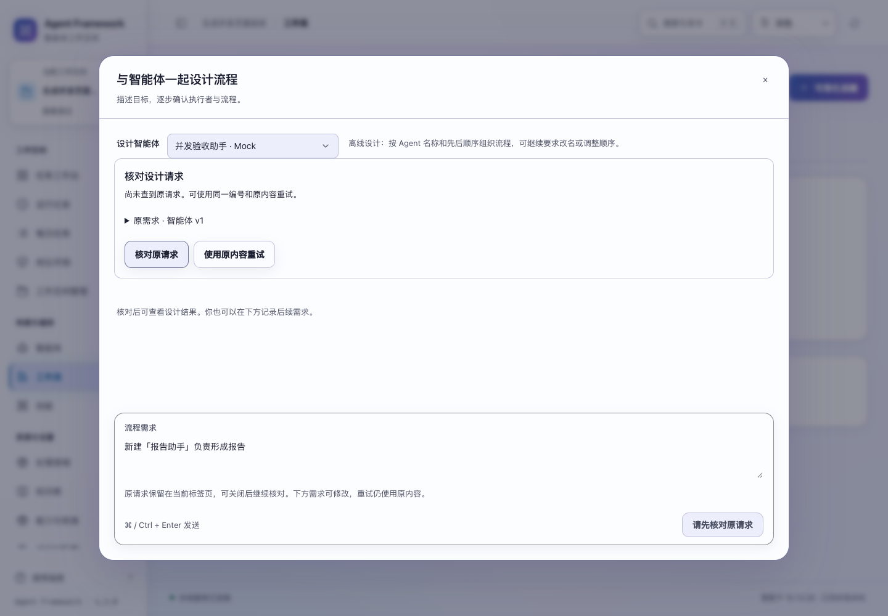
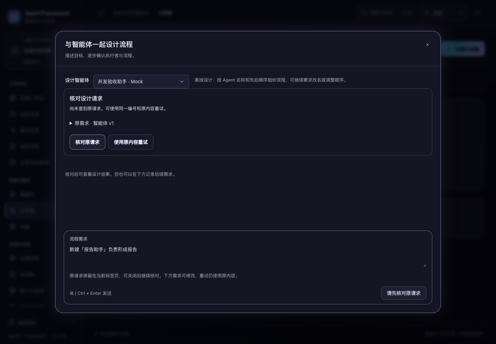

# 生成等待期间继续工作

2026-11-01，当前源码已验证，未重新打包发布。

工作流设计、运行复盘和本体生成现在独立受理。等待模型时，其他页面仍可保存任务草稿、创建任务、保存配置；每日计划检查也能取得普通命令锁。普通任务执行继续使用原有任务队列。

## 行为与容量

同一 Web 应用实例的所有工作空间共用 **2 个提案生成名额**。工作流设计、复盘和本体生成共同计数，离线模式也使用相同边界。这里限制的是提案生成，不是普通任务执行。

容量满时，尚未受理的新生成立即返回 `503`，错误码为 `proposal_capacity_full`，明确说明未调用模型。该请求不会创建 `RUNNING` 或 `GENERATING` 记录，也不会消耗提交编号；名额释放后可以明确重试。服务不在内存中堆积一个等待模型的请求队列。

已有请求先检查持久记录，再判断容量：

- 已完成的设计请求直接返回原结果；正在处理的相同设计请求返回 409，并可只读核对。
- 已受理的复盘或本体请求直接返回当前记录，包括 `GENERATING`，不再次调用模型。
- 请求编号已绑定不同内容时仍返回 409；读取历史和回执不占生成名额。
- 两个名额用满时，原结果回放、任务草稿和任务创建仍可完成。

页面沿用既有核对入口。设计容量不足时保留原编号与需求；核对确认尚未受理后，可明确使用原内容重试。后来输入的文字仍单独保留。

## 并行边界

独立处理仅覆盖 `POST /api/workflow-chat` 和 `POST /api/learning-proposals`。其他普通写入继续使用原来的命令顺序锁；停止接口继续使用之前的独立受理规则。身份、来源站点、令牌、正文及工作空间检查仍在分派前执行。

名额在接受事务内非阻塞取得，先检查重复请求和所需条件，再创建持久记录。正常返回、生成异常、事务回滚及非普通异常都会释放名额；发送 HTTP 回复不占名额。

两类结果沿用各自原有语义：

- 设计提交结果前再次检查空间、设计智能体和对话版本。另一页面更新智能体可立即完成，旧设计随后提交时返回冲突，不写入失效结果。
- 复盘与本体在受理时冻结配置及来源。已受理结果继续保存为可审阅草稿，后续配置变化不会丢失这份已接受的生成；沉淀和修订仍执行原有来源、空间和版本校验。

并发名额属于一个 Web 应用实例，不是多个独立服务进程之间的全局配额。跨进程的同编号去重、版本保护和设计处理权仍由原有数据库事务与租约负责。模型调用仍使用已有时限；本次未增加自动重试或自动执行提案。

## 验证证据

修复前，测试暂停一次实际离线设计调用，再通过另一条 HTTP 连接保存草稿，保存请求在 1 秒截止时间内超时。修复后，同样暂停生成时，草稿保存和任务创建都能完成，测试确认模型仍未释放。

新增 12 项后端测试，覆盖三类生成期间的普通写入、处理中去重、共享容量、已完成结果回放、跨工作空间限制、配置变更、后台计划检查、生成失败及事务回滚后的名额释放，以及入口权限检查。

```sh
PYTHONPATH=tests .venv/bin/python -m unittest \
  tests.test_proposal_responsiveness tests.test_http_responsiveness \
  tests.test_workflow_chat_requests tests.test_learning_acceptance \
  tests.test_learning tests.test_ontology_regressions \
  tests.test_ontology_evidence tests.test_web
```

**122 项通过**。所有测试使用临时数据、离线生成或合成输出，不调用外部模型。

浏览器套件 `proposal-capacity`、`learning-reads`、`workflow-chat-requests` 全部通过。新套件同时打开三个页面，验证两个提案生成未完成时，第三页的草稿保存及普通任务实际执行成功；容量不足不进入第三次模型调用，释放一个名额后原编号重试成功。最终观测到最多 2 个同时生成、总计 3 次生成调用、0 个遗留调用；后续输入保留，未自动保存或运行工作流。

验收记录与源码摘要见 [proposal-responsiveness-verification-20261101.json](proposal-responsiveness-verification-20261101.json)。下图是容量不足后，原请求核对提供的重试入口。




