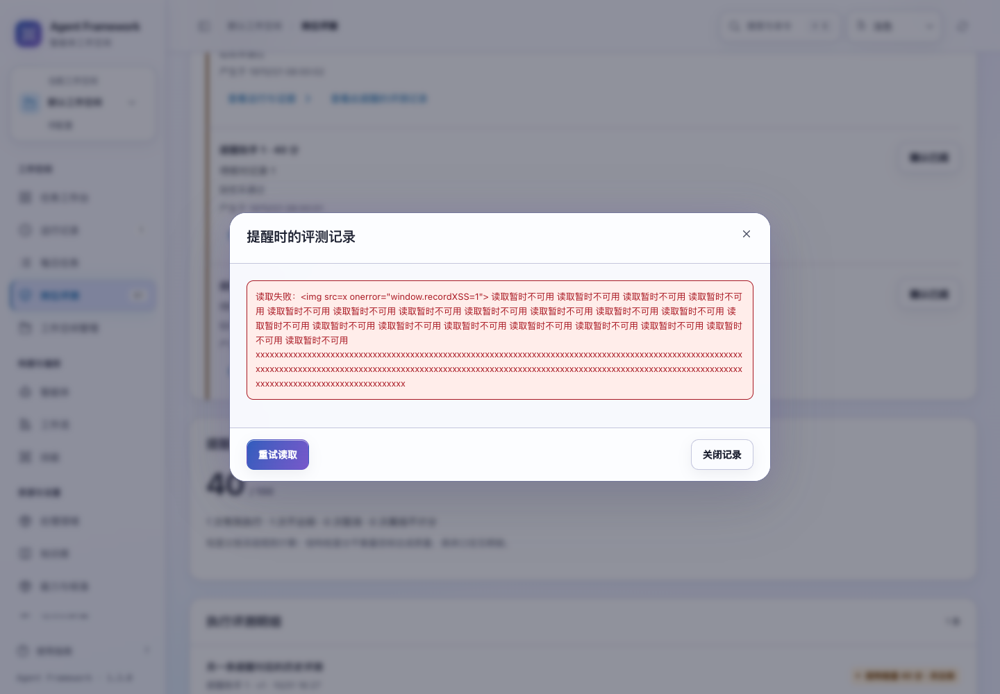
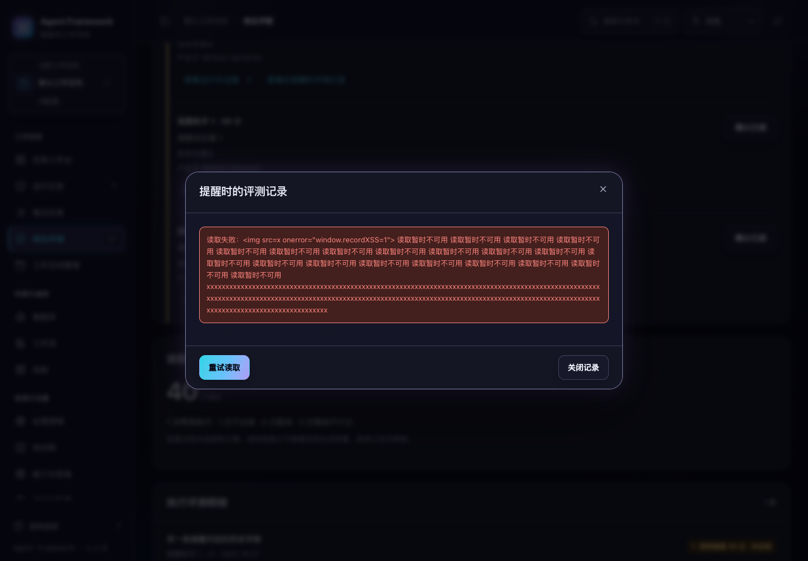

# 后台同步与评测记录读取

2026-10-31，当前源码。本轮修复知识库后台同步期间忽略主动翻页、重复搜索的问题，并让评测记录在网络等待或失败时可以关闭、重试。

## 知识库浏览

后台同步时，当前查询与页位置一致的已读结果会继续显示，并标注“正在同步，先显示上次已读取的结果”。用户仍可主动搜索、翻页或从最新记录开始，操作立即派发，迟到的后台回复不会把页面退回。

再次搜索同一关键词会重新建立浏览起点。主动请求正在等待时，相同操作仍会合并，避免重复读取；修改关键词则可以开始新搜索。搜索失败、返回上次结果和空间隔离沿用已有规则，详见 [知识库搜索恢复](library-search-recovery.md) 与 [情节记忆历史浏览](memory-history.md)。

## 评测记录详情

- 点击提醒中的评测入口后，立即出现带读取状态的窗口，可用关闭按钮或 Escape 退出，无需等请求结束。
- 失败原因显示在原窗口内。“重试读取”仍指向原评测，不会误开最近一次评测，也不会提交写入。连续点击重试只保留一次在途读取。
- 关闭后打开另一条记录，旧回复不会重开窗口或替换新记录。离开当前页面，或切换工作空间、租户、主体后，旧读取结果和错误不再显示。
- 设置编辑器与只读记录窗口各自保留所有权：已经关闭的记录即使随后读完，也不会覆盖正在编辑的设置或清除未保存输入。
- 关闭时，焦点返回原评测入口；入口被列表刷新替换后，寻找对应的新入口，找不到时返回收件箱标题。重试时保留按钮焦点，成功后移到记录正文；用户已经转向关闭按钮时保留其选择。
- 长错误文本会换行，重试和关闭入口保持可见；返回内容按文本转义，返回的评测编号也必须与当前选择一致。

关闭窗口会放弃这次读取对界面的影响，已发出的网络请求仍可能完成。这些操作只读取数据，不会确认提醒、修改评测或启动任务。





截图使用故意构造的长错误内容，验证文本转义、长词换行和可见的键盘焦点。

## 验证

新增 3 项知识库交互用例和 17 项评测详情用例，修复前分别复现后台读取阻塞主动操作，以及详情缺少等待、取消和过期回复保护。最终 **335 项界面测试全部通过**。

真实浏览器的新增场景使用 138 条情节记忆、61 条未确认提醒、230 条已确认提醒与两条历史评测，验证后台慢读取、关闭与重开、离开页面、保留设置输入、故障恢复和焦点。浏览、关闭与重试没有提交写入，也没有调用外部模型。1024 / 1440 宽度、深浅主题、正常与 200% 文字共 8 组布局通过，修复了初次检查发现的长错误溢出与重试焦点丢失。

七套浏览器验收通过：读取交互、情节记忆、知识库搜索、提醒收件箱、每日计划恢复、既有问题回归和历史模块。其中前一批通过的四套保留原结果；修改详情错误排版、重试焦点及等待断言后，重跑读取交互、提醒收件箱与历史模块，三套全部通过。

本轮未修改后端产品逻辑，未重新运行完整后端套件。最近一次完整后端验证为 **793 项通过**，见 [提醒收件箱验证记录](../operations/alert-inbox-verification-20261031.json)；相关接口与记忆实现的文件摘要已核对。该次历史运行包含一条空间生命周期场景中的后台派发异常日志，整体测试通过；本轮不将它计为已修复。

```sh
npm test
.venv/bin/python scripts/run_browser_tests.py --suite reading-interactions --suite memory-catalog --suite library-search --suite alert-inbox --suite daily-recovery --suite audit-fixes --suite legacy-modules
```

完整结果、初次失败及源码摘要见 [本轮验证记录](reading-interactions-verification-20261031.json)。旧版布局脚本已同步等待详情正文的规则，但本轮未单独运行该脚本。本轮改动尚未重新打包或发布。
