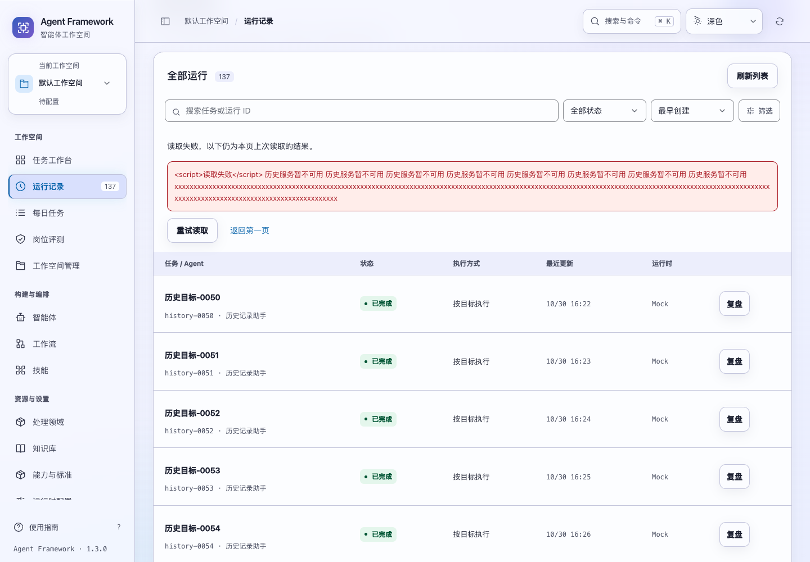
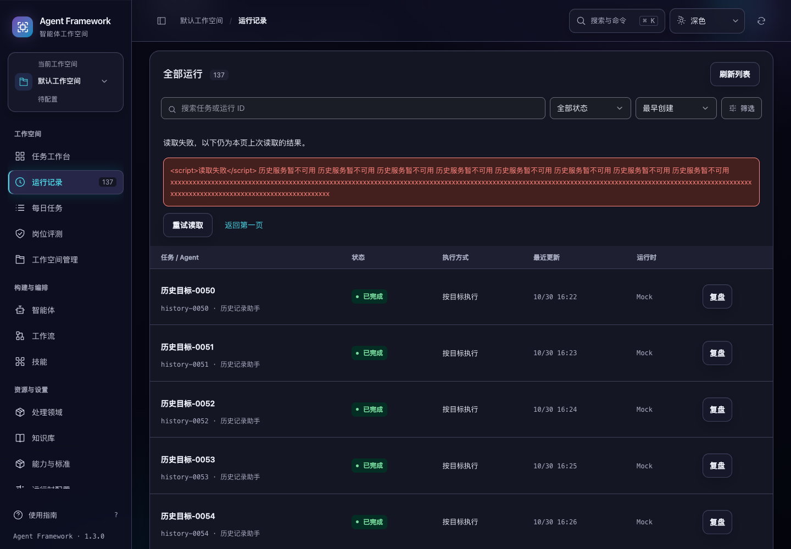

# 运行历史的搜索、翻页与读取恢复

2026-10-31，当前源码。运行记录的主动查询改为独立读取，不再等待整页后台刷新结束。筛选条件、页码与显示结果按同一次请求核对，避免新条件下混入旧结果。

## 查询与恢复

- 搜索、状态、智能体、领域、日期和排序仍使用原有服务端查询。输入关键词时保留短延迟，新的输入会取消尚未开始的旧查询；输入法组合期间保持原有处理方式。
- 后台慢读取期间仍可提交新条件。较早的成功或失败响应不能替换当前结果、写入当前错误或抢走输入焦点。
- 同页刷新失败保留本页上次成功结果，并明确标注。更换条件或页码后读取失败，则隐藏不匹配的旧行，不将失败显示为“没有匹配的运行”。
- 可“重试读取”当前条件与当前页，或“返回上次结果”恢复上次成功的关键词、状态、智能体、领域、日期、排序与页码。恢复旧结果本身不发请求，页面说明可刷新核对最新状态。
- 翻页读取期间禁止再次推进页码，失败时保留目标页地址。可以重试原页、返回上次结果或返回第一页。
- 只有成功读取且结果为空时才显示空结果提示。读取失败后后台轮询不会反复重试同一失败查询，由用户明确恢复；新条件仍可直接查询。
- 进入任务详情再返回时保留查询和分页位置。切换空间、租户或主体后，旧查询和结果不会用于新范围。

分页、重试与结果恢复保持键盘焦点可见；主动搜索返回后保留输入位置。读取过程不创建任务、不重跑任务，也不调用模型。

## 实现边界

`run_history.js` 维护当前私有范围内的请求顺序、查询地址、读取状态和上次成功结果，继续向现有页面提供运行摘要与分页信息。全页刷新复用同一条件的在途读取，主动操作可以越过旧的全页刷新等待。

请求同时绑定租户、空间、主体、路由和查询条件。其他页面的旧运行列表回复也在写入页面状态前检查路由，避免导航后污染当前列表。

后端查询、排序和游标协议保持不变：列表仍反映实时状态，并非整次遍历的数据库快照；新增任务和运行更新可能改变当前结果。此处的恢复快照仅是浏览器内上次成功读取的结果，刷新浏览器后不会恢复历史查询。

## 验证

新增 21 项交互回归，覆盖忙碌期间查询、迟到成功与失败、搜索延迟、重复翻页、原页重试、恢复完整条件、后台请求复用、范围隔离和错误转义。完整界面测试 **438 项**通过。历史查询及 Web 接口 **38 项**相关后端测试通过，含新增脚本实际响应与安全响应头检查。

专项浏览器使用 137 条隔离历史记录，核对三页完整遍历、详情返回、慢后台请求期间主动搜索、失败与空结果区分、失败分页准确重试、返回第一页及空间隔离。专项共 7 项流程检查，读取期间零写入、零页面异常。

运行历史、运行筛选、任务动线、全局搜索与全站控件五套浏览器验收通过。相关验收均使用临时数据与合成模型响应。

长错误与恢复控件验证了 1024 / 1440 宽度、明暗主题、正常与 200% 字号共 8 组桌面布局，没有页面横向溢出。截图中的长错误和任务均为测试夹具。





测试路径、跨模块验收和源码摘要见 [验证记录](run-history-recovery-verification-20261031.json)。

```sh
npm test
.venv/bin/python -m unittest tests.test_run_catalog tests.test_web
.venv/bin/python scripts/run_browser_tests.py --suite run-history --suite run-filters --suite journeys --suite commands --suite control-routes
```

本轮只更新当前源码，没有重新打包或发布。
