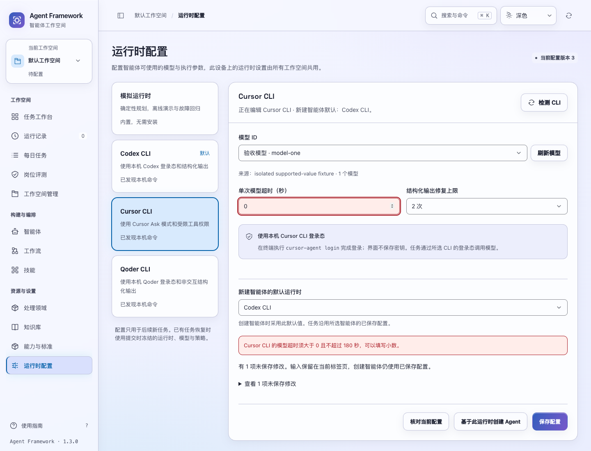
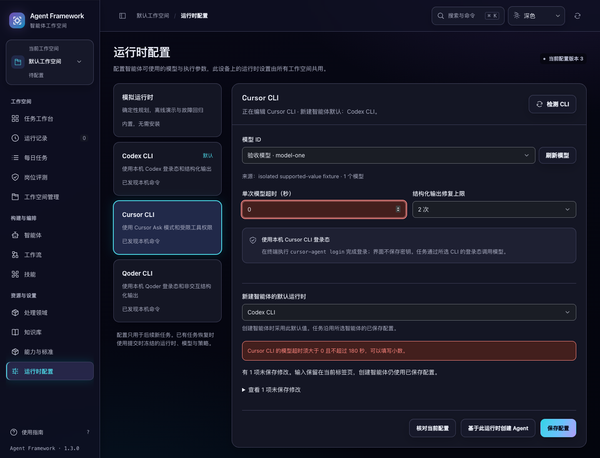

# 执行参数的表单与回执一致性

2026-11-03。当前源码改进，版本仍为 1.3.0，未发布。

后端的 `CodexConfig` 已支持 `ultra` 推理强度，以及大于 0、不超过 180 秒的有限数值超时；Cursor、Qoder 沿用相同超时边界。此前运行时页面的已保存配置校验缺少 `ultra`，并要求超时至少 1 秒。两个编辑器的数字输入又默认按整数步进，导致后端接受的合法配置在页面读取、回执核对、草稿恢复或继续编辑时被拒绝。

## 修改后的行为

- 运行时配置、保存回执和恢复草稿的编辑基准均接受 `ultra` 与正小数超时。原始输入、原提交编号和已接受版本仍分别保留。
- 运行时的初始强度选项包含 `ultra`；模型目录仍决定具体模型支持哪些强度。智能体保存继续使用后端模型目录校验。
- 运行时与智能体的超时输入支持小数，范围保持 `(0, 180]`。空值、零、负值、非有限数值和超出上限的值不能作为新配置保存。
- 运行时保存先检查所有运行时的超时值，包括当前未展开的配置。发现问题时显示对应运行时，聚焦字段，并通过 `aria-invalid`、`aria-describedby` 关联错误。此时不分配保存编号、不发送请求，输入继续保留。
- 修正已标记的字段会清除其旧错误，保留其他编辑。已明确被服务器以 400/422 拒绝的配置，继续修改后不再显示旧内容的错误。
- 回执未确认或读取失败的恢复提示继续保留，后续编辑不会把它当作已解决。原提交重试仍使用原内容，不受后续无效输入影响。
- 智能体的零超时仍阻止继续；更正为合法小数后，原有字段错误清除，可以保存并用于任务配置快照。

实现调整 `runtime_settings.js`、`agents.js`、`app.js` 与 `index.html`。后端约束和协议未改动，也没有改变默认超时或推理强度。

## 验证

新增 **8 项**前端回归：合法值读取与保存、含合法值的恢复基准、丢失回执的只读核对、隐藏配置的无效超时、字段修正、已拒绝错误与未决错误的区别，以及无效已保存值仍被拒绝。

对照上一轮候选中的 `runtime_settings.js`，新用例 **7 项失败、1 项通过**。修改后相关测试 **47 项通过**，完整前端 **1053 项通过**。

**6 组浏览器回归通过**：`runtime-values`、`runtime-settings`、`runtime-feedback`、`runtime-lifecycle`、`agent-models`、`agent-drafts`。新流程使用临时服务和固定模型目录：

1. 从服务读取 `ultra`、0.5/1.5/0.125 秒超时，保存小数值并正确接受回执。
2. 模拟保存已经受理但响应丢失，刷新恢复原编号，只读核对后保留后续输入。
3. 在未展开的运行时保留零超时，验证保存前定位字段、没有请求，修正后正常保存。
4. 从已保存运行时创建智能体，继承强度和小数超时；验证零值拒绝、修正及保存，再通过 HTTP 创建未启动任务，核对规划器和智能体快照中的实际值。

新流程共 4 次运行时保存、1 次智能体保存和 1 次未启动任务创建，没有真实模型调用。首次验收在智能体成功创建后，因脚本期望 HTTP 200 而误判正确的 201；修正断言后该流程完整重跑通过，未因此改动产品代码。

检查了浅深色截图。1024/1440px 桌面宽度、正常/28px 错误提示文字共 **8 种布局**验证了字段焦点可见、错误区和页面没有横向溢出。既有桌面范围保持不变。

```bash
node --test tests/test_runtime_settings_interactions.js tests/test_agent_model_interactions.js tests/test_agent_interactions.js
npm test
.venv/bin/python scripts/run_browser_tests.py --suite runtime-values --suite runtime-settings --suite runtime-feedback --suite runtime-lifecycle --suite agent-models --suite agent-drafts
```

本次后端源码未变，完整后端测试与全新安装验收没有重复运行；浏览器直接使用当前后端保存配置并核对实际回执和快照。源码候选包与 wheel 按 166 个程序文件、包内清单和内外校验和核对，结果详见同目录验证清单。未发布。




