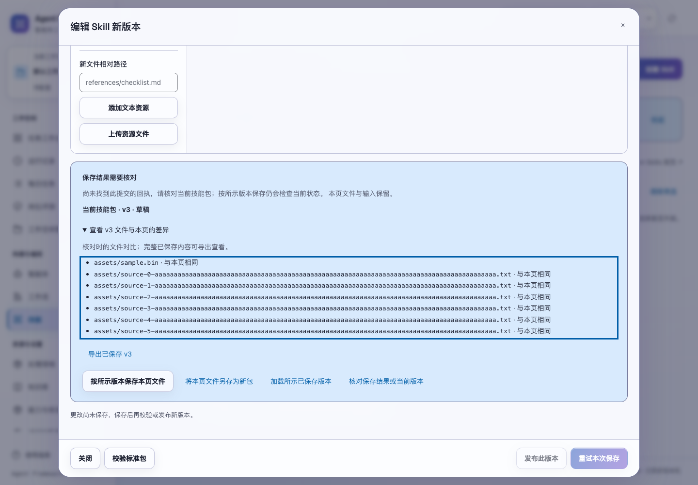
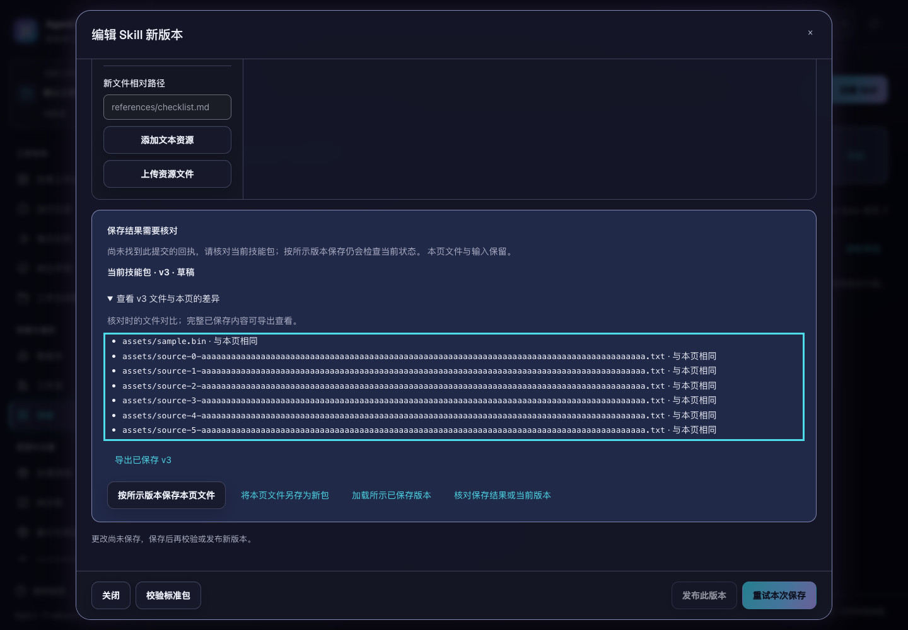

# Skill 保存回执与文件恢复

2026-10-30。本轮改进位于当前源码，尚未重新构建或发布发行包。

此前 Skill 已经保存成功、页面却没有收到回复时，创建重试会遇到同名冲突，编辑重试会遇到旧修订号冲突。页面无法确认上次提交是否已接受，也不能安全处理随后继续编辑的文件。现在创建和编辑使用持久保存回执，重试相同提交返回原技能与内容版本。

## 编辑器中的恢复

- 原保存的编号和文件快照保留在当前编辑窗口中。回复丢失后重试沿用原编号，不重复新增技能或内容版本。
- 用户继续编辑后，普通保存先提示核对，不会把新文件混入原提交。可以明确选择“重试原保存，保留本页文件”，先确认原结果，再保存后续修改。
- “核对保存结果或当前版本”只读。读取期间可以继续输入，结果返回后保留文件、输入焦点和光标。核对区区分原保存的内容版本与当前技能包状态。
- 文件对比逐项显示相同、不同、仅本页或仅已保存的文件；完整已保存内容可按指定版本导出 ZIP。二进制文件保留原内容，不转为文本。
- “按所示版本保存本页文件”明确基于核对时的修订号生成新草稿。另一页面随后再修改时，仍返回冲突并保留本页文件，需要重新核对。
- 当前包已归档时，停止原包保存，允许“将本页文件另存为新包”。复制保留资源文件，并同步调整 `SKILL.md` 中的包名；用户检查新名称后再保存。
- “加载所示已保存版本”沿用放弃本页修改的确认。关闭未知结果的编辑窗口会明确说明：关闭不会撤销已经接受或仍在处理的保存。
- 未知结果后即使后续重试遇到空间、权限或参数错误，也继续保留原编号。空间不可用的 404 不会被当成“已确认没有回执”。

未解决保存结果前，发布和内容版本切换暂停，空间切换也会要求先处理当前编辑。异步编辑、复制、导入与保存结果核对租户、空间、操作人和编辑窗口，迟到的回复不会打开其他范围的文件或覆盖另一份编辑。目录刷新失败会提示“已保存、刷新失败”，不把已经接受的提交误报为保存失败。

本地尚未保存文件仅保留在当前打开的编辑窗口中，刷新或关闭页面不会自动恢复这些文件。服务端回执跨重启与核心备份恢复保留，重新查询仍需原提交编号。当前功能没有新增浏览器持久草稿机制。

## 接口与事务

创建 `POST /api/skills`、编辑 `POST /api/skills/{id}` 在原有 `folder`、`files`、`revision` 之外支持可选 `request_id`。操作人由服务端取得，客户端不能通过保存内容指定。旧客户端不提供编号时保持原有接口和返回结构；需要可靠重试时必须提供编号。

```json
{
  "folder": "review-method",
  "files": {
    "SKILL.md": {
      "encoding": "utf-8",
      "content": "---\nname: review-method\ndescription: 复核方法\n---\n\n检查证据。\n"
    }
  },
  "revision": 0,
  "request_id": "skill-save-example"
}
```

带编号的响应在完整技能包和校验警告之外增加：

```json
{
  "save_receipt": {
    "request_id": "skill-save-example",
    "revision": 1,
    "version": 1,
    "at": 1793318400,
    "replayed": false
  }
}
```

`save_receipt.version` 是此次请求保存的不可变内容版本，`save_receipt.revision` 是接受时包头的修订号。回放返回原内容版本，顶层 `revision`、`archived` 以及版本状态和历史反映查询时状态：技能随后被编辑、发布或归档时，两者可以不同。回放仍校验完整包及资源摘要，损坏内容不能靠回执绕过校验。

`GET /api/skill-saves/{request_id}` 返回回执与原保存版本，不产生写入。回执按租户、空间、操作人隔离。确实未找到当前范围的回执时返回 404 和 `code: "skill_save_not_found"`；空间不可用或其他读取错误不带此代码。暂未找到回执不证明仍在处理的原请求已停止，因此界面不会自动换号创建第二份包。

| 情况 | 行为 |
| --- | --- |
| 相同编号、目标和保存参数 | 返回原回执，不重复写版本或审计 |
| 相同编号用于不同目标或参数 | 409，要求先核对原提交 |
| 新编号使用旧修订号 | 409，继续执行并发保护 |
| 包已归档或为内置包 | 拒绝新编辑；已接受请求可回放原版本和当前状态 |
| 空间在预检后被删除 | 提交事务拒绝写入，生命周期变更也检查空间仍有效 |
| 回执记录写入失败 | 技能包头、版本、审计与回执整次回滚 |

`skill_save_requests` 保存请求摘要、技能身份、接受的版本/修订号、警告和时间。主键包含租户、空间、操作人与编号，文件内容继续只存于原版本表。预检和写入事务均查询回执，两个并发重试最多接受一次；新保存继续校验包、包头修订号、名称和归档状态。响应从接受事务直接构造，不依赖提交后的另一次读取。

回执覆盖编辑器创建和保存新版本两个接口。ZIP 直接导入、历史方法迁移及发布、撤回、归档、恢复沿用各自操作，没有新增同编号重试保证。发布依然需要用户单独触发；保存草稿不发布，不修改已有 Agent 绑定或任务冻结内容。

## 验收

```bash
.venv/bin/python -m unittest discover -s tests -p 'test_skill*.py' -q
.venv/bin/python -m unittest discover -s tests -q
npm test
.venv/bin/python scripts/run_browser_tests.py --suite skill-saves --suite agent-catalog --suite multica --suite legacy-modules --suite audit-fixes
```

完整后端 **662 项通过**，完整界面 **169 项通过**。新增 16 项后端回归覆盖重试、并发、事务回滚、身份隔离、重启/备份恢复、归档和空间删除、损坏包以及实际 HTTP 回执。新增 15 项保存交互回归和 3 项资源交互回归，覆盖冻结原提交、继续编辑、再次冲突、归档复制、迟到响应、确认文案及跨身份复制/导入。

本轮 `skill-saves`、`agent-catalog`、`multica`、`legacy-modules`、`audit-fixes` 五套浏览器验收均通过。最终保存恢复套件通过 5 组实际双页面场景，另检查 1024/1440px、浅色/深色、正常/200% 文字的 8 组桌面布局，以及键盘核对、焦点恢复和文件差异区滚动。使用临时服务、合成文本和二进制文件，没有调用真实模型或改写已有业务数据。分轮记录见 [验收数据](skill-save-verification-20261030.json)。

已检查最终浅色与深色截图：文件长路径可换行，差异区可用键盘滚动，弹窗底部操作可达，页面没有横向溢出。




