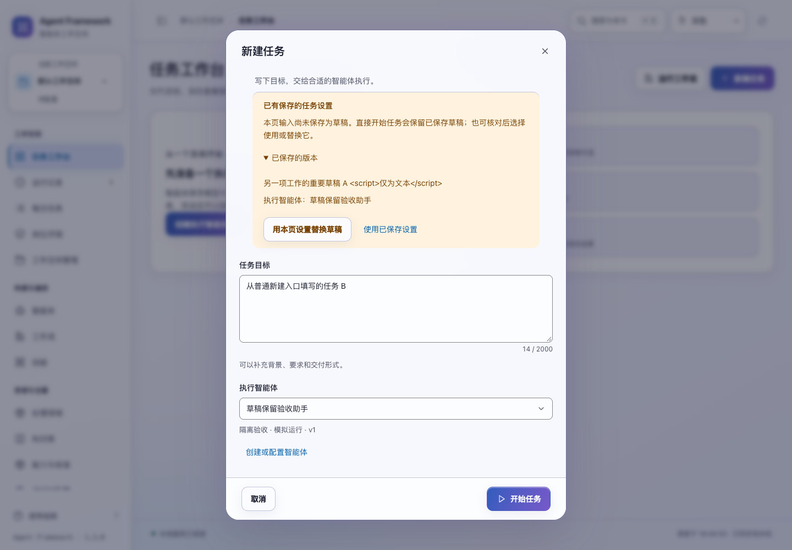
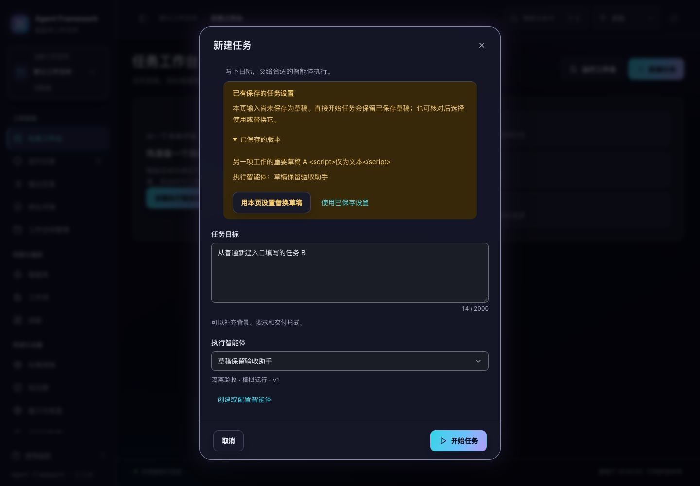

# 新任务与独立草稿

2026-11-03。当前源码改进，版本仍为 1.3.0，未发布。

## 修复的问题

此前，普通“新建任务”和带智能体的新建入口会读取已有草稿及其版本，但没有显示独立草稿选择。用户第一次填写新目标后，自动保存可能直接覆盖另一项尚未完成的工作。只有“基于此任务新建”已有这项保护。

另外，从任务复用入口恢复待核对提交时，一段旧逻辑会清除恢复流程产生的草稿提示，导致原本独立的服务端草稿重新暴露给自动保存。

## 现在的行为

- 新任务表单仍从空目标开始；已保存草稿单独显示，可展开核对目标与智能体。本页提示明确说明尚未保存为草稿。
- 填写、选择智能体以及临时前往配置页，都不会自动覆盖另一份草稿。直接开始任务时使用本页目标，保留独立草稿。
- “使用已保存设置”明确恢复原草稿，之后的编辑恢复自动保存。
- “用本页设置替换草稿”明确保存当前输入，仍携带刚核对的版本。另一页面若已更新，保留本页输入并要求重新核对。
- 放弃尚未使用或替换草稿的新任务，仅放弃本页设置，不删除原草稿。
- “继续上次任务设置”仍直接恢复草稿；没有已保存草稿时仍正常自动保存。
- 待核对提交优先恢复原编号与本页编辑。随后判断草稿是否独立，保留已有冲突提示；已经拥有且版本未变的草稿不会被误报为独立草稿。

实现只调整 `app.js` 中任务准备结束时的判断顺序，复用现有的草稿比较、显式选择、版本核对及清理协议。没有新增后端接口或数据表。

## 验证

新增 9 项界面回归。以本次修改前的候选包中 `app.js` 为对照，9 项中 7 项失败、2 项通过；当前完整前端 **1035 项通过**。

新增 `task-draft-ownership` 浏览器验收，使用临时项目服务与离线模拟智能体，验证普通新建、放弃本页、直接提交、明确恢复、并发替换冲突，以及待核对提交通过复用入口恢复。共 2 次任务创建请求、2 项任务，没有真实模型调用。

7 组相关浏览器套件全部通过：`task-draft-ownership`、`task-drafts`、`task-editing`、`task-submissions`、`task-receipts`、`task-reuse`、`journeys`。结果详见同目录验证清单。

新提示沿用已有草稿组件。检查浅色与深色截图，验证 1024/1440px 桌面宽度、正常/28px 提示文字共 8 种布局下，键盘焦点及按钮均在可视范围，无横向溢出。范围遵循项目现有桌面定位，没有扩展为移动端适配。

```bash
node --test tests/test_task_draft_ownership.js tests/test_task_reuse_interactions.js tests/test_task_submission_interactions.js tests/test_draft_interactions.js
npm test
.venv/bin/python scripts/run_browser_tests.py --suite task-draft-ownership --suite task-drafts --suite task-editing --suite task-submissions --suite task-receipts --suite task-reuse --suite journeys --output /private/tmp/af-task-draft-ownership-browser
```

## 交付与边界

本次程序改动仅在前端任务准备流程。后端源码与上轮候选一致，本轮没有重复完整后端测试，也没有重新执行全新安装验收。候选包已校验 166 个程序文件与当前源码、包内清单、内外校验和一致；未发布。

独立草稿尚未被使用或替换时，本页新设置不会写入那份服务端草稿。已有的离页未保存提醒继续生效；只有存在待核对提交时，才有上一轮加入的本页编辑恢复副本。本次没有扩展为任意数量的独立草稿。




