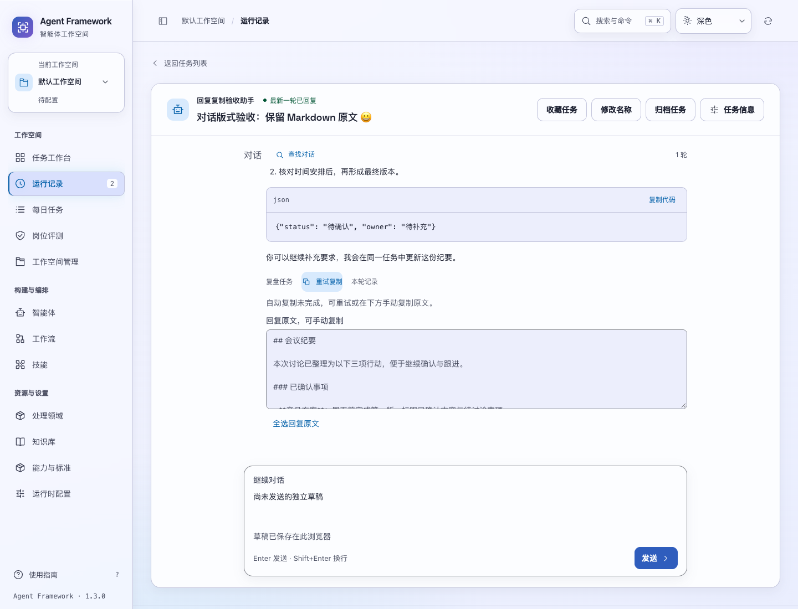
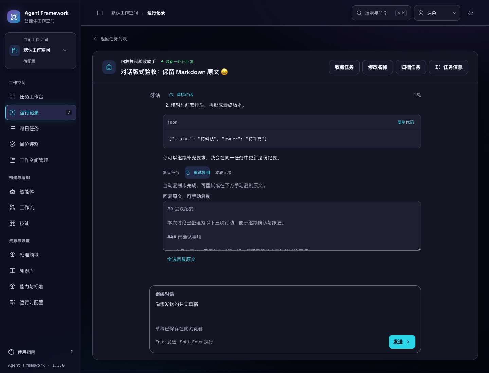

# 回复复制与失败恢复

2026-11-04。任务回复的复制现在保留完整 Markdown 原文，并在对应回复旁显示结果。复制失败时可重试，也可直接全选只读原文手动复制。源码版本仍为 1.3.0，隔离候选已验证，尚未发布。

## 用户体验

- 同一回复正在复制时，重复点击和页面重绘共享这次操作。浏览器超过 1.5 秒未确认时显示手动复制入口，仍等待原操作，不另发复制请求。
- 浏览器拒绝复制或不提供剪贴板接口时，保留原文和重试入口。只有焦点仍在原复制按钮上时才聚焦并选中原文；用户已继续输入时保留输入焦点。
- 显式全选后，页面重绘保留选区。输入草稿不因复制、重试或切换任务而清理。
- 成功、等待和失败都使用回复旁的状态区域。旧任务的迟到结果不会弹出全局提示，也不会覆盖当前任务的复制状态。
- 复制失败恢复入口在深浅主题、1024/1440 宽度、正常与 28px 文字下可操作，无页面横向溢出。

复制在浏览器本地完成，不发送写请求。任务、轮次、运行身份、回复内容和页面作用域共同约束操作归属；离开页面释放等待提示。浏览器已经接收的剪贴板写入无法取消，这些约束保证的是页面反馈归属，不会撤回已经发出的系统剪贴板操作。

浏览器回归还发现了较矮窗口的既有问题：1280×720 下长输入固定占据 180px，会把发送按钮挤出可见范围。输入区现在可随剩余空间收缩，正文仍可在输入框内部滚动；本次实测任务输入约 118px，深浅主题的发送按钮均可见。

## 验证

| 检查 | 结果 |
| --- | --- |
| 新增复制单元测试 | 11 项；旧实现 11 项失败，新实现全部通过 |
| 相关前端回归 | 60 项通过 |
| 全量前端 | 1064 项通过 |
| Web 静态资源与接口回归 | 21 项通过 |
| 真实浏览器 | `task-reply-copy`、`conversation-ui`、`conversation-details`、`task-exports` 全部通过 |
| 对话细节 | 17 个上下文、4 组长输入检查，问题和页面错误均为 0 |
| 独立安装 | 85 个模块来自安装目录，71 个页面资源与 wheel 字节一致 |
| 数据恢复 | 两次实际重启、安装后 CLI 备份恢复、恢复后状态和请求重放检查通过 |

浏览器复制测试实际读写 Chromium 系统剪贴板，验证代码围栏、中文与多行原文一致；拒绝、延迟和切换任务使用受控注入。全流程只创建测试 Agent 和两项测试任务，没有复制引发的额外写请求，没有调用真实模型。

首轮浏览器检查暴露了遗漏的新脚本静态路由，已补齐并复验。旧布局测试的单一标题高度限制也已改为检查标题按钮完整可用和阅读区高度；有两行标题的页面保留正常布局。发送按钮被挤出的实际问题通过输入区布局修复，未降低该项验证要求。

本轮后端改动仅增加静态脚本路由，未重复上一轮已通过的 1401 项后端全量测试；本轮执行了 21 项 Web 回归及独立安装检查。安装验证没有重复浏览器检查，浏览器功能回归运行于同字节的保存源码。

复验命令：

```sh
node --test tests/test_task_reply_copy.js tests/test_reply_markdown.js tests/test_conversation_sync.js tests/test_conversation_review.js tests/test_run_review.js
npm test
.venv/bin/python -m unittest tests.test_web
.venv/bin/python scripts/run_browser_tests.py --suite task-reply-copy --suite conversation-ui --suite conversation-details --suite task-exports
```

候选位于 `/private/tmp/af-task-reply-copy-source-candidate-20261104/`，167 个应用文件与保存源码逐项匹配；相比上一备份内容候选，只有复制模块、任务对话、入口 HTML、对话样式与静态路由共 5 个应用文件改变。六个历史发行产物校验和保持不变。完整结果、日志摘要和文件校验值见 [验收证据](task-reply-copy-verification-20261104.json)。




