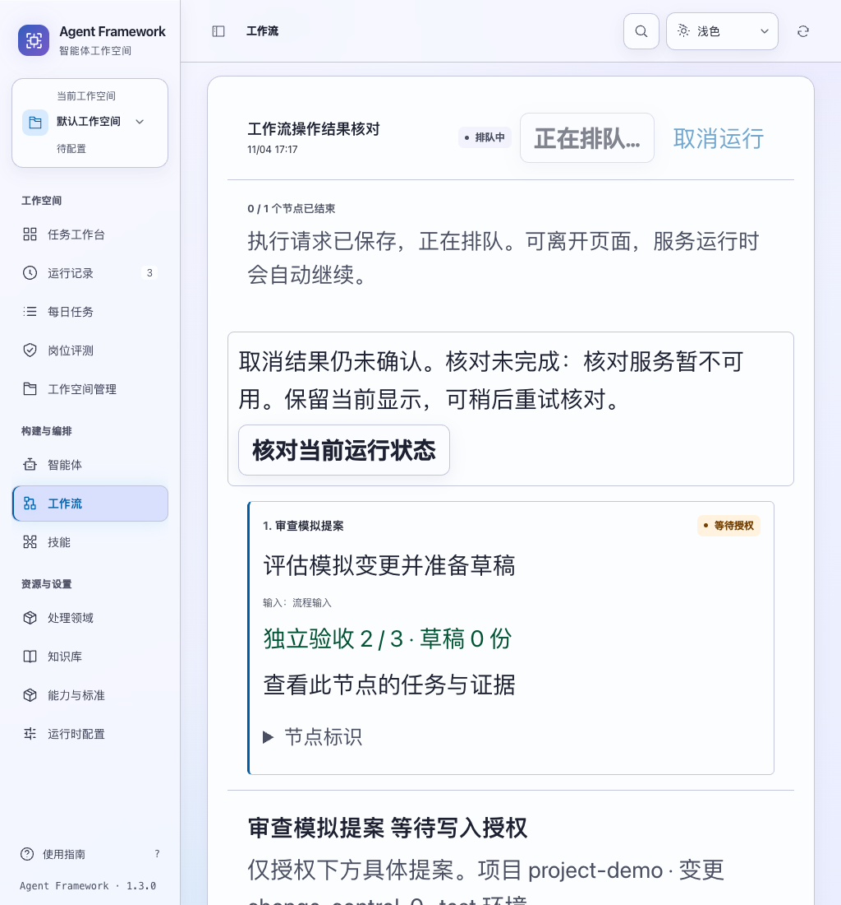
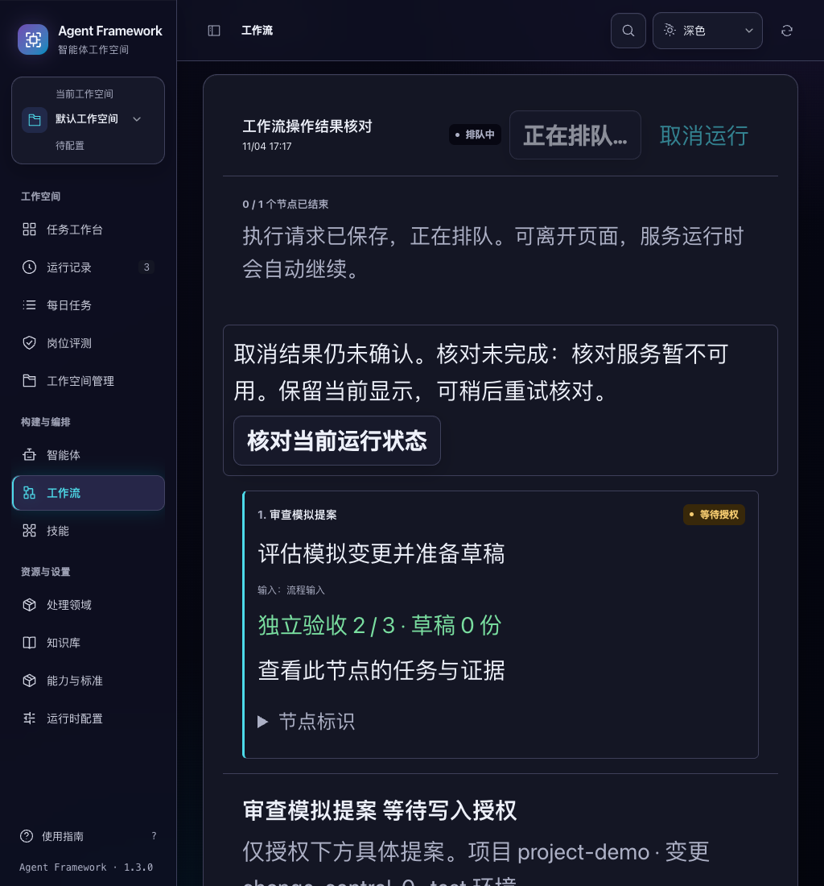

# 工作流恢复与取消的结果核对

2026-11-04，当前源码改进。工作流详情中的“继续 / 恢复”“取消运行”和“重试取消”现在保留操作状态，并在响应不明时提供只读核对入口。

## 用户可见变化

原实现只禁用刚刚点击的 DOM 按钮。隔离 Chrome 验收复现了一个问题：恢复请求尚未返回时，重绘页面会生成可点击的新按钮。操作失败也只显示短暂提示，无法继续核对已经被服务端受理的请求。

- 请求状态按租户、身份、工作空间和运行保存于当前页面内存，重绘后继续阻止重复提交。
- 恢复结果不明时仍可取消。取消会接管这条运行的操作提示，较早的恢复响应或错误不能覆盖它。
- 取消结果未确认时，恢复、重复取消和新增授权保持停用；直接触发点击事件也会检查同一状态。
- 网络失败、超时、无效 JSON 或错配运行回执会保留提示，提供“核对当前运行状态”。核对失败后继续显示先前操作名称及未知状态，可稍后重新读取。
- 核对仅 GET 原运行，成功后显示当前节点、派发与取消状态。不会自动重发恢复、取消或授权；后续操作仍需明确点击。
- 已收到成功回执但列表刷新失败时，仍显示请求已保存。切换运行、页面、工作空间或身份后，旧请求不会覆盖当前详情或提示，也不会抢走焦点。
- 发起操作或核对时，焦点进入状态区；异步结果不强制移动焦点。状态区和核对按钮具有稳定标识，页面重绘可以保留键盘位置。

“重试取消”继续使用原有恢复接口，服务端保留取消意图和原节点任务；提示明确称为取消重试。既有回执版本、终态与取消优先级检查继续适用。

## 范围与边界

此改动没有新增执行接口或数据库字段，也没有改变派发、授权或外部写入规则。它不会把“请求已保存”表述为“执行已结束”。只读核对得到的是当前运行状态，不是原 HTTP 请求未执行的证明；请求仍可能稍后完成。

操作提示保存在当前页面内存，跨页面导航后返回可继续核对；浏览器刷新后重新读取服务端状态，不保存或自动重放这次操作。跨标签页、刷新及其他调用方的并发仍由原有服务端租约、派发和取消规则处理，不能把本页的重复点击保护理解为所有请求只会执行一次。

## 验证

```bash
node --test tests/test_workflow_control_interactions.js tests/test_workflow_grant_interactions.js tests/test_workflow_sync.js tests/test_workflow_interactions.js
npm test
.venv/bin/python -m unittest tests.test_web tests.test_workflows tests.test_workflow_grants tests.test_release_delivery -q
.venv/bin/python scripts/run_browser_tests.py --suite workflow-controls --suite workflow-queue --suite workflow-sync --suite workflow-grants
```

完整界面 **1,213 项通过**；其中新增 **22 项**操作核对检查。最终提示文案调整后再次通过这 22 项及新浏览器套件。相关后端与交付 **84 项通过**。四套浏览器验收共 **23 个流程通过**，没有未处理脚本错误；新套件包含 6 个流程及 8 种深浅主题、1024/1440 窗口、正常/两倍文字组合。

浏览器使用三个隔离模拟运行。故意丢弃已受理的恢复、取消响应后，核对没有增加 POST，恢复沿用原节点，取消最终完成且草稿数为 0。另验证页面重绘、合成重复点击、读取失败、错误运行回执、离开记录后的延迟响应以及键盘操作。全部使用合成数据和本地模拟模型，没有调用真实模型或业务服务。

本轮未重新构建安装候选；上一份候选的安装后验收不代表已经包含本改动。详细记录见 [验收证据](workflow-controls-verification-20261104.json)。

后续补充：[详情与历史列表的一致性](workflow-history-consistency.md)覆盖核对后返回列表及正常详情终态刷新，避免列表读取失败时再次显示过期状态和数量。

后续交付：[安装后验收](../release/workflow-recovery-delivery.md)已将本改动与历史一致性修复纳入独立候选，验证实际安装服务中的恢复、取消、授权及响应丢失核对；候选尚未发布。




