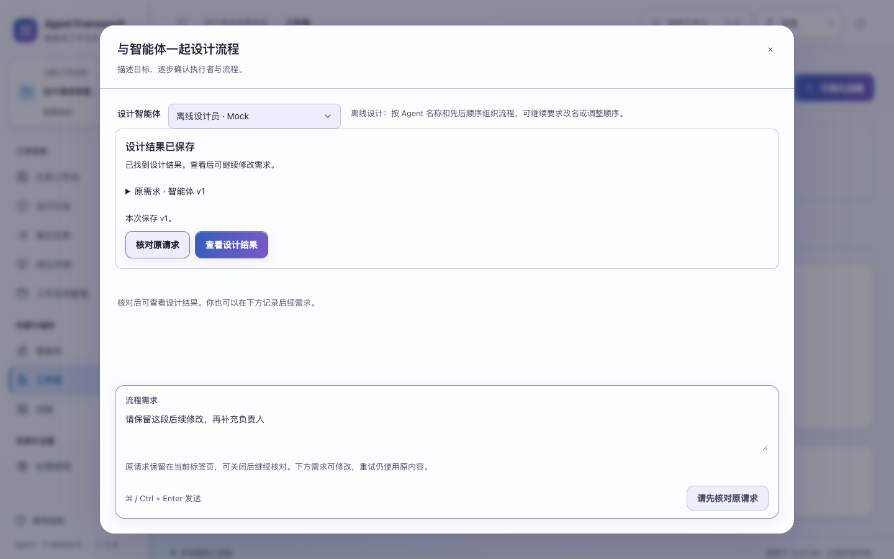
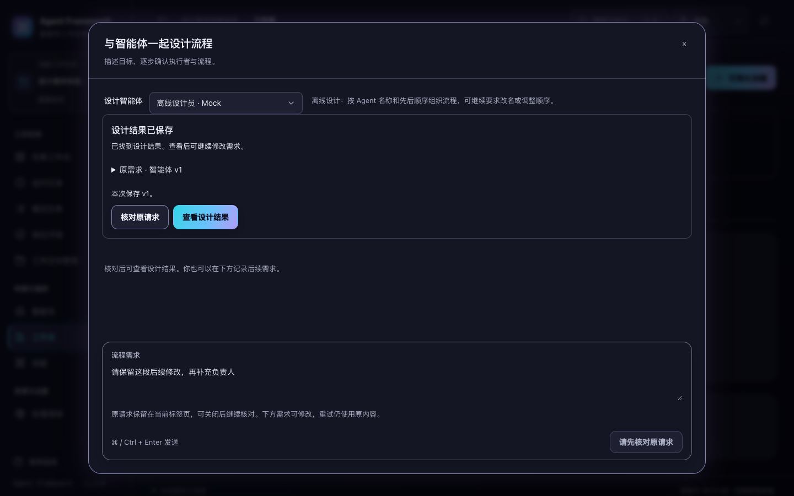

# 工作流设计请求的核对与恢复

2026-11-01，源码实现并验收，未打包发布；发行版本仍为 1.3.0。

设计请求在发送前获得固定编号。服务保存请求状态，并将对话结果与完成回执放在同一个事务中提交。响应丢失后，页面可以查回原结果；已完成请求再次提交返回原回执，不重新调用模型或创建另一段对话。

## 页面行为

- 发送固定消息、设计智能体版本、许可和已有对话版本。未确认结果时禁用新的发送，下方文字仍可编辑。
- 当前标签页保存原请求和后续文字。关闭窗口、刷新或切换页面后，工作流目录提供“继续核对设计请求”。读取不会发送模型请求。
- 查到结果后明确选择“查看设计结果”。页面区分本次保存的版本与对话当前版本，后续文字不会被原请求覆盖。
- 未送达、失败或处理中断时，只能明确重试原编号及原内容。处理中不提供重试；核对失败保留入口。
- 已确认失败后可重新准备设计，重新读取当前智能体和对话版本，并重新确认模型使用许可。
- 读取历史失败时保持发送关闭，提供原地重读。关闭窗口、切换空间或页面后，迟到响应不能写入新窗口。
- 浏览器存储不可用会显示刷新恢复限制；内存中的原请求仍可核对。清除恢复入口失败时不会把已保存结果误报为可重新发送。

设计仍只生成提案。创建智能体、保存工作流和运行流程沿用各自的审查操作。

## 服务契约

`POST /api/workflow-chat` 必须包含：

```json
{
  "request_id": "design-client-generated-id",
  "agent_id": "agent-example",
  "agent_revision": 1,
  "message": "新建「整理员」负责整理会议纪要",
  "consent": false
}
```

继续已有对话还需 `id` 和正整数 `revision`。同一个租户、空间、主体下的编号只能绑定一份规范化请求；改变内容返回 409。旧的 HTTP 调用方需要补充编号、智能体版本和布尔许可。内部离线调用保留原 `WorkflowChat.reply` 入口；HTTP 统一经过持久请求服务。

`GET /api/workflow-chat-requests/{request_id}` 返回原 `payload`、状态、尝试次数、已接受的 `response` 和对话 `current`。两个版本可能不同。查不到该编号返回专用的 `workflow_chat_request_not_found`，其他不可访问或存储错误不能解释成“尚未发送”。

| 状态 | 含义 | 页面允许的下一步 |
| --- | --- | --- |
| `RUNNING` | 当前处理者仍持有有效租约 | 继续核对 |
| `INTERRUPTED` | 处理中租约已过期，仅在读取时推导 | 明确重试原请求 |
| `ERROR` | 该次尝试未提交对话结果 | 重试原内容，或重新准备设计 |
| `COMPLETE` | 对话与原结果已在同一事务提交 | 查看设计结果 |

`workflow_chat_requests` 使用租户、空间、主体和请求编号作为主键。新对话 ID 由同一范围与编号确定。处理权带独立 owner 和 240 秒租约；模型及 Skill 选择共用最长 180 秒预算。显式重试可以接管过期请求，旧处理者提交时会被拒绝。租约过期后的重试可能再次调用模型，但同一个请求最多保存一份确认结果；本实现不承诺外部模型仅调用一次。

提交事务还检查空间未删除、设计智能体未更新或归档、原对话版本仍一致。请求异常只持久保存通用失败说明，不将供应商原始错误写进恢复记录。查回已完成请求不依赖智能体当前仍可用。

备份会拒绝仍有有效设计请求在处理的数据库；已完成回执随数据库保存。恢复清除中断设计的旧处理权，之后仍需明确重试，不自动调用模型。

## 验证

- `npm test`：612 项前端测试通过，其中新增 20 项设计恢复交互测试。
- `PYTHONPATH=tests .venv/bin/python -m unittest tests.test_workflow_chat_requests tests.test_workflows tests.test_workflow_agents tests.test_backups tests.test_web`：78 项后端测试通过，其中新增 14 项覆盖重复请求、并发、过期接管、事务回滚、版本检查、私有范围、重启、备份和 HTTP。
- 浏览器套件 `workflow-chat-requests`、`workflow-agents`、`conversation-ui` 通过。新的恢复场景包含响应丢失后的实际刷新、原请求重试、后续文字保留、历史读取失败、关闭重开与页面切换。
- 恢复界面检查 1024、1280、1440、1920 四种宽度及深浅主题；操作可点击，输入区可见，无横向溢出。对话回归同时覆盖 200% 文字。
- 全部使用临时服务、离线设计语法或合成模型，不调用外部模型。

验收记录与源码摘要见 [workflow-design-verification-20261101.json](workflow-design-verification-20261101.json)。




