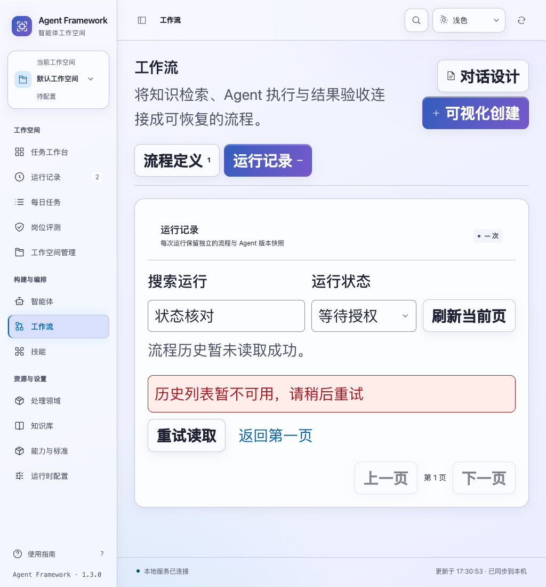
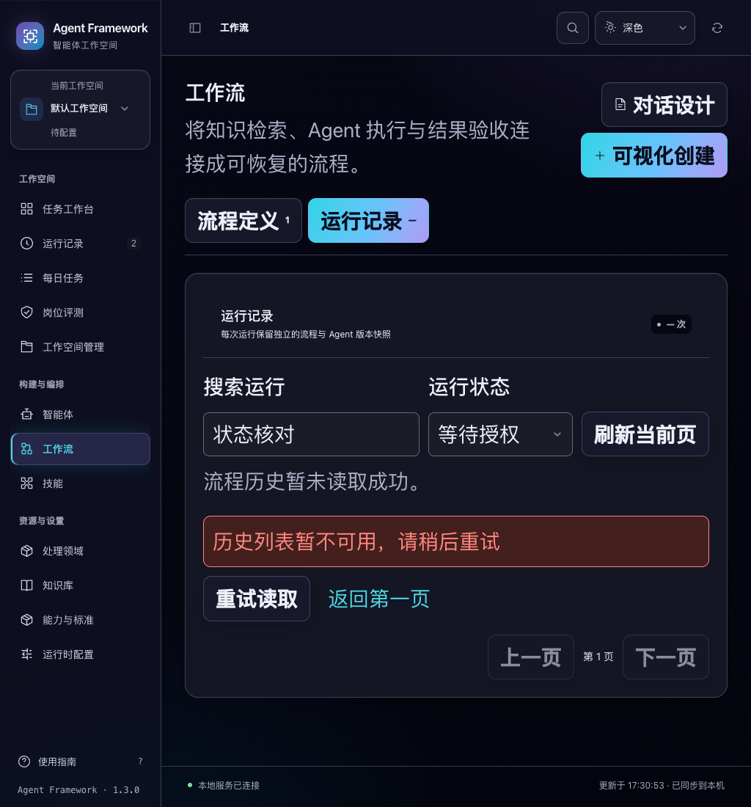

# 工作流详情与历史列表的一致性

2026-11-04，当前源码。详情确认了恢复、取消或授权结果后，历史页不再把已经过期的状态、筛选结果和数量显示为当前记录。

## 已复现的问题

隔离浏览器中，两条运行原本都在等待授权。取消第一条并丢弃成功响应，随后只读核对，详情已经显示取消请求已保存。但返回历史页时若列表接口失败，页面仍显示两条“等待授权”，并显示两次运行需要处理。这个旧页面与刚刚核实的状态相矛盾。

另有一条交互路径：收到成功操作回执后，列表被标记为加载中；若更早的定义读取失败，实际历史请求尚未发出，刷新按钮却一直禁用。新增回归也确认正常详情刷新看到终态后，需要处理同样的缓存问题。

## 当前行为

- 成功操作回执，以及恢复、取消、授权的只读核对，会使当前历史页失效。保留搜索词、状态筛选、记录窗口游标和前页记录；不凭单条详情猜测整页成员、总数或待处理数。
- 正常详情刷新发现已知运行的显示状态、取消标记、标题、变更标识或事件版本变化时，也清除过期历史。比较当前缓存与上一份同运行详情，避免没有状态变化时无故清空列表。
- 返回历史时重新读取原查询。若读取失败，不再展示已知过期的行或数量，也不显示“零条”或“没有匹配”冒充真实结果；可重试当前页或返回第一页。
- 只有实际请求进行中才标记为加载中。清除缓存本身不禁用刷新；正在等待的旧读取不能把失效页重新放回来。
- 没有确认状态变化的普通刷新失败，仍保留上次成功页并明确标注。失败、过期或离开原记录后的详情核对，不会清除当前有效页。
- 列表行只来自分页接口返回的完整页面，不再把单条操作回执混入历史结果。真实零匹配仅在成功读取后显示。

没有修改后端执行、授权、分页或数据库规则。详情与历史仍是独立读取，运行可以继续变化；这项保护不声称两个接口来自同一数据库快照。

## 验收

新增 10 项历史交互检查。首次回归中，6 项暴露原问题；正常详情刷新的补充回归另复现 1 项问题。修复后，相关 81 项与完整界面 **1,223 项**均通过。

```sh
node --test tests/test_workflow_history_interactions.js tests/test_workflow_control_interactions.js tests/test_workflow_grant_interactions.js tests/test_workflow_sync.js tests/test_workflow_interactions.js
npm test
.venv/bin/python scripts/run_browser_tests.py --suite workflow-history-consistency --suite workflow-catalog --suite workflow-controls --suite workflow-grants --suite workflow-sync --suite workflow-queue
```

六套浏览器验收共 **36 个流程通过**，报告记录 32 组布局检查，没有未处理脚本错误。新套件包含 5 个流程、8 组深浅主题与 1024/1440 桌面宽度及正常/28px 文字检查。验收样式使用固定 28px，避免标签与输入框的百分比字号叠加；最终截图已重新核对。

新套件使用两条真实接口创建的隔离模拟运行。取消和授权响应丢失后只读核对，返回失败历史页不再显示过期等待授权；重试后依次得到一条、零条真实匹配。随后明确取消剩余运行，等待两个实际终态，再验证普通详情刷新与历史重读。全程三次操作 POST：取消第一条、授权第二条、取消第二条；核对与历史重试没有新增操作。最终两条均为已取消、草稿数为 0。

既有目录套件继续覆盖 267 条运行的六页遍历、详情返回、筛选、失败恢复、全局搜索和空间隔离。本轮仅改变界面脚本与验收代码，没有重新运行完整后端测试或构建安装候选。

详细结果见 [验收证据](workflow-history-consistency-verification-20261104.json)。

后续已完成 [安装后验收](../release/workflow-recovery-delivery.md)，新独立候选包含本改动，并在实际安装服务上复验核对后返回失败历史及明确重试。候选尚未发布。




