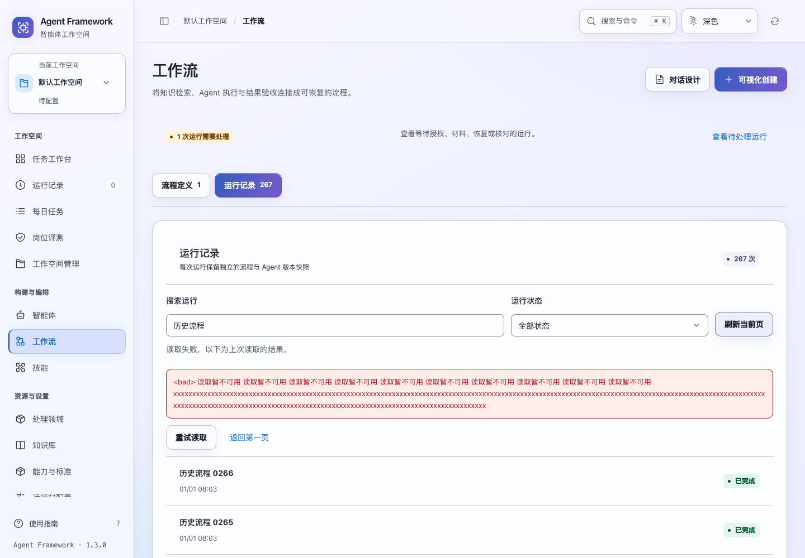
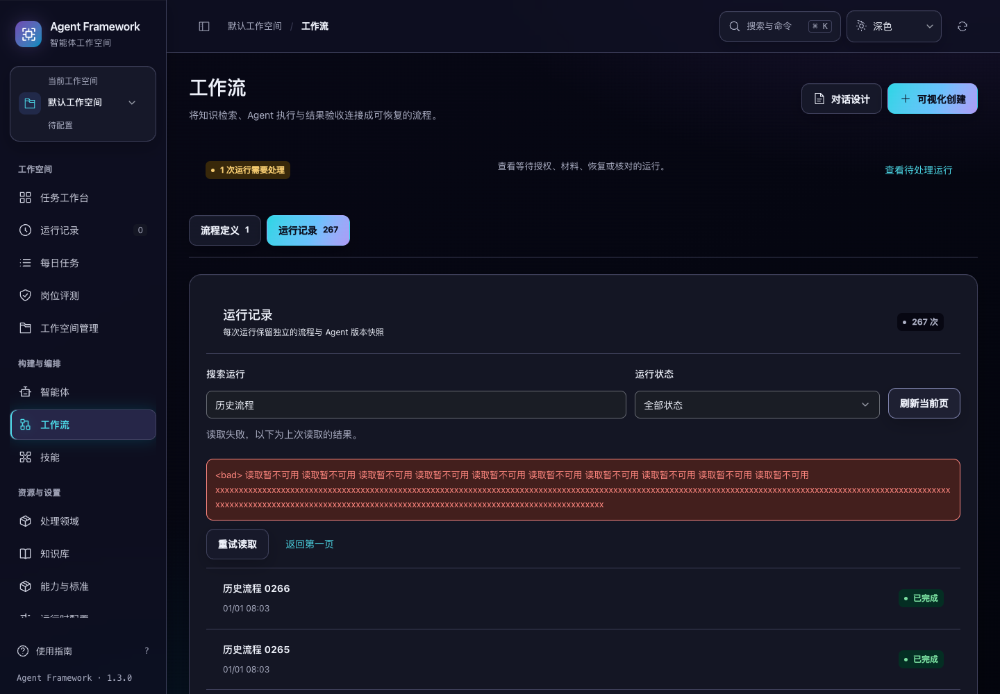

# 完整流程历史与待处理查询

2026-10-31，当前源码。工作流运行记录支持完整历史搜索、状态筛选及每页 50 条的前后翻页，不再只显示最近 100 条。工作台待处理和全局搜索也覆盖当前主体在当前空间的完整流程历史。

## 使用行为

- 搜索名称、运行标识、流程定义标识或变更标识；状态筛选在翻页之前执行。“需要处理”涵盖等待授权、材料、恢复、人工核对、失败、超时和派发失败。
- 打开详情再返回，保留关键词、状态和当前页。切换空间、租户或主体后清空私有查询上下文。
- 第一页建立记录窗口；翻页或刷新当前页时，新运行不会把旧记录挤到另一页。发现新记录后提供“查看最新记录”，主动回到第一页建立新窗口。运行状态仍实时更新，窗口不是冻结的状态快照。
- 输入新关键词立即移除旧查询结果，并在输入稳定后查询。旧响应、过期路由和写入前启动的读取不能覆盖新结果。
- 同页刷新失败保留上次成功结果并明确标注；换页失败不展示上一页冒充当前页。可重试或回到第一页。首次读取未成功时不显示虚假的零条总数。
- 全局搜索独立读取流程定义和流程运行。运行查询覆盖全部历史，面板显示前 50 个匹配；超出时提供完整列表入口，并保留关键词、清除旧状态筛选与页码。

流程启动、取消、授权和恢复仍走原执行链路。本轮没有运行外部模型，也没有更改权限或任务执行语义。

## 查询与兼容

新增 `GET /api/workflow-runs`，接受 `search`、`status`、`limit`（1–50）和 `cursor`。重复参数、非法状态、空或不匹配的游标会返回 400。游标绑定租户、空间、主体、关键词、状态及页面大小；使用记录插入顺序保证同一窗口内顺序稳定。

结果包含摘要列表、完整总数、窗口内匹配数和待处理数、偏移、新增数量、当前与下一页游标。统计和本页行在同一数据库读取快照中生成。摘要只返回标题、状态、标识、时间、节点数、事件版本和派发状态，不向客户端传输节点执行内容或冻结快照。详情读取仍校验完整快照摘要。

派发状态根据持久化派发请求和有效执行租约投影；终态优先，其次为派发失败、取消中和排队/执行中。旧的 `GET /api/workflows` 保留最近 100 条完整运行的兼容行为。新界面使用 `?view=definitions` 读取定义，并通过独立分页接口读取运行。

工作台待处理直接查询完整范围的摘要，不再先取最近 100 条再筛选；节点数量改为读取摘要中的实际计数。

## 查询体积与验证

在 267 条合成记录、每条冻结快照包含额外 8 KB 内容的相同本地数据上，对比三次读取的中位数：

| 读取方式 | 返回行数 | 数据库查询次数 | JSON 体积 | 中位耗时 |
| --- | ---: | ---: | ---: | ---: |
| 原最近完整运行列表 | 100 | 101 | 1,948,100 字节 | 62.959 ms |
| 新摘要首页 | 50 | 3 | 20,332 字节 | 16.682 ms |

这不是生产负载承诺；两种读取的页大小和返回内容不同。测试另行验证摘要查询不会在 Python 中解码完整冻结快照，且过滤范围外的损坏 JSON 不会被访问。

新增 10 项后端、14 项流程历史交互和 2 项全局流程搜索测试。完整后端 **819 项**和界面 **375 项**测试通过。完整历史、流程回执顺序、全局搜索、执行队列和跨页面控件共五套浏览器验收通过。

专项浏览器使用 267 条运行与两个隔离空间，验证六页无重漏、最早待处理、详情返回、筛选空态、慢响应、失败重试、搜索跳转和空间隔离。搜索和浏览没有提交写入。1024 / 1440 宽度、深浅色、正常与 200% 文字共 8 组布局检查通过。





截图中的长错误是隔离测试构造的数据，用于验证转义、换行和重试可达性。详细命令、测试辅助修正、结果和源码摘要见 [验证记录](workflow-history-verification-20261031.json)。

```sh
npm test
.venv/bin/python -m unittest discover -s tests -q
.venv/bin/python scripts/run_browser_tests.py --suite workflow-catalog --suite workflow-sync --suite commands --suite workflow-queue --suite control-routes
```

当前源码已更新，发布包仍为原版本，尚未重新打包或发布。

2026-11-04 补充：[详情与历史列表的一致性](workflow-history-consistency.md)修复操作核对及详情终态更新后返回过期列表的问题。已知状态变化会清除旧行与数量，保留原查询和页位置；没有状态变化的普通刷新失败仍保留并标注上次成功结果。
