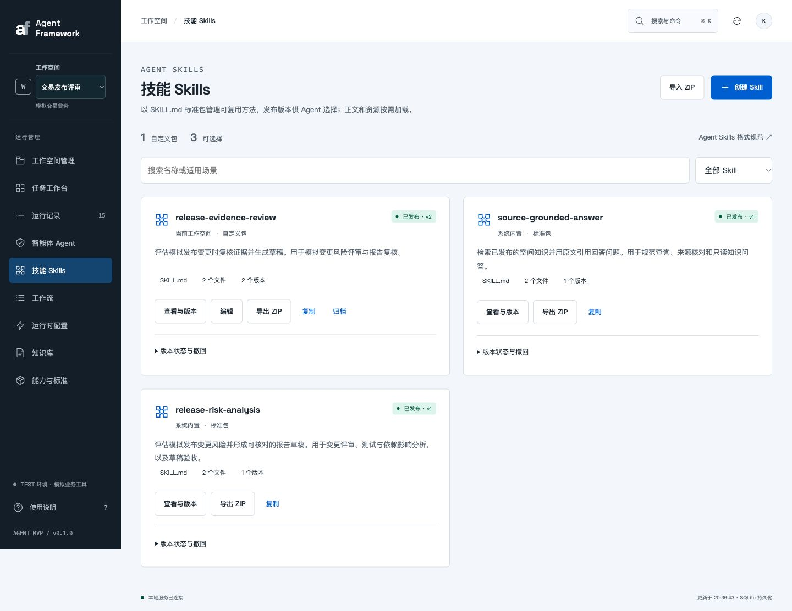
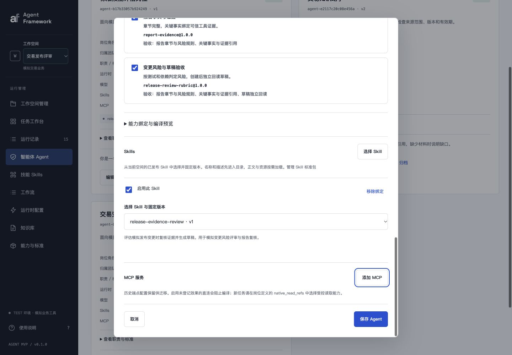

# 标准 Agent Skills 与独立管理模块

本次按 [Agent Skills 格式规范](https://agentskills.io/specification) 和 [客户端接入指南](https://agentskills.io/client-implementation/adding-skills-support) 实现标准包、目录发现、激活及资源按需加载。Skill 提供方法指导，能力注册、业务授权和独立验收继续由运行器执行。

## 启动与使用

```bash
cd /Users/kurt/Desktop/CodeSpace/AgentFramework
python3 -m venv .venv
source .venv/bin/activate
python3 -m pip install -e .
python3 -m agent_framework serve --port 8787
```

打开 <http://127.0.0.1:8787/#/skills>。当前服务已启动。新增导航“技能 Skills”与 Agent 配置分开管理。

1. 在当前工作空间创建 Skill：填写目录名、编辑 `SKILL.md`，按需添加 `references/`、`scripts/`、`assets/` 等资源；也可导入包含一个顶层 Skill 目录的 ZIP。
2. 校验后保存草稿，再明确发布版本。每次编辑创建新的内容版本；查看历史不会覆盖原版本。可复制、导出、撤回指定发布版本、归档及恢复使用。
3. 在“智能体 Agent → 编辑配置 → Skills → 选择 Skill”中选择已发布版本并保存。卡片显示包名与固定版本。Skill 有新版本后不会自动改绑，需明确选择升级。
4. 历史内联方法显示为“兼容内联方法”。点击“迁移为标准包”，完善并发布生成的草稿，再保存 Agent，才会用标准绑定替换原内联方法。历史任务不被改写。

内置 `release-risk-analysis`、`source-grounded-answer` 已提供标准 `SKILL.md` 与独立参考文件，支持查看、导出、复制；系统内置包只读。岗位领域的固定执行方法属于原有领域契约，继续保留以兼容历史任务。

## 格式与互操作

```text
release-evidence-review/
├── SKILL.md
└── references/
    └── report.md
```

```markdown
---
name: release-evidence-review
description: 评估模拟发布变更时复核证据。用于变更风险评审与报告复核。
metadata:
  author: "synthetic-demo"
  version: "1.0.0"
---

编写报告前读取 [报告约定](references/report.md)。
```

- 使用 PyYAML 安全解析完整 YAML，检查 `name`、`description` 及可选 `license`、`compatibility`、`metadata`、`allowed-tools` 的类型和限制；名称与目录一致，不允许连续或首尾连字符。
- 保留 UTF-8、二进制资源和其他包内文件。ZIP 导入导出保持文件内容与包摘要一致，资源不必在导入时全部进入模型上下文。
- 拒绝重复 YAML 字段、对象构造标签、YAML 别名、路径越界、符号链接、特殊文件、重复路径及超预算解压。实现预算为每包 64 个文件、单文件 96 KB、总内容 256 KB；Agent 最多绑定 8 个 Skill，冻结包总预算 512 KB，单任务已加载正文与文本资源预算 128 KB。
- `metadata.version` 是包自带的可选元数据；管理模块的 v1/v2 是不可变内容版本，二者分别保留。

实际从 Web UI 导出的 [release-evidence-review v2 ZIP](release-evidence-review-v2.zip) 已在另一个工作空间通过界面导入，并通过 `skill-creator/scripts/quick_validate.py` 检查。两个内置标准包也均通过该检查。

## 运行时的三层加载

1. **目录**：Agent 只向模型公开启用包的名称、描述和固定版本引用，不发送全部正文及资源。
2. **激活**：模型用结构化 `skill_activate` 选择相关包；任务显式包含 `$skill-name` 时，运行器保证激活已绑定的对应包。只加载选中包的元数据、Markdown 正文和资源目录。
3. **资源**：模型用结构化 `skill_resources` 选择包内具体文件；读取必须属于已激活包。随后规划、动作提案、报告生成只携带这些已加载内容。未选包的正文和未选资源不会进入推理上下文。

`skill.activated` 与 `skill.resources_loaded` 审计事件记录选择和摘要，选择状态持久化到任务。恢复时读取冻结版本，不重复模型选择。工作流执行节点复用同一运行器；工作流设计对话也通过相同的选择/资源加载协议获取 Skill 指导，仍只生成提案。

模拟运行时使用明确的关键词/显式名称匹配和相对链接读取来演示加载，**不声称能执行任意自然语言 Skill**。真实模型联调验证了资源中的指导确实影响报告输出。

`allowed-tools` 保存为元数据，不扩张已注册能力。包内脚本可以保存、查看和导出，导入或激活不会执行脚本；当前执行仍通过已注册的业务能力，未经登记的 Shell/工具不可调用。二进制资产保留在包内，模型获得资源描述，不将二进制内容作为文本指令注入。

## 版本与兼容性

包版本不可变；Agent 保存时由服务端解析已发布版本并冻结实际内容，客户端不能伪造 `skill_packages`。发布新版本不改写已保存 Agent、已启动工作流或任务。

撤回版本或归档包后，UI/API 不允许新任务继续启用该绑定。可在 Agent 中停用、移除或改绑。已经启动的任务继续使用快照中的指导；业务能力撤销、写入授权和知识来源有效性仍按原机制检查。

旧内联格式和旧规划器 v1–v4 保持恢复兼容；标准包逐级加载使用新版本描述符，新版本将动作 `expected_checks` 限定为登记的验收项枚举。过渡版本 v5 也保留可恢复解释。验证确认 28 个历史任务快照摘要均未改变，旧编译产物和模型描述符仍可解析。

## 主要接口

接口均使用原有本地访问、Origin/CSRF 和工作空间边界；变更请求需要当前修订号。

| 接口 | 用途 |
| --- | --- |
| `GET/POST /api/skills` | 元数据目录 / 创建草稿 |
| `GET/POST /api/skills/:id` | 读取指定版本 / 保存新版本 |
| `POST /api/skills/validate` | 校验标准包 |
| `POST /api/skills/import` | 导入标准 ZIP |
| `GET /api/skills/:id/export?version=1` | 导出指定版本 ZIP |
| `POST /api/skills/:id/publish`、`withdraw` | 发布 / 撤回内容版本 |
| `POST /api/skills/:id/archive`、`restore` | 归档 / 恢复包 |
| `GET /api/skills/:id/events` | 版本操作记录 |
| `POST /api/skills/migrate` | 将历史内联方法导入为标准草稿 |
| Agent 的 `skill_bindings` | `{skill_id, version, enabled}` 数组 |

配置按租户和工作空间隔离。同名包可在不同空间分别管理；未发布版本不能绑定。包内容冻结在已有 Agent 与任务中，撤回不会删除这些审计内容。

## 验证结果

```bash
source .venv/bin/activate
# 标准包、按需加载、版本、迁移、作用域与恢复：13 / 13
python3 -m unittest discover -s tests -p test_skill_packages.py -q
# 全量：184 / 184
python3 -m unittest discover -s tests -q
# 原 P0 场景：44 / 44
python3 -m agent_framework.p0_evaluate --output .agent-data/skills-p0
```

| 实测 | 证据 |
| --- | --- |
| Web UI 创建、添加资源、校验、发布、Agent 选择 | 交易发布评审空间的 `release-evidence-review`；Agent“标准技能评估岗位”绑定 v1 |
| 发布 v2 不改变已绑定 v1 | 管理模块显示 v2；Agent 和已有任务仍为 v1，包内容摘要保持一致 |
| 未授权与响应丢失 | `run-30043831139c43f4` 先停在具体提案，0 草稿；授权后 3/3 验收，创建 1 次、草稿 1 份 |
| 写后中断并实际重启服务 | `run-ed003d10ea8b4b94` 恢复成功；快照、编译摘要、已加载 Skill 状态均不变；激活和资源加载事件各 1 次，创建 1 次、草稿 1 份 |
| 标准包互操作 | Web UI 导出 v2 ZIP，再导入本地工作空间；包摘要一致，空间内 ID 独立 |
| 旧方法迁移 | “旧方法迁移演示岗位” v2 已清空内联方法，改为绑定发布的标准包 |
| 真实模型 | 本机 Codex CLI 登录态、`gpt-6.1-sol`，仅固定模拟上下文；9 次调用，190989 tokens，222.79 秒 |
| 真实按需读取 | 先 `skill_activate`，再 `skill_resources` 读取 `references/report.md`；报告标题为“【技能复核】支付服务增加超时重试模拟变更评估” |
| 真实权限与验收 | 授权前 `WAITING_AUTH`、0 草稿；授权后模拟响应丢失，最终 `SUCCEEDED`、3/3 验收、1 次创建、1 份草稿 |
| 非法验收项 | 真实负向用例的自然语言验收项被白名单拦截，业务调用 0 次；新标准包规划器使用闭合枚举 Schema |
| 布局与可达性 | 1440px 桌面、375px 手机及 896×414 横屏无页面溢出；文件控件和版本选择可通过键盘访问；验证后恢复默认视口 |

[完整验收记录](verification.json) · [真实模型结果](live-result.json) · [重启前记录](restart-before.json)




