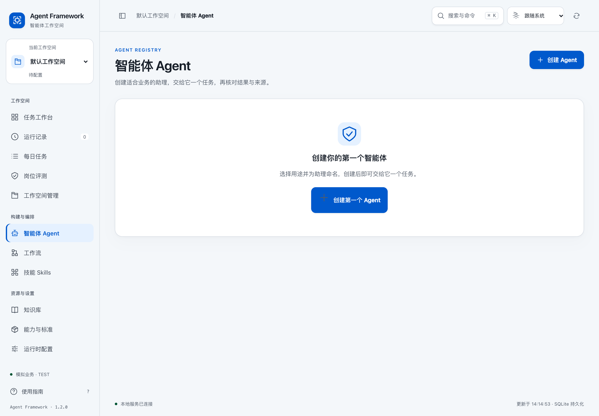
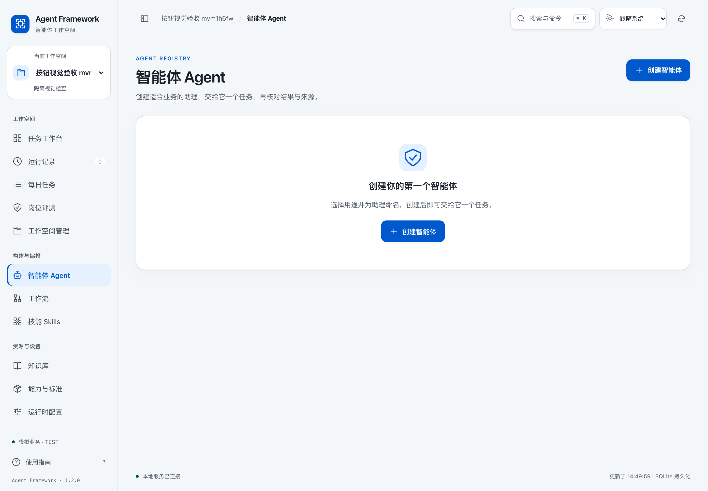

# 按钮与控件严格复查

2026-10-24。用户截图中的按钮异常已复现并修正。**此前的 96 分结论已撤回，不再用功能流程通过来推断整体视觉质量。** 本次只对下列实际检查覆盖的范围作结论，不另给一个缺少依据的综合高分。

## 截图问题与实测结果

根因是基础样式中的 `.empty svg`：它把空状态插画的大小、灰色和下边距，同时施加到了按钮内部的加号。将它限定为 `.empty > svg`，并明确按钮自身的图标尺寸、颜色和边距后，装饰图标与操作图标各自使用对应样式。

| 检查项 | 修正前 | 修正后 |
| --- | --- | --- |
| 空状态主按钮高度 | 62px | 44px，与页头按钮一致 |
| 加号尺寸 | 28 × 28px | 18 × 18px |
| 加号下边距 | 12px | 0 |
| 加号相对按钮中线 | 向上偏移 6px | 偏移 0px |
| 图标颜色 | 灰色，与白色文字不一致 | 跟随文字颜色，当前为白色 |
| 操作名称 | 页头、空状态使用不同称呼 | 统一为“创建智能体” |

单位均为 CSS 像素，截图按 2 倍像素密度保存。桌面按钮现为 130 × 44px；宽度缩短也包含文案变更的影响，不把它归因于图标修正。

[修正前测量](before-measurements.json) · [修正后完整测量](visual-results.json)

| 修正前 | 修正后 |
| --- | --- |
|  |  |

[空状态局部](screenshots/after-empty-panel.png) · [键盘焦点](screenshots/after-button-focus.png) · [深色手机页面](screenshots/after-empty-dark-mobile.png)

## 一并修正的问题

- 按下按钮时保持尺寸和位置稳定，用背景变化表示响应，避免缩放导致图标和文字看起来跳动。
- 实际保存前、保存中均为 112 × 44px；“保存中…”不会把相邻操作挤动。加号和播放图标不再作为通用加载图标旋转，刷新图标保留对应的加载反馈。
- 结果区的复制按钮由 30px 扩为 44 × 44px，内部图标为 18px。
- 手机端创建成功的浮动提示曾遮住结果区操作。创建成功现在由持久的“已就绪”入口、任务状态和状态播报表达；保留错误等必要提示。“开始使用”通过描述关联到已保存智能体的名称。
- 手机端保存结果中的主操作和“继续编辑”收拢为一行，关闭按钮放在右上角并为标题预留空间，点击区域仍为 44 × 44px。

[手机端保存结果对照：之前](screenshots/before-saved-mobile.png) · [之后](screenshots/after-saved-mobile.png) · [手机结果区](screenshots/after-result-mobile.png) · [深色结果区](screenshots/after-result-mobile-dark.png)

## 本次验收依据

专项检查采用明确的失败条件：尺寸、对齐、颜色、裁切、遮挡、焦点或对比度任一不符合约定，即判定失败；完整流程通过不能抵消这些失败。

| 范围 | 实际检查及结果 |
| --- | --- |
| 原问题的检出能力 | 在浏览器中临时恢复 28px 图标、12px 下边距和灰色，检查确实失败；删除临时规则后通过。该负例未修改产品文件。 |
| 空状态与页头 | 浅色/深色 × 320、375、414、768、1440 宽度及 812 × 375 横屏，共 12 组；每组同时检查两个按钮。 |
| 已有内容和使用流程 | 保存入口、智能体卡片、搜索空结果、任务提交、结果复制，共 5 个场景 × 4 种尺寸 × 2 种主题，40 组。 |
| 几何与文字 | 操作区域至少 44 × 44px；普通单行按钮高度不超过 46px；图标为 18px、边距为 0；图标相对按钮中线误差不超过 1px，与文字中线误差不超过 2px；文字和控件不越出边界。 |
| 可见与可操作 | 控件完整进入视口时，真实页面命中检查必须落在该控件内；创建回执立即检查，不等待浮动提示消失后才验收。图标按钮必须有可访问名称。 |
| 交互状态 | 普通、悬停、真实键盘焦点、按下、禁用、加载，以及真实保存请求期间的尺寸；禁用时不触发创建。键盘焦点具有 3px 可见轮廓。 |
| 主题与对比 | 已检查主按钮文字对比度最低约 6.36:1，超过本次 4.5:1 的门槛。启用和关闭减少动态效果分别检查对应状态。 |
| 手机保存结果 | 320/375 宽度下，浅深色共 4 组额外检查：两项操作同行、标题不被关闭按钮遮住、关闭按钮不缩小。 |
| 相邻页面盘点 | [九个初始页面的 44 个控件记录](control-inventory.json)用于排查同类继承。指标卡是上下分区结构，没有套用单行按钮的中线规则；该盘点不等于所有页面、所有状态均已验收。 |
| 行为回归 | [22 项完整浏览器流程](flow/browser-results.json)、[5 阶段全程键盘流程](flow/keyboard-results.json)、[112 项前端交互检查](ui-tests.log)通过。 |
| 当前运行的应用 | [8787 工作台只读复核](live-verification.json)：按钮 44px、图标 18px、白色、中线偏移 0；实际返回的 6 个界面文件与已验收源码一致。未产生写请求，未写入测试数据。 |

最终专项结果记录了浏览器版本、生成时间和受检文件 SHA256；同一轮检查前后源码必须一致。表单后续刷新可能替换旧 DOM，测试仅对已断开的元素重新定位，不放宽尺寸、对齐或遮挡条件。

浏览器依据为本机 Chrome/macOS，使用模拟业务执行和独立预览数据。尚未验证其他浏览器、真实触屏设备或屏幕阅读器语音输出；这些项目不计作通过，也不据此声称整站无缺陷或符合平台认证。

## 复现

使用独立数据目录启动预览，避免向日常工作台写入测试智能体与任务：

```sh
.venv/bin/python -m agent_framework --data-dir /tmp/agentframework-button-review --tenant button-review serve --host 127.0.0.1 --port 8799 --principal button-review
```

在可解析 Playwright 且已安装 Chrome 的环境中依次运行：

```sh
node tests/verify_button_visuals.cjs
AGENT_UX_OUTPUT=docs/ui-strict/flow node tests/verify_agent_ux_browser.cjs
AGENT_UX_OUTPUT=docs/ui-strict/flow node tests/verify_agent_ux_keyboard.cjs
```

专项脚本默认访问 8799；可用 `AGENT_UI_BASE_URL`、`AGENT_UI_OUTPUT`调整。完整流程脚本使用 `AGENT_UX_BASE_URL`、`AGENT_UX_OUTPUT`。需要时通过 `NODE_PATH`指定本机已安装的 Playwright 目录。
