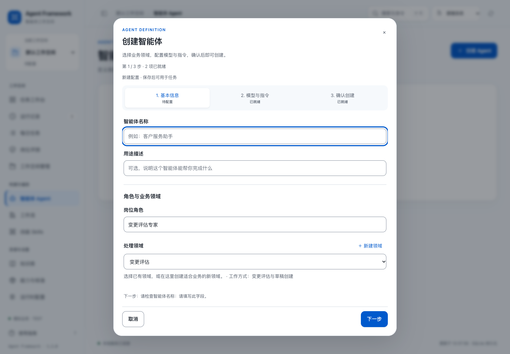
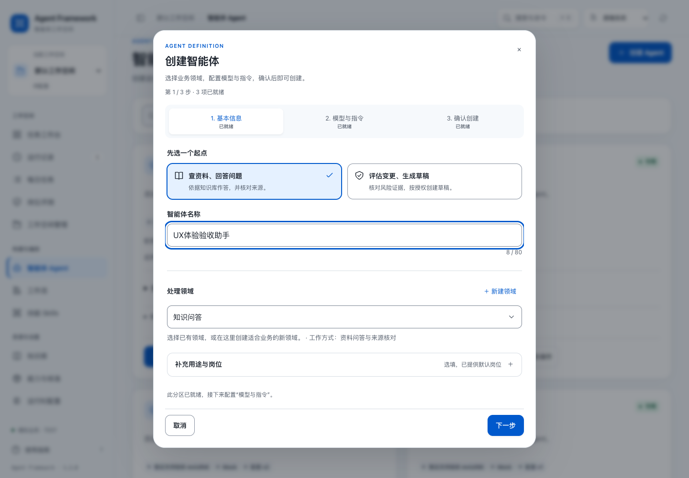

# 智能体创建与使用：交互验收

> **原96分结论已撤回（2026-10-24）**：该量表漏测空白页面的按钮图标继承，未发现按钮增高、图标颜色与中线异常。以下记录仅作历史过程留存，不应作为当前视觉质量证明。更严格的复查见 [按钮与控件复查](../ui-strict/README.md)。

本轮针对「创建智能体 → 发起任务 → 调整配置并返回 → 查看结果」的整体动线，以及其中的下拉选择和文本填写。沿用现有 System Blue 设计系统，没有更换产品路由或执行规则。

评分采用预先固定的 [25项量表](rubric.json)：每项通过4分、部分通过2分、未通过0分，总分100，目标90。它是实现质量审查及回归验收分数，不是独立用户研究、用户满意度或平台认证结论。

| 维度 | 基线 | 第一轮 | 当时评分（已撤回） |
| --- | ---: | ---: | ---: |
| 创建动线 | 10 | 20 | 20 |
| 使用动线 | 12 | 20 | 20 |
| 表单控件 | 6 | 14 | 20 |
| 反馈与状态保持 | 20 | 20 | 20 |
| 可访问性与布局 | 16 | 10 | 16 |
| **总分** | **64** | **84** | **~~96~~** |

第一轮发现主题切换期间的颜色过渡干扰边界对比测量，后续无足够证据完成触控和放大文字验收，因此这些检查不计完成分。第二轮加强控件边界、取消新选择器颜色跨主题渐变，并在稳定状态重新测量；未完成的键盘、智能体搜索与大字检查也已补齐。

## 主要变化

- 创建时先按用途选择起点，预填可修改名称、岗位与工作指令；可自建业务领域。可选用途、岗位和执行参数通过展开项补充。
- 保存成功后提供明确的「开始使用」。从任务调整配置会直接打开对应智能体；返回保留任务目标和预算，并重新审查许可。
- 领域、智能体、模型目录可搜索，支持方向键、Enter、Escape和Tab；空结果可清除搜索，领域可直接新建。底层原生字段继续负责实际表单值和约束。
- 文本自动增高并展示长度，错误与字段关联，填写正确或输入法完成后清除。搜索后取消不会误报未保存更改。
- 使用页突出所选智能体和任务目标，示例按领域生成，重复锁定字段隐藏。完成后优先显示结果与来源，用户手动切换视图不会被刷新覆盖。

## 实际验证

- 251项 Python 回归通过，见 [日志](python-tests.log)。全部既有前端交互回归通过，见 [日志](ui-tests.log)。本轮补充了任务错误清除与输入法回归。
- [浏览器记录](browser-results.json)覆盖新建领域、80项模型目录筛选、键盘选择、双击防重入、失败重试、配置往返、领域草稿保持、模拟任务成功执行、结果视图以及6种尺寸。
- [纯键盘记录](keyboard-results.json)覆盖完整的创建、使用、审查、提交及结果到达。
- 浅色/深色下稳定状态的控件边界对比分别约3.78:1和5.66:1；正文与提示对比均超过4.5:1。可见主要触控目标最低44px。
- 已检验320、375、414、768、1440宽度和812×375横屏；375宽度下将表单文字扩大到200%仍可到达字段及操作，固定头部偏密集，因此A4保留2分。未开展真实屏幕阅读器会话，A5保留2分。
- 所有业务执行均使用本地模拟模式。80项模型目录是隔离的浏览器测试数据，未冒充真实CLI目录，也未发起模型推理。

[逐项评分](final-score.json) · [基线观察](baseline-observations.json) · [第一轮发现](round-1-browser.json)

## 界面对照

| 创建前 | 创建后 |
| --- | --- |
|  |  |

[使用页](screenshots/after-use.png) · [保存后入口](screenshots/after-saved.png) · [回答与来源](screenshots/after-result.png) · [手机搜索](screenshots/after-picker-mobile.png) · [深色模式](screenshots/after-dark-mobile.png) · [200%文字](screenshots/after-large-text.png)

## 复现

使用独立数据目录启动本机预览，在可解析 Playwright 的环境中运行：

```sh
node tests/verify_agent_ux_browser.cjs
node tests/verify_agent_ux_keyboard.cjs
```

默认访问`http://127.0.0.1:8799`，可通过`AGENT_UX_BASE_URL`调整，产物默认保存到本目录，可通过`AGENT_UX_OUTPUT`调整。浏览器脚本会向预览写入测试智能体和模拟任务，请使用隔离数据目录。
