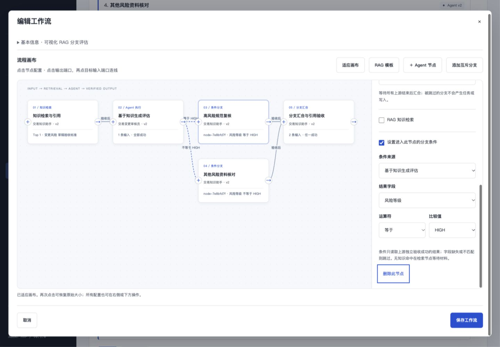

# 可视化工作流、条件分支与 RAG

## 使用

```bash
cd /Users/kurt/Desktop/CodeSpace/AgentFramework
python3 -m agent_framework serve --port 8787
```

打开 <http://127.0.0.1:8787/#/workflows>，切换到“交易发布评审”。本次保留了“可视化 RAG 分支评估”样例，点击“编辑节点”查看完整画布。

- “工作空间管理”使用文件夹图标，“任务工作台”使用四格工作台图标。
- 创建工作流进入可视化画布；选择节点，在配置面板修改 Agent、目标、上游、汇合方式、检索和分支条件。
- 点击上游右侧输出端口，再点击目标左侧输入端口连线；也可直接勾选目标节点的上游列表。循环依赖会被拒绝。删除节点会清理相应连线和条件引用。
- “RAG 模板”添加知识问答 Agent → 变更评估 Agent。首次空白草案的默认节点会被模板替换；已有工作内容会保留。
- “添加互斥分支”根据选中节点生成两个互补条件节点，再分别选择执行 Agent、修改目标。画布以虚线、条件文字和节点类型表示路由。
- “适应画布”切换全图与原始大小；手机上画布与配置面板上下排列，原始画布可在内部滚动。端口和配置控件都支持键盘操作。
- 对话生成的提案进入同一画布审查，保存、运行、写入授权仍是独立步骤。

## 实际执行规则

每个节点继续绑定已编译的 Agent 版本。新增配置是可选字段，旧节点的六字段格式仍可直接使用，不会重写旧定义或已运行快照。

```json
{
  "id": "review_high",
  "name": "高风险复核",
  "agent_id": "<当前空间 Agent ID>",
  "agent_revision": 1,
  "goal": "查询已发布规范，为高风险评估提供原文引用",
  "depends_on": ["assess"],
  "join": "all",
  "condition": {
    "source": "assess",
    "field": "risk_level",
    "operator": "eq",
    "value": "HIGH"
  },
  "retrieval": {"query": "变更风险 草稿验收", "top_k": 3}
}
```

条件只能读取直接上游**独立验收成功**的产物。字段为 `risk_level`、`citations_count`、`answer`，比较操作为类型匹配的 `eq/ne/gte/lte/contains`；风险等级只支持 `eq/ne`。不接受表达式或脚本，字段缺失也不会通过“不等于”条件。

条件不匹配记为 `SKIPPED`，保留条件、源产物摘要和审计事件，**不会提交 Agent 任务、授予权限或执行业务动作**。`all` 汇合要求所有上游成功；`any` 等待所有上游成功或跳过，并要求至少一条成功，只传递成功上游的冻结产物。节点独立验收失败时仍然停止工作流，不会被 `any` 掩盖。

恢复时仍使用 `flowrun + node ID` 导出的确定性子任务 ID，重新核对 Agent 编译摘要、任务范围、目标、上游输入摘要和检索配置。已发生但响应不明的写入先核对原幂等键。

## RAG 的实现范围

检索复用现有本地知识库的关键词 / FTS5 检索和中文分词；本次没有新增向量服务、Embedding 或重排服务。

- `retrieval.query` 与 `top_k`（1–8）冻结到节点任务。
- 知识 Agent 的网关将搜索动作规范到配置查询，审计同时保留模型原始提案和实际参数；按 Top K 返回已发布知识，之后通过受控 `knowledge.read` 回读，独立验证引文、范围、当前有效性。
- 检索保留原有租户、工作空间/项目、用户、可见性、知识空间、发布与有效期约束。偏好和经验不占知识命中的 Top K 名额。
- 引用版本、摘要和已验收产物经 `workflow_inputs` 传入后续 Agent。真实模型可在任务上下文中使用这些内容；模拟业务工具继续按可信变更数据执行。
- 其他领域 Agent 的检索配置作用于其模型参考上下文；必选岗位标准始终保留。只有知识问答节点在无可引用命中时等待材料；这不会被当成可验收成功的空回答。
- 知识撤回、过期或失去访问权后，仍阻止旧引用继续流入下游。检索和路由配置不产生业务写权限。

## 验证

```bash
# 新增 8 个 RAG / 分支用例
python3 -m unittest tests.test_workflow_routing -q

# 全量测试：171 / 171
python3 -m unittest discover -s tests -q

# 原 P0 故障矩阵：44 / 44
python3 -m agent_framework.p0_evaluate --output .agent-data/workflow-visual-p0
```

新增用例包括互斥路由、未选分支零任务/零写入、any/all 汇合、乱序 DAG、具体写入授权、丢失响应唯一草稿、重新创建 Application 后恢复同一子任务、RAG 查询和 Top K 实际生效、无资料补充后恢复、引用撤回、非法配置拒绝、旧格式兼容和模型 Schema。

本次 Web UI 实测使用五节点流程：检索 → 评估 → HIGH / 非 HIGH 两条分支 → 汇合。

| 验证 | 结果 |
| --- | --- |
| 不授予写权限启动 | 检索通过，评估停在具体写入提案，草稿 0 份，下游未执行 |
| 授权后模拟写入响应丢失 | `flowrun-8c69780d2e602a9b52998f47` 成功，写节点创建调用 1 次、草稿 1 份 |
| 写后中断并实际重启 Web 服务 | `flowrun-e2acba10c6d184a4fe3f1b2c` 恢复成功，子任务 `run-c3f9f6b07ff7ed66`、流程和任务快照摘要均不变，仍为 1 次创建、1 份草稿 |
| 分支和汇合 | HIGH 分支执行；非 HIGH 节点 `SKIPPED` 且无子任务；汇合只收到成功分支的输入 |
| 历史兼容 | 28 个旧任务快照摘要不变，旧编译产物与领域仍可解析 |
| 真实模型提案 | 本机 Codex CLI 登录态，`gpt-6.1-sol`，仅固定模拟需求、岗位摘要与 Schema；一次生成 5 节点 RAG、分支、汇合提案，原生 MCP 调用 0 次 |
| 真实提案执行 | 执行节点使用模拟 Agent 和模拟业务工具；授权、引用验收和响应丢失核对成功，草稿 1 份，未选分支无任务 |
| 响应式和图标 | 1440px 双栏、375px 上下布局无页面横向溢出；两个导航 SVG 路径不同；验证后恢复原视口 |

真实模型调用耗时 31.03 秒，输入 18070 tokens、输出 780 tokens。真实提案和执行保留在 8789 模拟预览空间，名称“RAG 风险分支复核”。

[验收明细](verification.json)、[真实模型提案](live-proposal.json)、[真实提案执行](live-execution.json)、[重启前记录](restart-before.json)。


