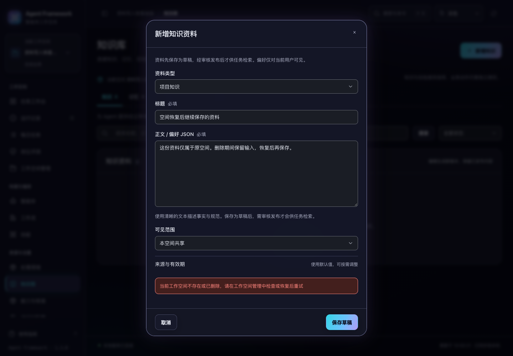

# 空间删除后的资料写入保护

2026-10-31，当前源码。旧页面或持有旧服务对象的进程，在空间删除后不能继续保存资料、修改发布状态或推进本体审阅。恢复原空间后，仍可沿用原输入和版本继续操作。

## 使用体验

另一页面删除当前空间后，资料编辑框保存失败会显示“当前工作空间不存在或已删除，请在工作空间管理中检查或恢复后重试”。标题、正文、编辑框和原提交范围保持不变。重新加载空间目录不会自动把这份输入提交到其他空间。

在空间管理中明确恢复原空间后，可以继续保存原输入。保存结果为原空间的草稿，仍需正常提交审核和发布；其他空间不能读取该资料。



## 提交保护

保护按租户和项目查找已登记的工作空间，在实际写入事务内检查删除状态。检查与版本、索引、审计或生效指针的修改共用同一个写事务；即使删除发生在请求初次校验之后，也不会留下部分资料或审计记录。

| 操作 | 提交时的检查 |
|---|---|
| 知识、偏好、记忆、能力方法创建与追加版本 | 空间可用后才保存版本、全文索引和创建记录 |
| 审核、发布与撤回 | 空间可用后才推进状态和相关审计 |
| 本体修订 | 空间可用，最新版本和冻结来源仍符合原有条件 |
| 本体启用 | 空间可用，预期生效版本和来源仍符合原有条件 |
| 本体证据保存与审阅 | 空间可用，冻结来源、逐字证据和编辑版本仍符合原有条件 |
| 经验离线评测 | 启动前和最终保存时分别检查；期间删除会拒绝结果落盘 |
| 首次初始化内置模拟知识 | 创建前检查，已存在的历史资料可继续读取 |

独立资料库、尚未登记工作空间的 CLI 项目继续可用；同名项目在其他租户中独立判断。已经受理的执行在终态检查点内归档历史记忆的通道沿用原有规则。HTTP 接口仍先检查所选空间和权限，不会因为 CLI 兼容规则开放其他空间。

## 准确的提交回复

创建、状态变更、本体修订与启用，在写事务内生成本次回复。本体来源检查和生效指针读取也复用该事务。

例如，本次创建接受的是 `DRAFT`，另一进程紧接着审核并发布，创建回复仍是 `DRAFT`；后续查询可以看到 `PUBLISHED`。启用本体的回复也描述本次接受的生效版本，不会混入另一进程随后切回的版本。

路径、状态码和资料字段保持兼容，空间不可用返回 404 并明确提示空间问题。当前修改未给资料保存新增请求去重编号；网络结果未知时，仍需核对已有版本，不能据此认定任意重复提交只会创建一次。

历史版本和 JSON-LD 内容继续保留，服务层读取遵守原授权。HTTP 中已删除的所选空间仍不可访问，恢复后沿用原项目、历史与资料标识。

## 验证

新增 22 项后端回归，覆盖删除发生在初次校验后、离线评测中，以及另一写入者在提交后立刻发布或切换本体等交错场景。拒绝写入时逐项比较版本、全文索引、审计、证据、评测和生效指针，确认没有变化。真实 HTTP 回归同时验证空间错误提示和原运行不存在提示。

```sh
.venv/bin/python -m unittest discover -s tests -p 'test_asset_write_safety.py' -q
.venv/bin/python -m unittest discover -s tests -q
npm test
.venv/bin/python scripts/run_browser_tests.py --suite asset-writes --suite ontology --suite audit-fixes --suite legacy-modules
```

完整后端 719 项、界面交互 197 项和上述四套浏览器验收通过。新增浏览器验收使用两个真实页面，验证删除后输入保留、明确恢复后保存、正常审核发布和空间隔离。本体回归继续覆盖 1024/1440 宽度、深浅色及 200% 文字的 8 组键盘焦点检查。

详见 [机器可读验证记录](asset-write-verification-20261031.json)。全部验证使用临时服务、合成资料和离线模拟，未调用真实模型、修改现有业务数据、重新构建安装包或发布。
