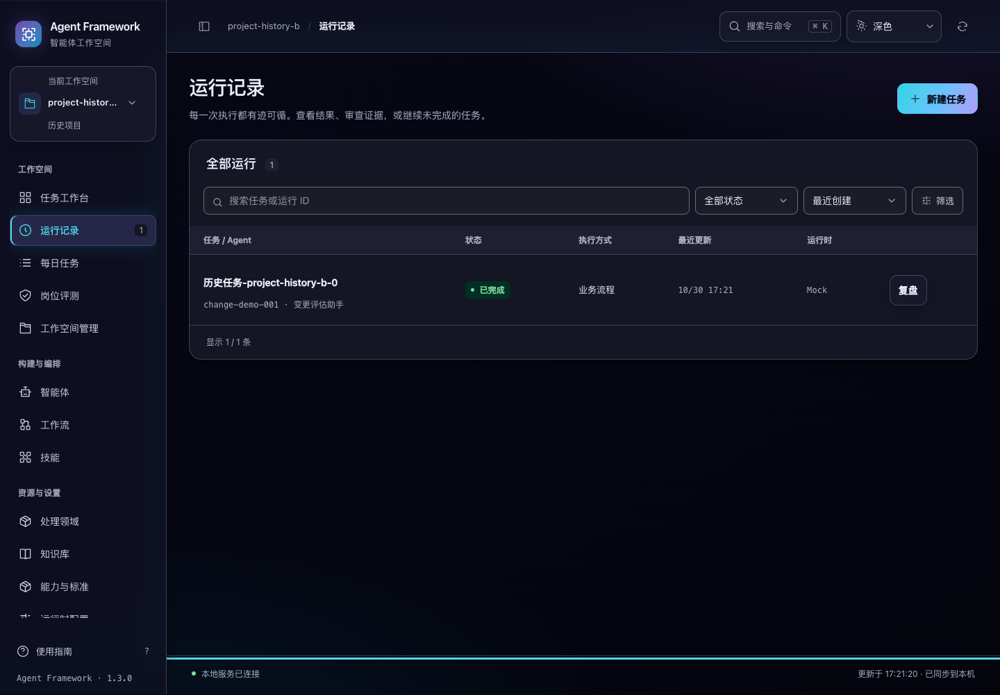

# 历史项目登记的启动开销

2026-10-30。当前源码改进，尚未重新构建或发布发行包。

工作台启动时会把历史 CLI 任务所属的项目登记为工作空间。此前实现先将本租户每条任务的完整 JSON 读入 Python，再逐条尝试插入空间。报告正文或冻结资源较大时，初始化开销随全部任务内容增长；同一项目有很多条任务、空间已经存在时，也仍然重复解析和尝试插入。

现在由数据库提取并去重项目标识，排除已经登记的项目，Python 只处理尚未登记的标识。每个新项目最多尝试插入一次，不再把完整任务正文载入 Python。默认空间的固定初始化仍保留一次插入尝试。

## 兼容与数据边界

- 历史项目继续使用原有稳定空间标识 `workspace-legacy-<项目摘要前 16 位>`，名称和项目归属不变。
- 已有空间按租户与项目匹配，包括用户自行创建并关联的空间。已修改的名称、用途、说明、修订号和时间保持原样。
- 已删除空间也算已经登记，不会因历史任务再次出现而复活；已删除的默认空间同样保持删除状态。
- 后续通过 CLI 新增项目时，下次启动仍能发现，不使用只运行一次的迁移标记。
- 只查询当前租户。另一个租户的历史记录不会进入本租户的登记与解析。
- 不修改任务、冻结快照、报告、审计或执行状态；两个初始化连接并发时，仍由现有唯一约束与事务保证每个项目一个空间。
- 尚未登记的项目标识缺失或无效时，明确拒绝登记并回滚此次插入，错误不包含完整任务内容。损坏的本租户 JSON 也不会被静默忽略。本步骤不替代完整历史数据校验。

数据库仍需扫描本租户历史 JSON 以提取项目标识。本轮没有新增索引、投影缓存表、任务写入钩子或数据库迁移，也没有将完整启动开销变成与历史大小无关的常数。

## 测量

同一台机器、同一份临时合成数据：240 条历史记录、12 个待登记项目，另含默认项目与一个已配置空间的项目。每条记录含 128 KiB 合成报告正文。比较脚本保留上一实现，只作用于脚本自身创建的临时数据库；每种情况测量三次，表中为中位数。

| 指标 | 以前 | 现在 |
| --- | ---: | ---: |
| 首次登记耗时 | 71.3 ms | 13.3 ms |
| 项目均已登记后的初始化耗时 | 69.9 ms | 15.3 ms |
| 首次登记的 Python 分配峰值 | 约 61 MiB | 约 16 KiB |
| 项目已登记时的 Python 分配峰值 | 约 61 MiB | 约 6 KiB |
| 每次在 Python 中解码完整任务的次数 | 240 | 0 |
| 首次登记的 INSERT 尝试次数 | 224 | 13 |
| 项目已登记时的 INSERT 尝试次数 | 224 | 1 |

所有测量的空间身份和元数据一致，用户配置与已删除的默认空间保持原样，任务原始 JSON 的整体 SHA256 在测量前后相同。INSERT 次数表示尝试执行的语句数，不表示实际新增了这么多行。

这些数字只覆盖空间注册表初始化，包含查询追踪与 Python 分配追踪。内存数字是 `tracemalloc` 记录的 Python 分配峰值，不包含 SQLite 等原生内存，也不是进程总内存。测量不覆盖整个工作台启动、冷磁盘读取、模型发现、网络或浏览器绘制，不能作为其他机器上的固定性能承诺。原始数据见 [性能记录](registration-benchmark-20261030.json)。

复测会自动创建并清理临时数据：

```bash
.venv/bin/python scripts/benchmark_workspace_registration.py --compare
.venv/bin/python scripts/benchmark_workspace_registration.py --runs 500 --projects 30 --body-bytes 131072 --repeats 3 --compare
```

省略 `--compare` 时只测当前实现。参数限制合成正文总量不超过 128 MiB；脚本不接受已有业务数据目录。

## 验收

```bash
.venv/bin/python -m unittest tests.test_workspace_registration -q
.venv/bin/python -m unittest discover -s tests -p 'test_workspace*.py' -q
.venv/bin/python -m unittest discover -s tests -q
npm test
.venv/bin/python scripts/run_browser_tests.py --suite workspace-history --suite workspace-sync --suite workspace-safety
```

新增 **10 项后端专项**通过，空间相关 **54 项**通过；完整后端 **675 项**、完整界面 **193 项**全部通过。专项覆盖不读取完整任务 JSON、已登记项目不逐条尝试插入、去重、已有名称和删除状态、新项目再次发现、原始任务和审计不变、租户隔离、并发初始化、无效标识及损坏 JSON。另从实际 CLI 提交路径创建任务，重启工作台后核对项目归属、原任务与冻结快照可读。

三套浏览器验收通过。新增 `workspace-history` 先实际执行四条模拟 CLI 任务，首次启动登记两个历史项目，再修改空间名称、删除默认空间和另一历史空间，关闭后重新启动。实际页面确认用户名称与删除状态保留，列表只显示当前项目任务，原结果和快照可读；明确恢复另一个历史空间后，其任务仍按原项目隔离。浏览器没有未处理脚本错误。`workspace-sync` 与 `workspace-safety` 继续验证跨页面状态同步、编辑保留及删除保护。

性能负载与浏览器验收均使用隔离临时数据，没有调用真实模型或改写已有业务数据。性能负载只用于测量项目登记；浏览器验收独立使用真实模拟执行产生的完整任务记录。结果与源码摘要见 [验收记录](registration-verification-20261030.json)。


