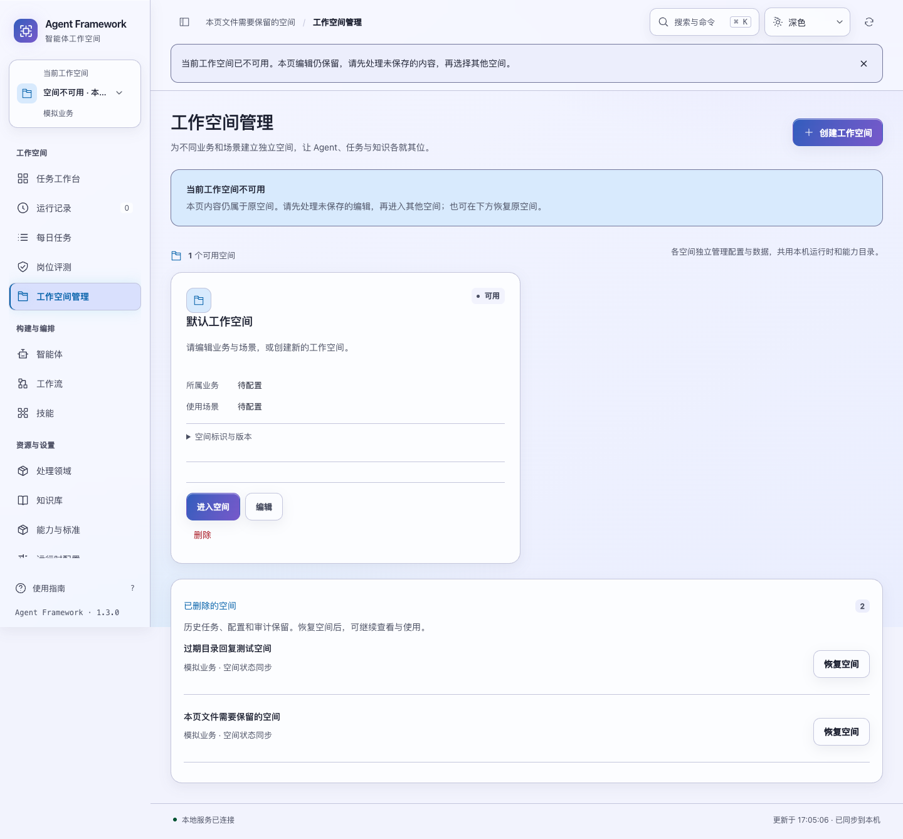
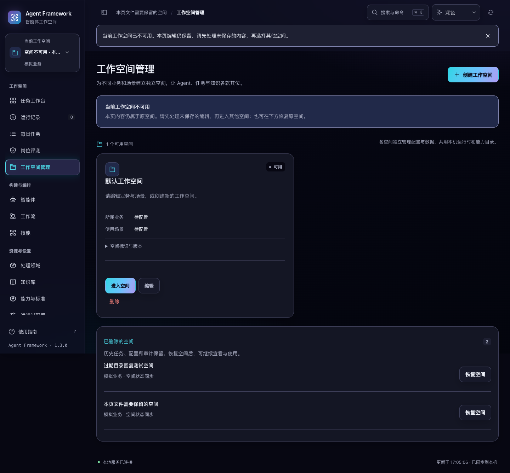

# 工作空间状态同步与编辑保留

2026-10-30，当前源码改进，尚未重新构建或发布发行包。

此前目录读取没有请求顺序保护，较早生成的空间列表可以在删除或恢复成功后返回，把页面退回旧状态。当前空间在另一页面被删除时，列表刷新还会直接把页面内的空间编号改成另一个可用空间，而已加载的内容和编辑器仍属于原空间，后续提交存在范围混淆。此外，空间管理页面先读取当前空间的任务，当前空间失效后连全局空间目录也无法正常打开。

本轮首批 15 项界面回归在修改前有 14 项失败；原有启动时选择可用空间的兼容行为仍通过。新增 3 项后端回归也复现了保存后重新读取导致的结果漂移：另一进程紧接着编辑会让回复包含别人的修改；紧接着删除则会让已提交的保存返回失败。

## 使用中的变化

- 已打开页面的当前空间失效后，保留原地址、空间编号、会话范围与编辑内容。选择器优先显示“空间不可用”，不会静默把后续提交转到其他空间。
- 全局空间管理可以继续打开，不依赖失效空间的任务、待办或评测接口。页面明确说明当前内容仍属于原空间，可展开“已删除的空间”恢复原空间，或处理当前编辑后进入其他空间。
- 原空间恢复后，当前页可继续使用原文件和资源保存。未保存内容仍只保留在当前打开的编辑窗口中，没有新增跨刷新本地草稿机制。
- 初次打开页面、尚未加载编辑内容时，原链接或上次选择不可用，仍可选择可用的初始空间。用户主动删除当前空间且没有待处理编辑时，仍按原有流程打开其他可用空间。
- 切换空间在目标会话和任务预检完成后，再次核对当前身份和待处理编辑。等待预检期间新打开的编辑窗口也会阻止跳转。
- 等待本页删除回执期间新输入的空间信息或 Skill 文件，同样阻止自动离开。删除已经生效会明确提示，本页文件继续保留，可在原空间恢复后保存。
- 空间信息正在保存时不能重新打开另一个空间编辑器，避免重置等待回执的表单。

空间恢复、切换和文件保存仍为不同操作。恢复不会自动保存未提交内容，切换不会把原空间文件迁移到新空间，已有任务与资源保持原归属。

## 一致性与接口

空间目录每次读取记录请求序号及租户、操作人、当前页面空间。较新读取或成功写入会使更早的读取失效；过期读取的成功和失败均不更新页面。空间保存、删除、恢复的迟到回复也核对原范围，不改变另一份身份或空间下的目录、编辑窗口及操作提示。

写回复按空间修订号合并。页面已经知道较新修订时，较旧的保存、删除或恢复回执不会把它改回旧名称、旧状态或旧修订号，而是说明操作完成后空间又发生变化。此规则保护已观察到的较新状态，其他页面后续变更仍由正常刷新读取。

创建和编辑空间的返回值直接来自接受写入的事务，包含此次保存的名称、项目标识、修订号与时间。提交之后另一进程修改或删除空间，不会再改变此次保存回复，或把成功保存变成后续读取失败。删除与恢复继续使用原有事务内回执、版本检查及未完成工作保护。

接口字段、路径与现有数据库结构保持兼容。本轮没有为创建或编辑空间新增持久提交编号；如果创建回复丢失，应先核对目录，不能将本轮保证理解为任意保存重试都会返回同一次持久回执。详情、任务和资源的范围权限仍由服务端校验。

## 验收

```bash
.venv/bin/python -m unittest tests.test_workspace_receipts -q
.venv/bin/python -m unittest discover -s tests -p 'test_workspace*.py' -q
.venv/bin/python -m unittest discover -s tests -q
npm test
.venv/bin/python scripts/run_browser_tests.py --suite workspace-sync --suite workspace-safety --suite skill-saves --suite multica
```

完整后端 **665 项通过**，其中空间相关 **44 项通过**。新增 3 项后端回归覆盖不依赖后续读取的创建回复，以及真实事务提交后另一连接立即编辑、删除时，原回复仍准确描述本次保存。

完整界面 **193 项通过**。新增 24 项界面回归覆盖读取顺序、旧读取失败、保存后目录刷新、旧删除和恢复回执、租户/操作人/空间变化、目录元数据同步、空间失效保留文件、首次启动回退、预检身份、新编辑保护，以及空间失效时实际全局目录刷新不调用范围内接口。

四套浏览器验收通过。`workspace-sync` 使用真实服务和两个页面，控制已生成回复的返回顺序，覆盖 5 组场景：旧目录晚于删除、旧恢复回复晚于新删除、当前空间失效期间的原范围保存与恢复、失效空间的全局目录和明确切换，以及本页删除等待期间新编辑的保留。文本和 `00 FF 80` 二进制资源均完整保留，页面没有未处理脚本错误。

另检查 1024/1440px、浅色/深色、正常/200% 文字的 8 组桌面布局，无页面横向溢出。`workspace-safety`、`skill-saves`、`multica` 继续覆盖原有删除保护、保存恢复和主要配置动线。所有验收使用隔离临时服务与合成数据，没有调用真实模型或修改已有业务数据。汇总见 [验收记录](state-consistency-verification-20261030.json)。




